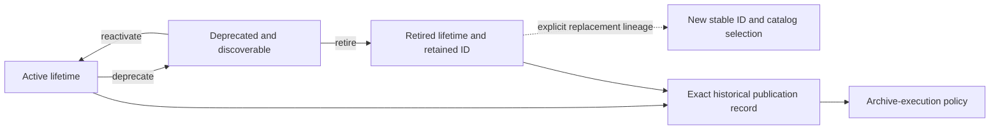

# RT-05 — Deprecation, retirement and exact operation calls

## Question and model

What does a caller retain when a catalog alias, selected operation revision, or operation lifetime changes? The [identity lifecycle experiment](RT-05-IDENTITY-LIFECYCLE-EXPERIMENT.md) distinguishes occurrence continuity from immutable value equality and tests declared split and merge. This fixture tests deprecation, reactivation and terminal retirement before explicit replacement. [PLAN §1.2](../../../PLAN.md#12-semantic-identity-hashes-and-canonical-encoding) · [#289](https://github.com/aivibeflow/LLMLang/issues/289) · [LL-002 / #345](https://github.com/aivibeflow/LLMLang/issues/345)

There are three separate facts in the fixture. A stable ID follows one managed lifetime. An immutable operation address identifies an exact semantic value. A catalog alias has a current owner. The alias here is a discovery name and has no role in the hashed operation payload. A previously published exact pin is a pair of stable ID and exact operation address, witnessed by the append-only publication record.

The model lets a deprecated operation remain discoverable and return to active status. Retirement removes it from current catalog selection and permanently reserves its stable ID. An explicit replacement gets a new stable ID and can claim a now-available alias even if its operation bytes equal those of the predecessor. The replacement edge records lineage. The separate archive-execution policy either permits an old exact pin after retirement or refuses it. Both policies keep archived bytes readable.



## Experiment

Sixteen histories cross alias retention or rename, unchanged or revised operation, same-value or changed-value replacement, and both archive-execution policies. Each includes deprecation and reactivation, later retirement, and a replacement at the original alias. The 112 checkpoint queries resolve the initial pin by exact publication, latest stable ID, latest original alias or an active selection with equal operation bytes. Expected results follow the original publication pair and explicit archive policy. A successful resolution in this model is an admission, without a native operation invocation.

| Resolution policy | Wrong exact target | Unexpected denial | Unexpected admission |
| --- | ---: | ---: | ---: |
| Exact published pair | 0 | 0 | 0 |
| Latest operation selected by stable ID | 8 | 16 | 0 |
| Current owner of original alias | 12 | 40 | 8 |
| Current selection with equal operation bytes | 4 | 20 | 4 |

The exact policy matches all 112 checkpoint expectations. Revisions change the latest selection under the same stable ID, so substituting it can redirect an old pin during the lifetime. In the replacement step the original alias resolves to the new ID. Reusing it can redirect a supported old pin or bypass the retirement policy where archived execution is disabled. Selection by equal bytes still confuses the two lifetimes in the same-value replacement cases.

The fixture rejects all 48 attempted reactivations, revisions or republications of the retired ID and retains all original operation values for exact retrieval. Reactivating after deprecation preserves the original lifetime. A fresh replacement can reference the retired lifetime and share immutable bytes while keeping its own publication identity. The fixture also rejects a pin pairing the replacement ID with an address that was published or resolvable only elsewhere.

## Reproduce and limits

The baseline was `fc81316c5e45c13d3450db13131082c5e3b7db2c` on `research/all`. The experiment ran on Debian 13 x86-64 Linux 6.18.57 with CPython 3.12.14. From the repository root:

```sh
fixture=research/semantic-representation/RT-05/OPERATION-LIFETIME-01
out=$(mktemp)
python3 -B "$fixture/run.py" > "$out" &&
  cmp "$fixture/evidence.json" "$out" &&
  python3 -B "$fixture/chart.py" &&
  (cd research/PROTOTYPES/DEPENDENCY-GRAPH-01 &&
    python3 -B -m unittest -q tests.test_identity_lifecycle tests.test_semantic_graph)
```

The [ledger](OPERATION-LIFETIME-01/evidence.json) records each checkpoint, exact publication pair and source digest. The [table generator](OPERATION-LIFETIME-01/chart.py) reproduces the comparison. The 19 existing prototype tests passed in the same checkout. This is evidence for the explicit lifecycle and archive policies. Allocation authority, alias reservations across distributed catalogs, authenticated historical admission, garbage collection and production publication semantics remain open. [Runner](OPERATION-LIFETIME-01/run.py)
