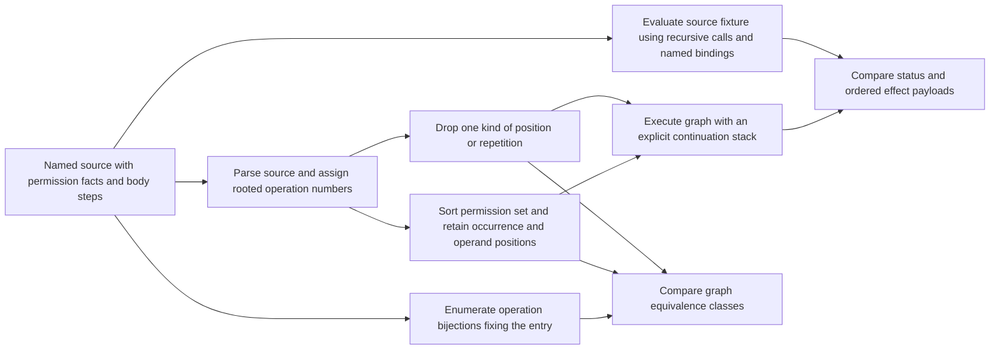

# RT-05 — Ordered occurrences in a recursive SPG fragment

A single occurrence sequence preserved the identity and execution traces of a closed recursive fragment. Separating calls and effects into independently ordered lists changed traces. Removing repeated steps also changed traces, and sorting call operands could change a successful execution to fuel exhaustion.

## Method

The fixture language has local operation declarations, finite sets of required permissions, two positional integer parameters, effect emission, ordinary calls, and a call taken only when the caller's first parameter is positive. One entry operation calls two others. One callee can return to the entry with its first argument set to zero, so the corpus contains a recursive call graph and executions with repeated visits. The fixture deducts one unit of fuel from the remaining depth at each nested call. A failed call stops the continuation and retains effects already emitted. Permission requirements are set membership checks performed on entry.

The corpus permutes the entry's occurrences, includes or omits a second identical call, and uses both orders of that call's operands. For each program the runner serializes the source, parses it, and lowers it as a rooted graph. Canonical numbering follows the first encounter along ordered call occurrences starting at the entry, and the representation sorts the permission set. Twelve surface variants cover the six declaration orders and both written permission orders under a local renaming. An exhaustive reference encodes both vertex assignments that fix the entry. Its induced equivalence classes are used to check graph identity. A separate source evaluator makes recursive calls on the fixture's named declarations. The graph evaluator consumes the lowered operation numbers using a continuation stack.



The comparison keeps the same source behaviors and execution settings across candidate encodings. The controls group the calls before the effects while preserving order within each role, keep only the first occurrence of each identical step, or sort operands in call instructions. All controls preserve the declared permission sets. The cross-product of two integer pairs, three permission sets and six fuel depths yields 36 observations per source program. An observation is the final status and the ordered list of emitted labels and scalar payloads.

## Results

| Encoding | Distinct keys | Collapsed groups | Observation differences | Status differences |
| --- | ---: | ---: | ---: | ---: |
| exact | 168 | 0 | 0 | 0 |
| role-local-order | 20 | 20 | 1,448 | 0 |
| unique-steps | 48 | 48 | 480 | 0 |
| unordered-arguments | 84 | 84 | 876 | 336 |

Each row has 6,048 source-to-graph observations. Status differences are a subset of observation differences. A collapsed group is one key associated with multiple exhaustive graph classes. The exact encoding agrees on equivalence classes with exhaustive numbering and preserves the key across all 2,016 renamed and reordered source renderings. The largest groups in the three controls combine ten, five and two exact classes respectively.

At least one collapsed group in every control contains source programs with observably different executions under identical settings. The ledger supplies both source texts, their shared projected key, the inputs and the differing outcomes. It also records one direct source-to-graph mismatch per control. For example, moving calls ahead of emissions loses a callee's already emitted payload when its next recursive call exhausts fuel. Sorting the recursive call's operands can put the former second parameter into the guard position and keep recursion active after the source would have stopped.

## Implementation boundary

Represent executable body occurrences with a shared ordinal across instruction roles, preserve repeated occurrences, and give each positional operand its own position. Canonicalizing unordered permission facts still yielded stable keys across source variations. The distinction lets a single SPG carry both executable order and order-independent facts without making declaration order or local names part of identity.

The results apply to one scalar fixture and one guarded back-edge. The source evaluator uses the generated fixture declarations and the graph evaluator uses their parsed rendering. This checks the fixture path from rendering through parsing and lowering. It leaves a general frontend, language-level source correspondence, concurrency, production canonical bytes and recursion policies open.

## Reproduce

From the repository root with CPython 3.12.14:

```sh
fixture=research/semantic-representation/RT-05/ORDERED-OCCURRENCES-01
output=$(mktemp)
python3 "$fixture/run.py" --output "$output"
cmp "$fixture/evidence.json" "$output"
python3 "$fixture/chart.py"
```

[Runner](ORDERED-OCCURRENCES-01/run.py) · [Evidence ledger](ORDERED-OCCURRENCES-01/evidence.json) · [Directed recursive roles](RT-05-DIRECTED-RECURSIVE-ROLES-2026-11-24.md) · [Ordered SCC traversal](RT-05-ORDERED-SCC-CANONICAL-TRAVERSAL-2026-11-24.md)
