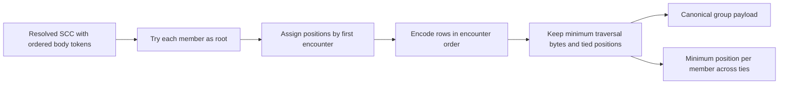

# RT-05 — Canonical traversal for recursive groups with ordered references

- **Evidence** — Executable comparison, explicit graph argument and bounded corpus.
- **Baseline** — `254352ee8cc635014a139811fd1f68ef2ce09777`.
- **Plan** — [§1.1](../../../PLAN.md#11-semantic-program-graph-and-program-representation) · [§1.2](../../../PLAN.md#12-semantic-identity-hashes-and-canonical-encoding) · [LL-005](../../../TODO.md#ll-005--define-hash-relevant-dependency-edges-and-cycles).

## Question and admitted graph

Can a structural address for mutually recursive definitions avoid trying every permutation while preserving exact ordered calls and making symmetric members share one value address? The existing prototype canonicalizes a strongly connected component (SCC) by taking the smallest JSON encoding across all permutations and rejects components larger than six members. Compare it with traversal from each possible root and with the existing scheme using explicit member keys. Feed all three already-resolved, typed body tokens. [Recursive identity experiment](RT-05-RECURSIVE-IDENTITY-EXPERIMENT.md) · [Typed SPG](RT-05-TYPED-SEMANTIC-PROGRAM-GRAPH.md#recursive-structures)

An SCC is a set of vertices that can all reach one another via directed edges. Here each local call edge has a position in its ordered body. Typed literals and pinned external values also occupy exact positions. Display names and explicit members' keys are outside the structural payload. The study operates on one already-separated SCC with any external target resolved to an exact value. The full component finder, typed importer and external dependency checks belong to the existing graph prototype.



The algorithm begins with position zero at the root. It visits waiting members in first-encounter order and scans each ordered body from left to right. A first reference to an unseen local member assigns its next position. Every root reaches the whole group. Keep the least byte encoding across complete root traversals, and for each original member keep its minimum position across all traversals that produced those bytes. Malformed calls and graphs that fail full reachability from any root are rejected.

## Why the comparison is valid

A bijection of members preserving ordered bodies, token types and external values preserves the sequence of first encounters for corresponding roots. A rooted encoding can also be decoded to exactly the numbered graph, so equal complete encodings give an isomorphism. Taking the minimum across roots therefore gives the same group value exactly for isomorphic graphs in this profile. This argument depends on unique positions for edges in each body. An unordered collection of graph edges provides no such traversal order.

When two root traversals achieve the same minimum, composing their numberings produces an automorphism, which is an isomorphism from the group to itself. Conversely, each automorphism produces corresponding root traversals with the same bytes. Thus each member's attainable minimum-encoding positions form a class under symmetry. Two members get the same minimum position exactly when some automorphism carries one to the other. Independently governed members in the same class still need separate occurrence selectors. This is a graph argument checked against a finite oracle. No machine-checked general proof is provided here.

## Results

The small oracle exhausts all 729 ways to assign two ordered call targets to each of three member bodies. An independent reachability check admits 296 SCCs and rejects 433 inputs. Traversal and the published exhaustive prototype group the SCCs into the same 52 isomorphism classes and produce identical payload bytes at this size. The member classes in both models agree with explicitly enumerated automorphisms. Reversed names and all six input declaration orders give 1,776 additional exact invariance checks.

The scale corpus contains a symmetric and a singly marked directed ring at each of seven sizes from 3 to 128. Each member calls its next two successors in that order. With no marked member all members share one structural class. Marking one member gives every member a distinct class. The keyed model gives every member a distinct address in both fixtures.

| Members | Traversal candidates per fixture | Existing exhaustive permutations per fixture | Member classes, symmetric / marked |
| ---: | ---: | ---: | ---: |
| 3 | 3 | 6 | 1 / 3 |
| 6 | 6 | 720 | 1 / 6 |
| 8 | 8 | Rejected by bound | 1 / 8 |
| 16 | 16 | Rejected by bound | 1 / 16 |
| 32 | 32 | Rejected by bound | 1 / 32 |
| 64 | 64 | Rejected by bound | 1 / 64 |
| 128 | 128 | Rejected by bound | 1 / 128 |

With `n` members and `b` body tokens, traversal examines `n` complete orderings and scans `n × b` tokens. The largest fixture scans 49,152 tokens per canonicalization by this count. Each traversal also emits and compares serialized bytes, including the variable width of JSON positions. Existing exhaustive search scans `n!` orderings within its bound. These are operation counts for the implementation, with no elapsed-time or memory benchmark.

**Payload compatibility.** The agreement at three members does not extend to lexicographic JSON positions in general. For an 11-member marked ring, swap positions 1 and 10 in the traversal payload, including their references. The resulting valid full permutation is lexically smaller because the decimal characters following the common prefix in `10}` and `1}` are ordered as `0` then `}`. The full exhaustive search is disabled at size 11. A single valid smaller permutation proves the traversal payload differs from the unconstrained exhaustive minimum. Use a separate version/domain if prototyping this payload in the graph store. This experiment does not migrate any address. [Exact position control and scale evidence](RECURSIVE-CANONICAL-02/evidence.json)

Other controls preserve distinct payloads when two calls swap order, a pinned external hash changes, or a Boolean literal becomes an integer. Selecting an arbitrary root gives two different encodings of the same group. The minimum over roots removes that arbitrary choice.

## Implementation decision boundary

Traversal is a viable alternative to factorial search for resolved components whose call positions are already semantically ordered. Explicit keys remain useful when member identity itself needs continuity independently of structural equivalence. Their allocation becomes part of keyed content identity. The comparison leaves recursive types, unordered edges, whole-graph SCC partitioning and publication, production resource bounds, and the relative cost on representative graphs open. An identity decision must still specify which references are hash relevant and where independently managed occurrences are stored.

## Reproduction

The implementation reuses the fixture's typed token format and canonical JSON function. The test calls the actual prior publication implementation and separately checks reachability and explicit automorphisms. Run from the repository root with CPython 3.12.14. [Traversal](RECURSIVE-CANONICAL-02/canonical.py) · [Verifier](RECURSIVE-CANONICAL-02/verify.py) · [Machine-readable evidence](RECURSIVE-CANONICAL-02/evidence.json)

```sh
study=research/semantic-representation/RT-05/RECURSIVE-CANONICAL-02
PYTHONHASHSEED=1 python3 -B "$study/verify.py" > /tmp/llmlang-rt05-scc.json
cmp "$study/evidence.json" /tmp/llmlang-rt05-scc.json
(cd research/PROTOTYPES/DEPENDENCY-GRAPH-01 && \
  python3 -B -m unittest tests.test_recursive_identity tests.test_semantic_graph tests.test_spg_representation)
```

Five Python hash seeds produced the same evidence bytes. All 30 existing focused tests passed.
