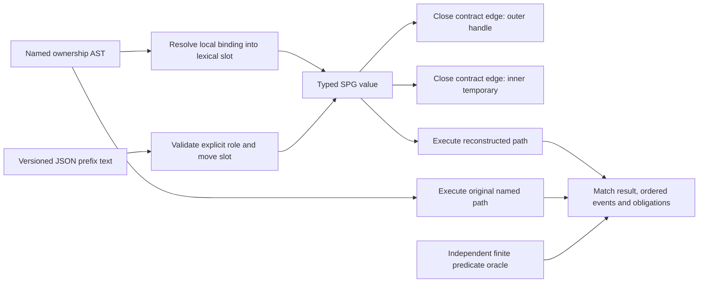

# RT-05 — Preserve ownership and cleanup in canonical SPG values

**Evidence** — 900 program pairs, 8,192 path inputs per evaluation path, and three semantic counterexamples.

## Question and scope

Can the graph erase local binding names and the order in which a close contract lists possible results while preserving which resource gets transferred, which closes run and which obligations reach the caller? The previous typed SPG experiment established normalization for scalar expressions and ordered events. COR-13 now supplies a named ownership AST, an executable transfer/cleanup model and an inferred caller obligation for each admitted close result. This study reuses that exact subset and tests which of its fields must affect identity. [Typed SPG](RT-05-TYPED-SEMANTIC-PROGRAM-GRAPH.md) · [COR-13 ownership](../../language-design/RT-04/RESEARCH-COR-13-TYPED-OWNERSHIP-ACROSS-CALLS.md)

The fixed subset acquires an outer handle and an inner temporary, then branches on a Boolean input. One arm requests a move of the outer handle and the other exits with a domain error. Cleanup may succeed, consume its resource with an error, retain it with an error, or leave ownership indeterminate. The transfer can run before local cleanup or be committed after successful local cleanup. The observation includes the result tag, ordered acquire/transfer/release events, cleanup errors and caller obligations. A retained resource must be handled. Indeterminate ownership requires reconciliation.

## Candidate encoding and experiment



The body commits to the exported name, transfer policy, scope order and two ordered branch arms. A move refers to lexical slot zero. Each edge labels the exact contract value with the resource's role. The contract values canonicalize permitted dispositions as sets. Two contracts with equal sets may share one value while keeping both roles. This encoding uses the existing content store, with separate kind markers for functions and close contracts. It tests graph identity within a fixed profile. Source binding names remain available in the input AST for diagnostics.

For each combination of the 15 nonempty close-result sets at each scope, two transfer policies and two branch layouts, both inputs produce the same snapshot. The experiment also renames both local variables and reverses the two contract lists. Every variant still has the same expected root. Each original and reconstructed program then runs on every admitted combination of flag and close outcomes. A separate predicate oracle predicts transfer timing, release events, result and obligations. Its result does not call the RT-04 executor or checker. The reconstructed graphs independently preserve the inferred sets of result cases.

## Results

| Comparison | Observation |
| --- | --- |
| Named AST versus JSON prefix and alpha-renamed variants | Each of 900 pairs has the same snapshot root. All 900 exact program variants have distinct roots. |
| Source and graph execution versus oracle | Each path matches all 8,192 expected observations, including ordered events and cleanup debts. |
| Erase transfer timing | Two distinct roots collide in the weakened representation. A retained local cleanup failure yields a returned owned handle with early transfer and a staged failure without a value with late transfer. |
| Sort branch arms | Two distinct roots collide. The same Boolean input selects a move in one program and a domain error in the other. |
| Erase close-contract edge roles | The same contract address multiset covers two programs with different possible ownership obligations. Swapping roles changes which resource can carry a live debt and which may require reconciliation. |
| Export rename and unsupported inputs | The export rename changes the root. Five controls reject an inner move, Boolean move index, empty contract, unknown disposition and swapped scope order. |

In the timing counterexample the early path transfers the handle before the failing release of the local resource. The caller receives the handle and the local cleanup debt. The staged path tries to release the pending handle after the failure. The chosen test input makes that release succeed, leaving only the local debt. The close contract role counterexample changes the admitted path domain and the possible obligations. Its weakened representation retains both contract payloads but cannot tell which scope uses which contract.

This supports positional normalization for local binders and set normalization for possible close outcomes, with exact role-labelled dependencies and ordered control. It leaves borrowing and alias escape, general substitution, source parsing beyond the prefix fixture, concurrent cleanup and checked semantics for platform API contracts open. The experiment compares both timing choices without adopting either. A production SPG must also recover the ownership and cleanup information from whichever typed frontend is admitted.

## Reproduction

Use CPython 3.12.14 from the repository root:

```sh
study=research/semantic-representation/RT-05/OWNED-SPG-01
PYTHONHASHSEED=991 python3 -B "$study/run.py" --output /tmp/llmlang-owned-spg.json
cmp "$study/evidence.json" /tmp/llmlang-owned-spg.json
(cd research/PROTOTYPES/RT-04-01 && python3 -B -m unittest \
  test_rt04_owned_call_match test_rt04_shared_owned_workload test_rt03_return_cleanup)
(cd research/PROTOTYPES/DEPENDENCY-GRAPH-01 && python3 -B -m unittest \
  tests.test_spg_representation tests.test_spg_admission)
```

The [harness](OWNED-SPG-01/run.py) enumerates all inputs. The [ledger](OWNED-SPG-01/evidence.json) records the ordered manifest digest of roots and observed paths, exact counterexample roots, per-path traces and distinguishing result cases.
