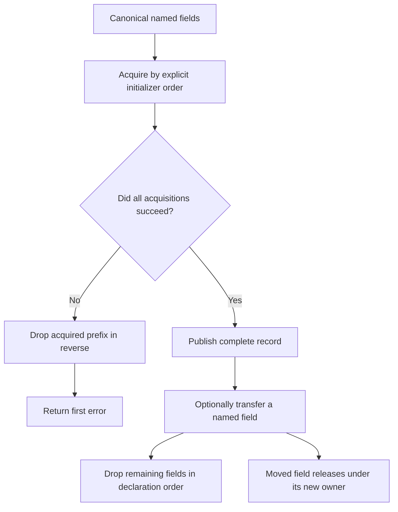

# Partial initialization and ownership order for named records

This RT-05 experiment compares ways to encode ownership during fallible construction of named records. A canonical field map identifies the slots. It leaves open which slot acquires a resource first, which values must be destroyed when construction stops, and which owners release each value after successful publication. The experiment tests candidate SPG projections against native Rust.

## Construction and transfer model

The fixture has three required fields, each holding a unique token with an observable drop. Each field acquisition records an attempt and either acquires a token or returns the field's error. The program tests all eight failure masks. A record becomes observable only when all three fields have been acquired. A successful program either leaves all fields with the record or moves one specified field out. The other fields drop at their enclosing scope boundary. The transferred token drops after a separate scope marker.

The closed source generator compares direct named initializers and explicit staging into locals followed by moves. It independently permutes all six declaration orders and all six initializer orders. A finite oracle derives the successful acquisition prefix, first failing role and the expected drop sequence. Evaluation of the stored SPG objects follows their own order fields and abort policy.



During construction, ownership follows the successful acquisition prefix. After completion, the record owns the remaining fields according to its declaration order. Moving one field removes just its release obligation from that record.

## Results

The corpus has 72 sources, 32 argument combinations per source and 2,304 case/input observation vectors. Optimizations O0 and O3 agree on all 4,608 native runs. The oracle predicts all vectors. Each successful acquisition has exactly one drop, no failed acquisition drops a token, and no partial record publishes. Both source forms in all 36 pairs produce equal traces and exact graph hashes under the separate-orders projection.

There are 2,016 early-exit vectors and 288 completed vectors. Exact classes count graph hashes across the 72 sources. The variants compare one alphabetical field order, one initializer or declaration order used in both phases, one reversed initializer order for all drops, or distinct incorrect abort policies with otherwise accurate information.

| Projection | Exact classes | Early-exit mismatches | Completed mismatches |
|---|---:|---:|---:|
| Separate acquisition, abort and completed orders | 36 | 0 | 0 |
| Canonical field order throughout | 1 | 1488 | 268 |
| Initializer order for acquisition and completed drop | 6 | 0 | 168 |
| Schema order for acquisition and completed drop | 6 | 1488 | 240 |
| Reverse acquisition for all drop | 6 | 0 | 168 |
| Forward acquisition prefix on abort | 36 | 288 | 0 |
| Filtered schema order on abort | 36 | 144 | 0 |

Reusing initializer order for final destruction preserves the early exits and changes 168 completed traces. Always reversing acquisitions similarly changes 168 completed traces. Keeping both correct full orders but releasing a partial prefix in acquisition order changes 288 early-exit traces. Filtering the declaration order to the acquired set still changes 144 early-exit traces. For instance, when `alpha` and then `beta` succeed before `gamma` fails, `beta` drops first. On successful construction with declaration order `alpha`, `beta`, `gamma`, the completed record drops `alpha` before `beta` unless one is transferred.

## Limits and replay

The results cover the exact core of the generated Rust programs on this compiler and host. The source adapter generates a closed subset. It does not read Rust's full typed IR. Drop bodies only append to the trace, and failure uses `Result` propagation. Unwinding, failing cleanup or cancellation, partial observation through callbacks, aliasing, user-defined record destructors, default initializers, nested ownership and independent review remain open. The result provides design evidence for explicit phase and owner obligations in SPG. It leaves LLMLang's chosen construction and disposal rules open.

Use CPython 3.12.14 and Rust 1.85.1 on x86-64 Linux. The initial LLMLang base is `6d66fb74304bac1fc41d56c84fbd0fde22d9cd2c`. The ledger records exact generator and generated Rust SHA-256 values, the full compiler revision, and every observation. Run from the checkout root.

```bash
fixture=research/semantic-representation/RT-05/PARTIAL-RECORD-01
PYTHONHASHSEED=1 python3 -B "$fixture/run.py" > /tmp/llmlang-rt05-partial-record.json
cmp "$fixture/evidence.json" /tmp/llmlang-rt05-partial-record.json
python3 "$fixture/chart.py"
```

See the [native fixture generator](PARTIAL-RECORD-01/run.py), [measured ledger](PARTIAL-RECORD-01/evidence.json), [table generator](PARTIAL-RECORD-01/chart.py), and [RT-04 construction alternatives](../../language-design/RT-04/RESEARCH-SCENARIO-68-VALUE-CONSTRUCTION-AND-INITIALIZATION.md).
