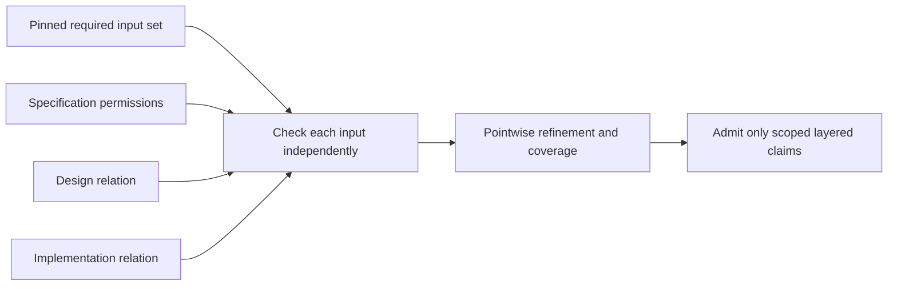

# RT-05 — Preserve input scope across specification, design and implementation

## Question and method

What must an SPG release judgment preserve when required inputs differ across specification, design and implementation? The [multi-requirement study](RT-05-MULTI-REQUIREMENT-COVERAGE-2026-11-24.md) checks several requirements over one input. This study adds explicit input-indexed permissions, checks coverage at each required input, and compares endpoint-only and projected-outcome alternatives. The research baseline is `950d331414c5203f6716c7967e6e4aa148b87cd1` on `research/all`. [Layered refinement evidence](RT-05-LAYERED-REFINEMENT-EVIDENCE-2026-11-24.md)

Let `S(x)` be the specification's allowed outcomes at input `x`, `D(x)` the outcomes admitted by the design and `I(x)` the implementation outcomes. For each input in the pinned required set, layered admission requires `∅ ≠ I(x) ⊆ D(x) ⊆ S(x)`. The fixture uses two inputs and two observable outcomes. It enumerates every nonempty specification at each input and every design and implementation pair, including empty output sets. It compares subset checks against a separately written direct enumeration oracle. The lack of an outcome represents absent coverage in this model.



The projected rule discards input identity and compares unions of outcomes, while requiring some implementation output in the union. The endpoint-only rule compares each nonempty implementation outcome set with the specification while omitting design conformance. Both alternatives answer weaker questions than the scoped layered judgment.

## Results

| Check or distinction | Cases among 2,304 |
|---|---:|
| Projected outcome inclusion and nonempty union | 1,089 |
| Pointwise inclusion at both layers | 225 |
| Pointwise inclusion with a coverage gap | 176 |
| Pointwise inclusion and required implementation coverage | 49 |
| Projected rule passes despite a pointwise violation | 928 |
| Projected rule passes pointwise but misses a coverage gap | 112 |
| Endpoint passes while a layer violates refinement | 351 |

The 49 layered cases agree with the independent oracle. For each input, either singleton specification has one covered refinement chain. The two-outcome specification has five. The two inputs therefore yield `(1 + 1 + 5)² = 49` valid chains. The same calculation with empty layers included yields `(3 + 3 + 9)² = 225` pointwise-only chains.

A swapped implementation can emit the correct set of outcomes globally at the wrong inputs. An implementation with one missing input can also pass pointwise inclusion. Allowing the producer to submit only the covered input changes that case from withheld to admitted. An endpoint-correct implementation may avoid an invalid outcome that the intermediate design still permits. These distinct controls show why coverage binds the independently selected input set, and why a release claim about all three graph layers has separate obligations. [Exact controls and counts](PER-INPUT-REFINEMENT-01/evidence.json)

Lean checks that pointwise refinement composes and that lower-layer coverage transfers through refinement. It also checks equal projected outcomes for a non-refining example and vacuous inclusion of an empty implementation without coverage. All five theorems have empty axiom dependencies. They concern explicitly supplied predicates; verification of predicate extraction, correct scope selection, progress of native code, authority and production release remains open. [Lean propositions](PER-INPUT-REFINEMENT-01/InputCoverage.lean) · [Stage 1.1 tracking](https://github.com/aivibeflow/LLMLang/issues/288)

## Reproduction

Use CPython 3.12.14 and Lean 4.36.0 at `611c117bfaf7b7ae1cfcf246ce6fba31e8f509e9`. The [runner](PER-INPUT-REFINEMENT-01/run.py) checks the finite cases and records exact tool versions, input domains, source hashes and Lean axiom output. Hash seeds 1 and 2 produced byte-identical results. The Mermaid source was checked without local rendering.

```bash
fixture=research/semantic-representation/RT-05/PER-INPUT-REFINEMENT-01
LC_ALL=C PYTHONHASHSEED=1 python3 -B "$fixture/run.py" --lean "$(command -v lean)" \
  > /tmp/llmlang-rt05-per-input.json
cmp "$fixture/evidence.json" /tmp/llmlang-rt05-per-input.json
```
