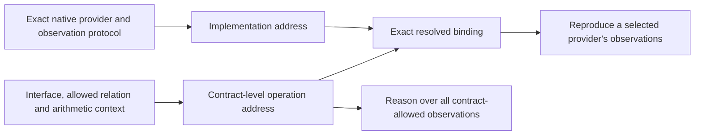

# RT-05 — Operation identity for a contract with multiple allowed observations

## Question and contract

What does a contract-addressed operation identify when conforming implementations can produce different observable traces? [Scenario 92](RESEARCH-SCENARIO-92-OPERATION-IDENTITY-AND-IMPLEMENTATION-BINDING.md) proposes an operation definition for the contract and a separate binding for an exact provider. This experiment compares that split with a body-qualified operation address and checks which semantic context the contract must commit. [PLAN §1.2](../../../PLAN.md#12-semantic-identity-hashes-and-canonical-encoding) · [#289](https://github.com/aivibeflow/LLMLang/issues/289) · [LL-001 / #344](https://github.com/aivibeflow/LLMLang/issues/344)

The fixture takes an unsigned byte `x`. The complete allowed relation couples return value with ordered events. The caller may observe either the pair `(x, read → commit)` or `(advance(x), read → advance → commit)`. The arithmetic context defines whether advancing byte 255 wraps to 0 or saturates at 255. The event sequences are ordered and belong to their respective result alternatives.

Five static C providers are built separately in each arithmetic context. Three choose the stay alternative, the advance alternative, or one based on input parity. Two controls mix the stay value with the advance trace or reverse the stay events. Each native profile covers all 256 inputs. The Python oracle checks membership in the paired relation and, separately, membership in the independently projected sets of values and traces.



The body-qualified comparison computes an operation address that also commits to the provider artifact. A concrete call pins the resulting address or the separate binding if it needs a particular realization. A caller reasoning universally over the contract must accept either admitted observation for each input.

## Native results

| Arithmetic | Provider | Complete relation | Separate value and trace |
| --- | --- | ---: | ---: |
| wrap | stay | 256/256 | 256/256 |
| wrap | advance | 256/256 | 256/256 |
| wrap | parity | 256/256 | 256/256 |
| wrap | mixed | 0/256 | 256/256 |
| wrap | reordered | 0/256 | 0/256 |
| saturate | stay | 256/256 | 256/256 |
| saturate | advance | 256/256 | 256/256 |
| saturate | parity | 256/256 | 256/256 |
| saturate | mixed | 1/256 | 256/256 |
| saturate | reordered | 0/256 | 0/256 |

All six within-context pairs of conforming providers share the contract-level operation address. Their body-qualified addresses and exact bindings distinguish them. The stay/advance pair differs on all 256 inputs in each context, and each of the other pairs differs on 128. The mixed controls give 511 false admissions under separate projection. At saturated input 255, both alternatives return 255, so the mixed result with the advance trace belongs to the complete relation.

Changing the arithmetic context while holding the signature and symbolic relation fixed makes the wrapping advance observation at 255 inadmissible under saturation. A context-free address collapses those contracts in the fixture. Both contexts need explicit interpretation if the operation payload represents the symbolic expression `advance(x)` rather than its fully interpreted relation.

## Proof and applicability

[Lean](OPERATION-IDENTITY-01/Contract.lean) checks four facts about the mathematical model. Either permitted selection conforms, two conforming selections are distinguishable, separate projections admit a concrete invalid combination, and the wrapping boundary outcome falls outside the saturated relation. All four theorems have empty axiom lists. The native C executions cover the finite byte domain and provide a separate conformance observation at each input. The Lean model leaves source-to-native correspondence and correctness of the identity encoder outside its proof boundary. [Axiom output](OPERATION-IDENTITY-01/axioms.txt)

The fixture supports a contract-level address for the complete typed observation relation and its interpretation. An exact realization needs a separately identifiable provider or body-qualified operation. Encoding every provider into the operation address preserves exact selection at the cost of a different operation address for each admitted provider and artifact build. Stronger guarantees about ordered effects must appear in the complete relation if callers depend on them. The study leaves the production envelope, general expressions, conformance authority and the choice between these address models open.

## Reproduce

The LLMLang baseline was `dadcc7da192e426c4fa02ecd4a99928066d4971a` on `research/all`. The run used Debian 13 x86-64 Linux 6.18.57, glibc 2.41, CPython 3.12.14, GCC 14.2.0-19 and Lean 4.36.0 (`611c117bfaf7b7ae1cfcf246ce6fba31e8f509e9`). Run from the repository root:

```sh
fixture=research/semantic-representation/RT-05/OPERATION-IDENTITY-01
out=$(mktemp)
axioms=$(mktemp)
python3 -B "$fixture/run.py" > "$out" &&
  cmp "$fixture/evidence.json" "$out" &&
  lean -DwarningAsError=true "$fixture/Contract.lean" > "$axioms" &&
  cmp "$fixture/axioms.txt" "$axioms" &&
  python3 -B "$fixture/chart.py"
```

The [native ledger](OPERATION-IDENTITY-01/evidence.json) records exact source and native binary hashes, tool data, commands and output vectors. Each profile stores one result byte and one codebook entry per input, in ascending input order. The [table generator](OPERATION-IDENTITY-01/chart.py) reproduces the categorical results. [Provider source](OPERATION-IDENTITY-01/provider.c) · [Runner](OPERATION-IDENTITY-01/run.py)
