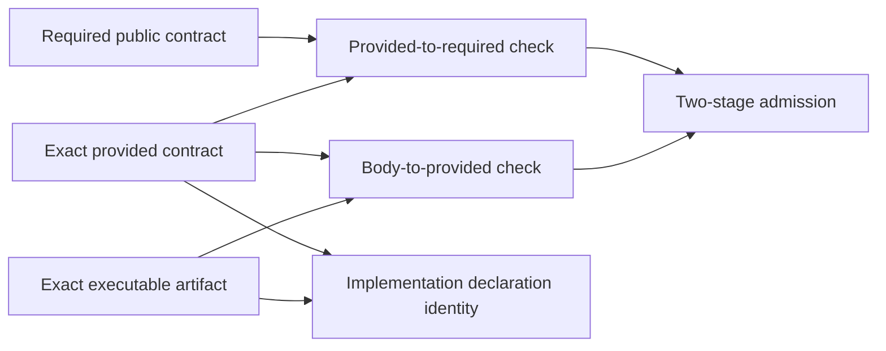

# RT-05 — Executable body, provided contract and admission identity

## Question and method

Can a receipt for a concrete provider be reused when the native code and public operation remain identical but the provider changes its own contract? The [RT-20 compatibility boundary](../../toolchain-and-collaboration/RT-20/RT-20-CONTRACT-IDENTITY-AND-COMPATIBILITY.md) puts one provided contract reference on the callee. The [public interface proposal](PUBLIC-INTERFACES-AND-CONTRACT-REFINEMENT.md) gives separate body and refinement obligations. This fixture checks their identity inputs using a previously replayed [native observation cohort](RT-05-PERMISSIVE-OPERATION-IDENTITY-2026-11-25.md). [PLAN §1.2](../../../PLAN.md#12-semantic-identity-hashes-and-canonical-encoding) · [#289](https://github.com/aivibeflow/LLMLang/issues/289) · [LL-008 / #351](https://github.com/aivibeflow/LLMLang/issues/351)

The 60 cases cross five fixed native provider artifacts, six alternative provided contracts and two required public contracts over all 256 unsigned-byte inputs. The harness decodes archived return values and ordered trace labels. A contract specifies the admitted input domain and allowed return/trace observations for each input. It checks the body against the declared provider contract, then checks that the provider accepts every required input and permits only required outcomes there. A direct check of body versus public contract is a separate alternative.



## Results

For the unchanged parity provider under the general public contract, the six declaration revisions give these distinct dispositions:

| Provided declaration | Body check | Refinement to general |
| --- | --- | --- |
| General | pass | pass |
| Parity | pass | pass |
| Stay only | fails at 1 | pass |
| Advance only | fails at 0 | pass |
| Also permits mixed result | pass | fails at 0 |
| Omits input 255 | pass | fails at 255 |

The broader mixed declaration permits a concrete outcome excluded by the public contract, even though this executable never produces that outcome. The restricted-domain declaration omits a required input. These are refinement failures with a passing body check. The stay and advance declarations refine the public contract but misdescribe the parity body.

Across all 60 cases, seven satisfy both obligations. In 17 cases the direct public check passes while at least one of the two declared obligations fails. These cases distinguish two acceptance policies. They do not contradict the direct behavioral check.

The executable-plus-public key merges 29 pairs with opposite two-stage outcomes. The candidate declaration address, which commits both the executable and the single provided contract, separates all such pairs when paired with the public contract. Separate body and refinement request keys preserve their scoped results. A body judgment depends on the exact executable and provided contract, while a refinement judgment in this model depends on the two contracts. An actual receipt also needs checker, assumptions and proof provenance even when its subject keys agree.

## Checked proof and scope

[Lean](PROVIDED-CONTRACT-IDENTITY-01/Admission.lean) proves that satisfying a provided contract and refining the required contract imply satisfying the required contract. Its two Boolean controls show that one fixed body can satisfy one declaration and refute another, and that satisfying both declarations does not give both the same refinement status. All three theorems have empty axiom lists. The generic obligations are stated over deterministic terminating bodies and relational output predicates. The proof does not verify native correspondence or the evidence admission policy. [Axiom output](PROVIDED-CONTRACT-IDENTITY-01/axioms.txt)

This supports a separately reusable code artifact and an exact implementation declaration that resolves its provided contract. It leaves open whether the project names that declaration `ImplHash` or commits the same pair through another immutable object in the chosen architecture. General effect, ABI, concurrency, termination and authority checks remain open.

## Reproduce

The baseline was `01d38f58f33df9f31f3f84a4013780cfd1b970ec` on `research/all`. Run from the repository root with CPython 3.12.14 and Lean 4.36.0 at revision `611c117bfaf7b7ae1cfcf246ce6fba31e8f509e9`, as checked on Debian 13 x86-64 Linux 6.18.57:

```sh
fixture=research/semantic-representation/RT-05/PROVIDED-CONTRACT-IDENTITY-01
out=$(mktemp)
axioms=$(mktemp)
python3 -B "$fixture/run.py" > "$out" &&
  cmp "$fixture/evidence.json" "$out" &&
  lean -DwarningAsError=true "$fixture/Admission.lean" > "$axioms" &&
  cmp "$fixture/axioms.txt" "$axioms" &&
  python3 -B "$fixture/chart.py"
```

The [ledger](PROVIDED-CONTRACT-IDENTITY-01/evidence.json) pins the [native input ledger](OPERATION-IDENTITY-01/evidence.json) by SHA-256 and records each checked obligation, first counterexample and key. The [table generator](PROVIDED-CONTRACT-IDENTITY-01/chart.py) reproduces the categorical comparison. [Runner](PROVIDED-CONTRACT-IDENTITY-01/run.py)
