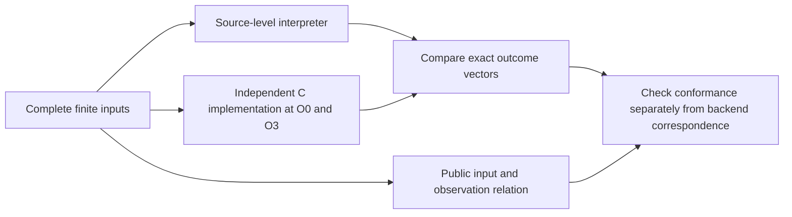

# RT-05/20 independent finite public-interface correspondence

A backend can reproduce the behavior of a source provider even when that provider violates its public contract. This fixture checks both judgments. It compares a Python source-level protocol interpreter, a separately written C implementation and an independently stated finite public relation. The study tests a bounded protocol and supplies evidence for choosing future benchmark cases.

## Protocol and comparison

The input contains a Boolean admission flag, a fuel input from zero to three and an integer payload from −2 to 5. The successful public result permits the payload plus either one or two. Its exact trace is reserve followed by commit, and total work is at most two units. A request without authority is denied without work. With authority, insufficient fuel is refused before effects. For an authorized request with enough fuel and a negative payload, the allowed domain refusal follows one reserve event. The model specifies this failure trace explicitly.

Two providers implement different permitted results. Three isolated control profiles reverse effect order, exceed the work bound or continue without the required authority. The source interpreter records observations as typed outcomes. The independent C program computes its own results and emits a compact wire vector. An adapter decodes those rows and refuses duplicate inputs. A separate relation checks the allowed permit, failure, result, trace and work combinations. Its failure cases are keyed by the outcome and its success check tests set membership.



The benchmark enumerates five profiles and 64 inputs per profile. It checks semantics rather than elapsed time. The source and C routes are manually specified for this protocol. The comparison exercises independent implementations of a common description. A general LLMLang source frontend and automatic translation into C are outside this fixture.

## Results

Both GCC profiles agree with all 320 source observations, including return values, ordered effects and work. The two output digests also agree. The public relation admits every observation from either correct provider. Their successful values differ on 12 inputs despite both satisfying the same operation contract. It rejects the expected sets for each control.

| Provider | Cases per route | Public refutations |
|---|---:|---:|
| Plus one | 64 | 0 |
| Plus two | 64 | 0 |
| Reordered effects | 64 | 12 |
| Excess work | 64 | 12 |
| Unscoped authority | 64 | 32 |

An oracle that checks only agreement between source and generated code would miss all 56 checked contract refutations, because both routes agree on those provider behaviors. A value-only positive check also cannot characterize ordering and resource guarantees. The distinction supports using an independent public relation and multiple conforming providers in the same benchmark. A real proof must still establish coverage, property correctness and exact source correspondence for its relevant domain and backend.

The prior [finite Python/Lean pilot](PUBLIC-INTERFACE-FINITE-REFINEMENT-PILOT-2026-11-24.md) supplies the mathematical composition check in its own model. The [modular caller theorem](PUBLIC-INTERFACE-MODULAR-CALLER-2026-11-24.md) proves a separate scoped all-integer caller claim under a provider premise. The new benchmark contributes native observation controls without treating them as a general proof.

## Verify and limits

The [runner](PUBLIC-CORRESPONDENCE-01/check.py), [native source](PUBLIC-CORRESPONDENCE-01/provider.c) and [ledger](PUBLIC-CORRESPONDENCE-01/evidence.json) use CPython 3.12.14, GCC 14.2.0-19, target `x86_64-linux-gnu` and Linux 6.18.57. The study baseline is `a281acdbb07fc520f609fef38504b5844149442f`. The ledger stores every input and source observation, native stream digests and exact source hashes. The complete output replays at hash seeds 37 and 71.

```bash
fixture=research/semantic-representation/RT-05/PUBLIC-CORRESPONDENCE-01
LC_ALL=C PYTHONHASHSEED=37 python3 -B "$fixture/check.py" > /tmp/llmlang-public-correspondence.json
cmp "$fixture/evidence.json" /tmp/llmlang-public-correspondence.json
```

Whole-language extraction, other backends, real authority and resource accounting, independent review and approval of normative semantics remain open.
