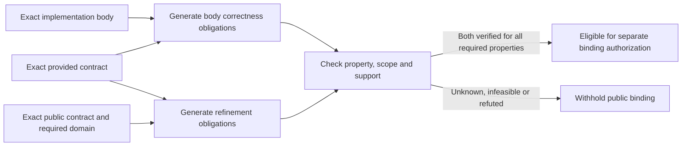

# RT-05/20 generate separate body and public refinement obligations

A provider can implement its own promise and still be incompatible with a public contract. A provider can also declare a refining promise that its body violates. The generator produces separate exact obligations for these cases and checks their dispositions in a finite scoped protocol. The experiment extends the [public-interface proposal](PUBLIC-INTERFACES-AND-CONTRACT-REFINEMENT.md) and the earlier [finite Python/Lean refinement pilot](PUBLIC-INTERFACE-FINITE-REFINEMENT-PILOT-2026-11-24.md).

## Obligations and subjects

Let `B` be one exact body, `I` its provider-owned contract and `P` the exact public contract. The body obligation checks that each input admitted by `I` has the required coverage and that each body outcome satisfies `I`. The refinement obligation checks that all public-admitted inputs are accepted by `I` and every allowed provider outcome on that domain satisfies `P`. Each judgment binds its own exact subjects, property and observation profile. The aggregate can admit a binding only when all relevant obligations are checked and the execution scope and authorization also pass.



The finite protocol has two admitted input cases, a first request and a retry. A successful execution reaches the committed state, records the ordered reserve/publish events, uses the scoped authority, returns ownership of a handle, completes by a tick bound, and stays within a cost limit. The model uses fixed observation fields and integer tick and cost units. Both bounds are upper bounds in the same model. There is no fairness or asymptotic cost claim.

| Property | Example counterexample |
|---|---|
| State/protocol | Result leaves the protocol open |
| Effects | Publish appears before reserve |
| Authority | A foreign scope is used |
| Ownership | Ownership of the handle is lost |
| Progress | Completion needs more than the promised ticks |
| Resources | Actual units exceed the promised bound |

The generated ledger records separate exact subjects and obligation IDs. An edit to (B) changes its body obligation while retaining the same refinement subject. A change to the public scope can leave the body obligation valid while changing the refinement subject. Real obligations also need exact source and target correspondence, a property-appropriate checker, input extraction, assumptions and evidence authority. The finite generator exercises its own declared model.

## Checked outcomes

Each of six properties is crossed with seven profiles. That yields 42 pairs of independently scoped obligations and 84 dispositions. All six exact pairs pass. Single-property fault controls distinguish failures of body correctness and public refinement. Other controls deny admission when a required result is missing, the provider domain excludes a public input, the public scope is empty, or the needed provider model is unsupported.

| Profile | Body | Refinement |
|---|---|---|
| Exact | Verified | Verified |
| Body fault | Refuted | Verified |
| Weaker provider promise | Verified | Refuted |
| Missing provider result | Coverage refuted | Verified |
| Narrower provider domain | Verified | Coverage refuted |
| Empty public scope | Verified | Infeasible scope |
| Unsupported model | Unknown | Unknown |

An empty public domain can make a mathematical inclusion true without giving an executable public service. The candidate requires declared required scope with coverage for this operation family. A missing or unsupported property model stays unknown. Signature-only matching cannot distinguish any fault in this table. A direct proof of the public contract is a useful alternative when the provider has made no independent promise to discharge. The two-obligation route gives reusable, explicitly scoped provider and public refinement evidence when those claims are required.

## Verify and limits

The [generator](PUBLIC-OBLIGATIONS-01/check.py) and [ledger](PUBLIC-OBLIGATIONS-01/evidence.json) use the bounded `finite-model/1` property interpreter and CPython 3.12.14 at study baseline `3c9ee2ba4b761cc2035cf26ebd2171c5f14ca299`. The example outcomes, exact subject digests and verdicts are deterministic at hash seeds 37 and 71.

```bash
fixture=research/semantic-representation/RT-05/PUBLIC-OBLIGATIONS-01
PYTHONHASHSEED=37 python3 -B "$fixture/check.py" > /tmp/llmlang-public-obligations.json
cmp "$fixture/evidence.json" /tmp/llmlang-public-obligations.json
```

This verifies finite obligations and false-admission controls. Mutable-state abstraction, native authority and ownership correspondence, richer progress and resource models, joint group invariants, and independent review remain open. The study establishes no inference of universal conformance from finite observations.
