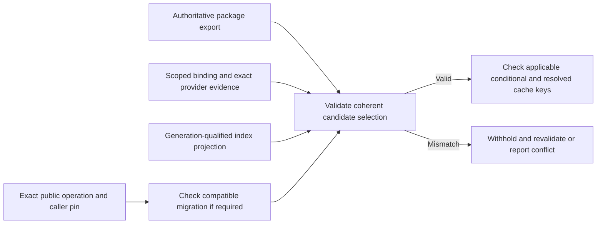

# RT-05/20 public-interface evolution, package consistency and reuse

A public revision, package export, provider binding and proof can each change separately. A transition can preserve a caller contract while changing an executable subject, and two individually valid branch edits can produce inconsistent composed evidence. This bounded experiment checks those distinctions over exact revision, export, index and binding inputs.

## Candidate consistency rules

An unchanged operation may select a new provider under fresh exact body and refinement evidence. A conditional caller claim about the unchanged operation can remain valid while resolved execution and provider-dependent cache entries require revalidation.

A changed public contract has a new exact operation revision. For the studied relation, a compatible revision accepts every former input and promises a nonempty subset of former permitted outcomes. Moving an old caller to that revision still needs an explicit checked migration and current bindings. A breaking revision cannot serve the old pin under the compatible migration route. Retain the old revision and authorized historical bindings or amend the caller and check it against the new contract. Signature, ownership, ABI and state protocol comparisons are separate requirements in richer profiles.

The package export catalog supplies the authoritative operation revision. Its index projects that exact selection and provider binding. A stale index returns no trusted discovery result. This fixture withholds current activation using that index; a separate authoritative resolution route could recover without trusting the derived data. Bind an exact execution cache entry to the resolved operation, implementation, profile and evidence for the checked action. The conditional theorem uses its actual public premises and independent assumptions.



## Checked outcomes

The matrix compares three public revisions, two providers, present or mismatched exact evidence, package export and index projections, and old or current caller pins. It covers 96 cases.

| Result | Cases |
|---|---:|
| Bound under current exact evidence | 10 |
| Package selection inconsistent | 40 |
| Old pin needs a different migration | 16 |
| Exact provider evidence pending | 20 |
| Index projection stale | 10 |

Among the ten bound cases, four retain the baseline conditional proof subject and two retain the exact baseline execution subject. The two cases with an unchanged operation and a different provider preserve the conditional premise but change exact execution. A checked migration to the compatible public revision can bind and changes both exact subjects. A same-name breaking revision leaves the old pin unadmitted. The matrix permits a caller explicitly pinned to the new breaking revision when all its required evidence is current. A separate control withholds a compatible migration when its explicit request is absent.

In one combined-branch control, a package export moves while the binding still names the prior operation. The combined view fails consistency. In another, each side independently binds successfully: one changes the provider, the other migrates the operation and retains the former provider. Naively combining those fields leaves evidence for the wrong exact provider and must remain pending. Keeping only old file-level checks would miss the cross-record relationship.

The [RT-23 mapping comparison](../../toolchain-and-collaboration/RT-23/RT-23-INTERFACE-MAPPING-MERGE.md) provides the underlying exact-revision, independent-key and ambiguous-symbol controls. The [package SQLite index study](../../packages-and-ecosystem/RT-12/RT-12-SNAPSHOT-CONTRACT-PROVIDER-INDEX-2026-11-25.md) checks scope-qualified reads against previous generations. The [RT-24 identity lineage study](../../toolchain-and-collaboration/RT-24/RT-24-IDENTITY-LINEAGE-AND-REBIND-2026-11-25.md) tracks exact rename, split and merge contexts. They supply bounded evidence for the surrounding resolution, storage and merge mechanisms.

## Verify and limits

The [runner](PUBLIC-EVOLUTION-01/check.py) and [ledger](PUBLIC-EVOLUTION-01/evidence.json) use CPython 3.12.14 and Git 2.56.1. They pin three relevant ledgers at `39c96755626604fb1a67901d8b85ce231a994553`. Both hash seeds give identical output.

```bash
fixture=research/semantic-representation/RT-05/PUBLIC-EVOLUTION-01
PYTHONHASHSEED=37 python3 -B "$fixture/check.py" > /tmp/llmlang-public-evolution.json
cmp "$fixture/evidence.json" /tmp/llmlang-public-evolution.json
```

The fixture models bounded result sets and exact projection agreement. Its merge controls do not run a complete graph merge or native pipeline. Production cache soundness requires independently established complete dependency extraction, group invariants and transactional publication. Deployment migration, package authority and broader proof correspondence remain open.
