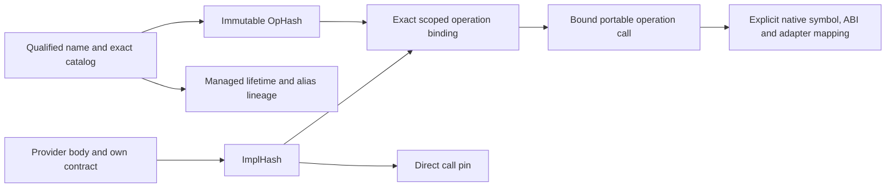

# RT-05/20 public export catalogs, immutable interfaces and binding modes

The public-interface candidate lets a caller resolve a governed name while preserving exact semantic calls and exact provider pins. This report specifies candidate catalog and call records and checks the boundary among qualified names, immutable interface revisions and native mappings. It follows the [public interface proposal](PUBLIC-INTERFACES-AND-CONTRACT-REFINEMENT.md) and the [candidate identity envelopes](RT-05-CANDIDATE-IDENTITY-ENVELOPES-2026-11-25.md).

## Catalog and signature

An export record contains the catalog identity, authoritative package or workspace namespace, qualified public name, visibility, selected managed lifetime and exact operation revision. The namespace and catalog revision are inputs to resolution. Aliases point to a selected immutable operation revision under an exact catalog. A rename, redelegation or retirement has its own lineage record. An old alias may remain supported under an old catalog or be explicitly migrated. A same-spelling entry in an unrelated package has independent authority.

A scalar public interface revision includes ordered typed parameter and result roles, ownership constraints, exact public contract and the call interpretation profile. The existing `OpHash` commits those exact semantic inputs. It supplies the call identity for an operation. Catalog aliases and draft labels resolve to that identity. A protocol group has an ordered or role-keyed set of operation references and a separate exact shared invariant. An operation includes the group protocol context when its meaning depends on that invariant. The group catalog can commit the selections without creating another execution hash for a member call. It may carry an independent content identity for package publication or checking group obligations.

A provider declares one exact provider-owned contract and supplies its canonical body and dependencies under `ImplHash`. The public contract and provider contract remain separate. A binding ties an exact operation to a selected provider under a catalog/snapshot, target/profile, policy and authorized scope. Selection evidence and exact contract conformance have to pass independently before invocation.



## Call and dispatch records

| Call form | Typed call records | Additional admission condition |
|---|---|---|
| Direct | Exact `ImplHash` and call signature | Current scope authorizes the pin and exact dependency |
| Operation | Exact `OpHash` and checked bindable signature | Resolve an exact current binding and prove the selected provider satisfies the required public contract |
| Foreign import or export | Exact semantic call plus explicit external symbol, calling convention, data layout and adapter/loader context | Verify source and binary correspondence and the exact native ABI |
| Policy-enabled runtime dispatch | Exact `OpHash`, dispatch contract and activation context | Revalidate the selected binding and allowed candidates under the exact policy and snapshot |

A runtime dispatch can select only within the operation's declared policy. Native ABI admission applies at the foreign boundary. Independent group, refinement and policy checks are still required and are outside this record-shape fixture. Only a provider already admitted under an external checked scope can enter the call matrix.

## Checked observations

The [runner](PUBLIC-EXPORT-BINDING-01/check.py) crosses five names, two scopes and two catalog revisions for 20 exact name lookups. Four resolve and 16 are absent. The two current aliases resolve to the same exact operation. An old alias resolves only under its pinned older catalog. An unrelated namespace resolves its own entry independently.

A separate 60-case matrix checks three call forms across five binding states, two scope conditions and two direct pins. There are five bound direct cases, four bound portable operation cases and two bound foreign cases. The remaining 49 are pending. The direct branch does not require an abstract catalog choice after the exact authorized provider is pinned. A stale operation or wrong scope leaves operation and foreign calls pending. A convention mismatch can preserve an abstract record's operation binding and still withhold its foreign invocation. This tests the small binding record. It does not execute providers.

Four pinned studies provide the surrounding boundaries. The [import-resolution study](RT-05-IMPORT-RESOLUTION-INVALIDATION-2026-11-24.md) verifies 972 lookup transitions and distinguishes explicit from open-catalog lookups. The [native implementation study](RT-05-NATIVE-IMPLEMENTATION-IDENTITY-2026-11-25.md) checks that identical symbol and aggregate layout permit two mismatched conventions under a weaker gate. The [modular substitution study](../../language-design/RT-04/RT-04-MODULAR-OPERATION-SUBSTITUTION-2026-11-25.md) requires exact body, provider-contract and refinement evidence for admission. The [identity envelope matrix](RT-05-CANDIDATE-IDENTITY-ENVELOPES-2026-11-25.md) checks differences among name metadata, operation, provider, binding inputs and evidence subjects.

Concrete pins give deterministic implementation selection and tighter invalidation when a provider changes. Named signatures without behavioral verification cannot support modular guarantees. An exact operation and scoped verified binding preserve public caller obligations, while dynamic selection requires additional runtime evidence. The scope fixture supports all three explicit forms and leaves their production policy open.

## Verify and limits

The [ledger](PUBLIC-EXPORT-BINDING-01/evidence.json) records the four source ledger hashes at `42254e9209aa525330c3fcaeb64959237878e72e`. Both hash seeds give identical output using CPython 3.12.14 and Git 2.56.1.

```bash
fixture=research/semantic-representation/RT-05/PUBLIC-EXPORT-BINDING-01
PYTHONHASHSEED=37 python3 -B "$fixture/check.py" > /tmp/llmlang-public-export.json
cmp "$fixture/evidence.json" /tmp/llmlang-public-export.json
```

Authoritative namespace governance, concurrent public catalog publication, multi-candidate resolution, group protocol proof production, complete native adapter correspondence and independent review remain separate. The records supply a candidate boundary without adopting a public interface grammar or policy.
