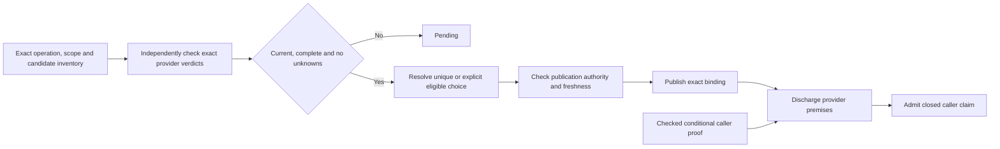

# RT-05/20 reproducible binding resolution and conditional caller admission

A public call needs an exact provider to execute, while some caller proofs can quantify over any provider satisfying the public contract. This candidate defines the data needed to reproduce resolution, authorize publication and determine when a checked caller conclusion applies to a closed executable. It preserves distinct outcomes for no match, ambiguity, unknown evidence and an explicitly refused choice.

## Exact resolution and publication

A reproducible resolution request binds an immutable catalog/selection, exact `OpHash`, scope, target, policy revision, candidate inventory and selector. Each provider verdict binds exact `ImplHash`, public and provided contracts, property-specific assumptions, authorization and checker identity. A receipt is usable when an independent checker validates the exact subject and scope. The supplied finite model uses a verification flag to represent that result. It does not implement an independent infrastructure or trust root.

Automatic resolution evaluates a complete current candidate inventory. A single eligible provider can be selected. More than one requires an explicit verified choice or remains ambiguous. A complete decided inventory with none eligible returns no match. Unknown or missing evidence leaves the request pending. An explicit choice is checked against the same inventory and is refused if its exact provider is excluded. Candidate order, name ranking and unvalidated discovery scores cannot establish a unique binding.

Publication independently checks the publisher's right to act in that scope and compares the expected snapshot/generation with current authority. On success it records the exact operation, provider, selection revision, receipt, policy and choice. A stale or unauthorized result remains unpublished. A caller guarantee remains conditional until its exact applicable provider assumptions and binding are discharged. A proof about the public contract can remain applicable to its conditional statement after provider rebind, even though closed execution evidence must be rechecked.



## Checked outcomes

The fixture enumerates 96 resolution cases across two providers' four receipt states, three choice modes and two completeness states. All agree with a separate expected-result table and give the same result under reversed enumeration. Six produce bindings, one remains ambiguous, one gives no match, four refuse the explicit choice and 84 remain pending. Three controls check missing coverage, duplicate records and a receipt scoped to another provider.

Each decision crosses publisher authorization, current generation and availability of a checked conditional caller proof. The resulting 768 cases include 12 published bindings and 756 withheld. Separately, six cases support a closed caller claim, 378 retain only a checked conditional claim and 384 lack a checked caller claim. These categories concern theorem applicability and selection in the finite model. The publication matrix does not execute a binary or provide a concurrent database implementation.

The prior [RT-35 exact resolution gate](../RT-35/RT-35-RESPONSE-AND-RESOLUTION-GATES-2026-11-25.md) is in the same research direction. Its 180 finite cases exercise complete exact coverage independently of scoring. The [modular caller pilot](PUBLIC-INTERFACE-MODULAR-CALLER-2026-11-24.md) checks a Lean theorem under a public provider relation and 100 bounded typed-SPG observations. The [rebind pilot](PUBLIC-INTERFACE-VERIFICATION-REBIND-2026-11-24.md) separately records changed provider premises, insufficient obligation sets and refuted provider promises. Together they motivate conditional reuse, exact independent receipts and fresh publication.

A whole-catalog proof can make coverage easier to audit at the cost of revalidation after unrelated changes. A smaller independently verified scope allows narrower reuse but requires exact completeness and policy. Automatic top-rank selection offers neither coverage nor direct provider admissibility. The candidate keeps these inputs separate and rejects incomplete or ambiguous automatic resolution.

## Verify and limits

The [runner](PUBLIC-RESOLUTION-01/check.py) and [ledger](PUBLIC-RESOLUTION-01/evidence.json) use CPython 3.12.14 at the claimed research baseline `12560418aaff27c0283cbfbe8b838f7b1944a087`. Two hash seeds give identical results.

```bash
fixture=research/semantic-representation/RT-05/PUBLIC-RESOLUTION-01
PYTHONHASHSEED=37 python3 -B "$fixture/check.py" > /tmp/llmlang-public-resolution.json
cmp "$fixture/evidence.json" /tmp/llmlang-public-resolution.json
```

Independent verifier governance, transactional registry publication, larger catalogs and actual claimant review remain open. The model gives exact acceptance and refusal conditions for the studied scope.
