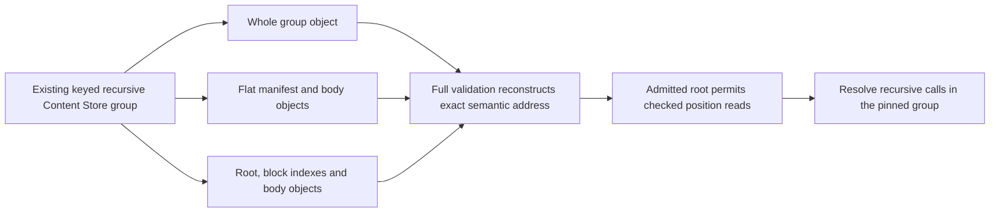

# RT-05 — Compare physical layouts for one recursive group identity

A blocked member index cuts a local edit from 44,495 new bytes to 2,688 in a 256-member recursive group. All members and the outside caller still obtain new semantic addresses. Independent member storage changes the physical cost without granting safe execution reuse to an unchanged local body.

## Question and scope

The [recursive identity prototype](RT-05-RECURSIVE-IDENTITY-EXPERIMENT.md) represents a strongly connected component as one immutable semantic value. A member address depends on that value, and the caller outside the component depends on the exact member. The [acyclic granularity study](RT-05-SPG-OBJECT-GRANULARITY-2026-11-24.md) compares physical decomposition for independent values and expressions. This study asks how much data can be shared for a recursive component while keeping the same group and member identities.

The generated fixture uses a ring of 8, 64 or 256 members. Every member emits a payload and calls the next member through its group position. One member also reads an exact external leaf value. The observer stops at the chosen fuel count. The edits independently rename and reorder display declarations, change one body payload, rebind that leaf to a new exact value, or rotate the stable member slot keys. The slot rotation reorders the manifest and changes the keyed identity while preserving the tested execution from the corresponding logical entry.

## Alternatives and admission

Three archives represent each exact group. Whole stores every ordered body with the header. Flat stores bodies separately and pins their ordered digests directly in the root. Blocked groups the digest vector into blocks of 16, then pins those blocks in the root. This is a physical index over the same semantic group.



Full admission checks every referenced physical digest, rebuilds the semantic address with the existing Content Store and binds the physical root to that address. It uses a temporary store containing the exact external leaf prerequisites. Subsequent reads start with the admitted root and recheck each accessed digest. The admitted root can be carried separately from the blobs. An execution following a recursive position resolves it in that pinned group. The local token alone does not identify the compiled callee semantics.

## Results

| Metric at 256 members | Whole | Flat | Blocked |
| --- | ---: | ---: | ---: |
| Base stored objects | 1 | 257 | 273 |
| Full admission, bytes | 44,494 | 61,391 | 62,482 |
| Admitted one-step read, bytes | 44,494 | 17,589 | 2,585 |
| Admitted full-cycle read, bytes | 44,494 | 61,391 | 62,482 |
| Display rename, new bytes | 0 | 0 | 0 |
| One body edit, new bytes | 44,495 | 17,692 | 2,688 |
| Exact provider edit, new bytes | 44,494 | 17,691 | 2,687 |
| Slot rotation, new bytes | 44,494 | 61,391 | 62,482 |

All 45 archives reconstruct the exact existing semantic group. All 405 execution comparisons match an independent ring oracle. Byte counts are uncompressed unique group-archive bytes, excluding outer callers and separately stored external dependencies. Each edit starts from the base archive. A post-admission read starts with no object bytes in its local cache and assumes an already verified root. Full-cycle execution reads the whole group in all three layouts.

Changing a member body, exact provider or keyed slot arrangement changes all 256 member addresses and the outside caller address. The body-edit control retains the same entry body digest. A call chain from that entry still reaches the changed member. Reusing its trace by local digest would return the old observation. Three negative controls per size reject a stale admission, a missing body, and a recombined archive that has valid physical digests but reconstructs the wrong semantic group.

## Implications and limits

Whole storage has the lowest total bytes and the simplest cold validation in this fixture. Flat or blocked storage can reduce writes and transfer for localized work. Blocked storage spends more on complete admission and rewrites the full index when slot rotation changes all block assignments. Choosing a physical layout needs a workload that distinguishes sparse edited reads and full graph admission. Cache identity must still express the pinned recursive context or separately checked sufficient dependencies.

The corpus uses keyed scalar members, leaf external dependencies and a fixed block size. It leaves structural-group member rearrangement, authenticated admission receipts, native Git packing, latency, failure recovery, representative workloads and independent review open. It does not choose a production layout or a canonical identity policy.

## Reproduce

Use CPython 3.12.14. The ledger records exact group and archive roots, source hashes, byte counts and independent trace witnesses.

```sh
fixture=research/semantic-representation/RT-05/RECURSIVE-STORAGE-01
output=$(mktemp)
python3 -B "$fixture/run.py" > "$output"
cmp "$fixture/evidence.json" "$output"
python3 "$fixture/chart.py"
```

[Archive layouts and admission](RECURSIVE-STORAGE-01/archive.py) · [Corpus and oracle](RECURSIVE-STORAGE-01/run.py) · [Evidence ledger](RECURSIVE-STORAGE-01/evidence.json)
