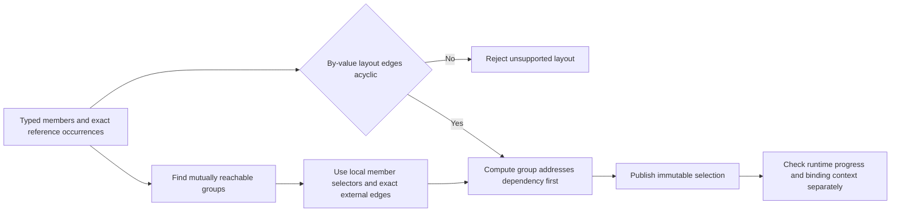

# RT-05 representation of recursive and mutually dependent SPG values

Exact reference cycles cannot be published by hashing each member with its neighbors' final hashes. The candidate represents a cycle as a simultaneous typed group with internal member references and exact references to external groups. It checks storage layout and executable recursion as separate questions. The model compares 19,683 small typed graphs and reconciles earlier studies on structural equality, canonicalization and physical layout.

## Group and admission rules

1. Extract exact references from the resolved typed declarations. Group mutually reachable members into strongly connected components (SCCs). A singleton with a self-reference is recursive. Condense the graph to a directed acyclic graph of components.
2. Bind a group to the declared semantic/profile version. Assign selectors through an explicit-key or checked structural canonicalization policy. Internal edges use local selectors. External edges use the exact destination group and member. Include edge role, direction, multiplicity and executable occurrence order where the profile observes them.
3. Hash each group after its external dependencies. Selected executable members refer to the group address plus their selector. A group edit changes every member address in the edited group and all exact transitive dependents. Physical storage can reuse unchanged blocks while publishing a new logical group.
4. Check type-layout admissibility before making the group executable. In the tested type profile the subgraph of by-value fields must be acyclic. A guarded indirection has its own fixed-size representation and may cross a recursive cycle. Distinguish nominal identity, finite declaration topology, and equality of guarded unfoldings. Each answers a different question.
5. Operation-dispatch recursion can arise through snapshot bindings without an exact-call cycle in the body references. Pin the context, validate typed dispatch, and check the separately required progress or termination policy. Group integrity alone supplies no termination claim.



The group candidates have different identity trade-offs. DAG-only publication is a useful restricted profile. Explicit keys keep symmetric members distinct but require stable key policy. Structural canonicalization can support rename-invariant identity, with separate occurrence identifiers for provenance. Ordered traversal has a stable construction on its admitted edge shape. Its bytes differ from the general exhaustive permutation encoding at a known 11-member example, so the two profiles need distinct domains. Unordered symmetry requires an exact tie resolution or an explicit refusal under a resource budget. Color refinement by itself has checked collisions. [Ordered traversal](RT-05-ORDERED-SCC-CANONICAL-TRAVERSAL-2026-11-24.md) · [Unordered canonicalization](RT-05-UNORDERED-RECURSIVE-CANONICALIZATION-2026-11-24.md)

## Checks and results

The three-key fixture admits one edge state per ordered pair, including self-pairs. An edge can be missing, guarded, or by-value. Layout elimination agrees with an independent simple-cycle oracle on all 19,683 graphs. The oracle checks only by-value cycles when deciding layout. Of the 3,968 admitted graphs, 3,859 have a recursive cycle when guarded edges are included. A total of 15,715 graphs fail layout. For every admitted graph, reversing input edge enumeration preserves the group digests.

For each admitted graph a separate payload edit changes one member at a time. Actual group-address changes agree with independent reverse reachability in all 11,904 cases. An edit changes one member address in 1,728 cases, two in 2,160, and all three in 8,016. The fixed graph topology excludes regrouping when an edge is added or removed. The fixture's explicit keys and bounded labels supply group ordering. It does not test a general structural canonicalizer.

Earlier controls complement the fixture.

- Guarded recursive shapes need a precise equality policy. Unfolding equality and finite topology equality can disagree while nominal wrappers remain distinct. [Guarded recursive type study](RT-05-GUARDED-RECURSIVE-TYPE-IDENTITY-2026-11-24.md)
- Reversing directed roles, erasing repeated edges or reordering observable occurrences can collapse distinct exact structures. Independent measurements preserve both graph roles and execution order. [Directed roles](RT-05-DIRECTED-RECURSIVE-ROLES-2026-11-24.md) · [Ordered recursive occurrences](RT-05-ORDERED-RECURSIVE-OCCURRENCES-2026-11-24.md)
- Whole, flat and blocked storage admit the same exact group under independent validation. In the 256-member storage fixture a local edit requires 44,495, 17,692 or 2,688 newly written bytes while the same 257 semantic addresses change. [Recursive group storage](RT-05-RECURSIVE-GROUP-STORAGE-2026-11-25.md)

## Verify and limits

The [runner](RECURSIVE-BOUNDARY-01/check.py) validates the bounded topology and hashes six relevant source ledgers at `a75fc77de15d7bbe18ea7f990d1d730c9db6d5af`. The [ledger](RECURSIVE-BOUNDARY-01/evidence.json) uses CPython 3.12.14 and Git 2.56.1. Hash seeds 37 and 71 give identical bytes. The counts are exact finite enumerations.

```bash
fixture=research/semantic-representation/RT-05/RECURSIVE-BOUNDARY-01
PYTHONHASHSEED=37 python3 -B "$fixture/check.py" > /tmp/llmlang-recursive-boundary.json
cmp "$fixture/evidence.json" /tmp/llmlang-recursive-boundary.json
```

The representation candidate establishes separations among mutually dependent meaning, layout safety and selective physical reuse. Full type-system admissibility, a portable canonical group encoding, authority for member lifetimes, invalidation after edge changes and whole-program progress remain open.
