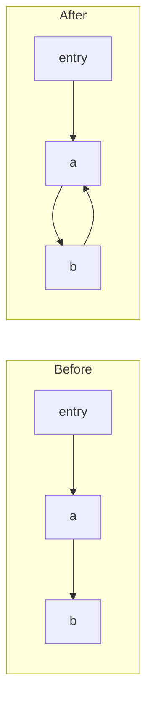

# RT-05 — Recursive addresses across group splits and merges

## Question and method

When one call edge is added or removed, do the existing recursive addressing schemes invalidate exactly the callers whose reachable definition graph changed? The [recursive identity prototype](RT-05-RECURSIVE-IDENTITY-EXPERIMENT.md) compares a keyed group with a structural group and has focused cycle removal and canonicalization controls. This sweep covers both directions of every one-edge edit for a complete small topology family. [PLAN §1.2](../../../PLAN.md#12-semantic-identity-hashes-and-canonical-encoding) · [#289](https://github.com/aivibeflow/LLMLang/issues/289) · [LL-005](../../../PLAN.md#ll-005--define-hash-relevant-dependency-edges-and-cycles)

The fixture has three operation slots `a`, `b`, `c`, a fixed entry calling `a`, and an independent root. It enumerates all 512 directed graphs on the three slots, including self edges. A body contains a visible slot tag and a canonical order of outgoing calls. The tags prevent symmetry from obscuring name-sensitive observations. A strongly connected component (SCC) is a group whose members can all reach one another. The production candidate is outside this scope. The existing [prototype](../../PROTOTYPES/DEPENDENCY-GRAPH-01/src/recursive_identity.py) publishes each recursive component with internal call positions and exact external references.

An independent forward-reachability oracle compares each selected root's reachable labelled rows and ordered references. It does not use the prototype's SCC finder or digests. A bounded interpreter records the nested slot visits with a four-step fuel limit as an observation control. After publishing all states, the fixture retrieves each historical address from the same in-memory store.



Adding the return edge from `b` to `a` merges their two components. The entry's own body stays the same, but it can now visit `a` a second time. Removing the edge splits the component and restores the earlier reachable graph. This exact example and both generated address pairs are in the ledger.

## Results

The 4,608 directed edits include 720 SCC merges, 720 SCC splits and 3,168 unchanged partitions. Each edit compares five roots, giving 23,040 root comparisons. The reachable graph changes in 2,624 root comparisons on merges, 2,624 on splits and 8,576 on unchanged partitions.

| Address rule | Retained | Changed correctly | Stale | Unnecessary change |
| --- | ---: | ---: | ---: | ---: |
| Keyed SCC | 9216 | 13824 | 0 | 0 |
| Structural SCC | 9216 | 13824 | 0 | 0 |
| Local body only | 9216 | 4608 | 9216 | 0 |
| Whole snapshot | 0 | 13824 | 0 | 9216 |

The local body leaves 9,216 stale addresses and the bounded interpreter observes a different trace in each. The whole snapshot invalidates every root, including the independent root and other unchanged closures. Both SCC schemes agree with the reachable-graph oracle on every comparison and retain all 2,161 distinct historical addresses. The shared store contains 2,839 exact content objects after publishing all graphs in both modes.

## Implications and limits

When exact calls commit to their transitive implementation references, a topology edit may invalidate an unchanged local body. Computing group boundaries again and publishing the condensation DAG accommodates SCC splits and merges in this finite family. Retained old values support reusing an earlier exact selection while a current graph selects the new addresses. This fixture does not test publication atomicity, rooted equivalence for unlabelled or symmetric bodies, general recursive semantics, or scale beyond three variable slots. The structural search limit and the canonical production format remain open.

## Reproduce

The baseline was `3de38b661549d2115fe733ec20a613968d031a5e` on `research/all`. The run used CPython 3.12.14 on Debian 13 x86-64 Linux 6.18.57. The [ledger](RECURSIVE-TOPOLOGY-EDITS-01/evidence.json) pins the original prototype sources by SHA-256 and records the exact edge family, comparison counts and worked witness. Run from the repository root:

```sh
fixture=research/semantic-representation/RT-05/RECURSIVE-TOPOLOGY-EDITS-01
out=$(mktemp)
python3 -B "$fixture/run.py" > "$out" &&
  cmp "$fixture/evidence.json" "$out" &&
  python3 -B "$fixture/chart.py" &&
  (cd research/PROTOTYPES/DEPENDENCY-GRAPH-01 &&
    python3 -B -m unittest -q tests.test_recursive_identity tests.test_semantic_graph)
```

The 19 focused prototype tests passed. The [runner](RECURSIVE-TOPOLOGY-EDITS-01/run.py) regenerates every graph and observation deterministically, and the [table generator](RECURSIVE-TOPOLOGY-EDITS-01/chart.py) renders the categorical comparison.
