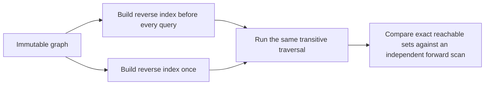
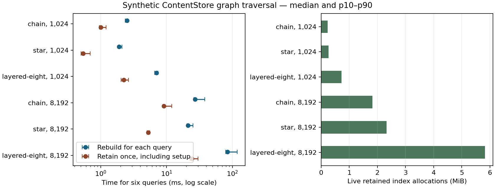

# RT-05 semantic graph size and repeated reverse traversal

The current in-memory `ContentStore.dependents` rebuilds its reverse dependency index for each query. An immutable graph allows one index to serve repeated queries over the same value set. This pilot measures the one-time work and additional memory of retaining that index. It reuses the prototype's traversal in both routes. [ContentStore](../../PROTOTYPES/DEPENDENCY-GRAPH-01/src/semantic_graph.py)



A chain and a star each have \(N-1\) edges. The layered graph connects every node after the first layer to all eight nodes in the previous layer. Each topology is measured at 1,024 and 8,192 nodes, with six fixed queries from the root through the last position. Each query returns transitive dependents. A separate forward topological scan predicts each reachable set. The retained route delegates to the existing traversal over one index and assumes the store stays immutable for the batch.

## Measurement

Ten trial blocks visit the six profiles in randomized order. Each profile starts a new process, with the two routes measured in randomized order inside the process. Graph construction and index construction have separate timers. The retained route is reported both for the query batch alone and with one index build added. The repeated-rebuild route includes index construction in every query. Both routes run in the same prepared process with the original graph and one retained index present. This paired setting fixes graph identity and locality for the trial. Validation and output hashing are outside the timed boundaries.

Measurements use logical CPU 4 on an AMD EPYC 9V74 under Linux 6.18.57 and CPython 3.12.14. The cgroup recorded no throttled periods. Python live allocations come from a separate traced build with the store and ordered hash list retained. Index retention is the live allocation increase when adding the reverse index. The process RSS high-water is measured before tracing and includes both routes and validation. [Trial metadata](REVERSE-TRAVERSAL-01/evidence/config.json)

| Graph | Nodes | Edges | Rebuild per query, ms per batch | Retained including setup, ms per batch | Live store / extra index, MiB |
| --- | ---: | ---: | ---: | ---: | ---: |
| Chain | 1,024 | 1,023 | 2.51 | 1.00 | 0.42 / 0.23 |
| Star | 1,024 | 1,023 | 1.90 | 0.54 | 0.42 / 0.26 |
| Layered eight | 1,024 | 8,128 | 7.02 | 2.23 | 1.13 / 0.72 |
| Chain | 8,192 | 8,191 | 27.25 | 9.14 | 3.38 / 1.82 |
| Star | 8,192 | 8,191 | 21.23 | 5.25 | 3.38 / 2.32 |
| Layered eight | 8,192 | 65,472 | 84.04 | 24.26 | 9.06 / 5.82 |

Each table entry is a median over ten trials. The per-pair median speedup including setup ranges from 2.44× to 4.08× across the six profiles. The summary includes p10 and p90, process RSS, payload bytes, build time and a seeded 2,000-resample paired bootstrap interval for each median ratio. Ten samples describe each synthetic profile on this runner. Host system and workload variation beyond the measured profiles remain open.



The retained path and fresh index path both match all 360 independent query expectations. Equal edge counts do not imply equal traversal work. In the star, most queries reach no other nodes, while many chain queries reach long suffixes. The extra retained index allocation is workload dependent. Snapshot mutation, persistent index layout and lifetime, shared or concurrent access and representative project graphs require further study. [Raw samples](REVERSE-TRAVERSAL-01/evidence/samples.csv) · [Summary](REVERSE-TRAVERSAL-01/evidence/summary.json)

## Reproduction

Use CPython 3.12.14 and Matplotlib 3.10.8 on Linux with cgroup CPU accounting. Choose a CPU in the runner's permitted affinity. The raw measurements vary across runs.

```sh
study=research/semantic-representation/RT-05/REVERSE-TRAVERSAL-01
build=$(mktemp -d)
LC_ALL=C PYTHONHASHSEED=37 PYTHONDONTWRITEBYTECODE=1 python "$study/measure.py" \
  --cpu 4 --trials 10 --seed 20261125 --output "$build/evidence"
LC_ALL=C MPLBACKEND=Agg MPLCONFIGDIR="$build/plot-cache" python "$study/summarize.py" \
  --evidence-dir "$build/evidence"
```

[Collector](REVERSE-TRAVERSAL-01/measure.py) · [Summary and chart generator](REVERSE-TRAVERSAL-01/summarize.py)
