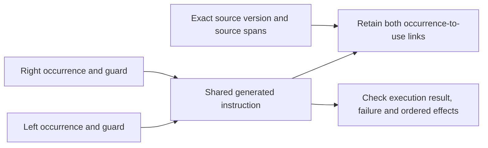

# RT-05 — Track multiple source occurrences behind one generated instruction

## Question and method

When two source occurrences share a generated instruction, what must an SPG preserve for execution and for source provenance? The [source-occurrence study](RT-05-SOURCE-OCCURRENCE-EVIDENCE-2026-11-25.md) distinguishes source spans even when typed graph bytes match. This experiment adds a many-to-one generated mapping and tests two possible execution strategies for sharing. The baseline is `9f6a3d96c086b38113ba2427a2efd832d8fd127d` on `research/all`.

A two-line synthetic grammar evaluates the same operation at two independently guarded slots. The baseline evaluates each occurrence at its slot. Lazy sharing evaluates at the first reached occurrence and reuses that result. Eager sharing evaluates before either guard. The observed result includes both slot values, the error or return outcome, and any ordered payload log. Profiles distinguish a pure total expression, a deterministic expression that rejects negative arguments, an operation that emits observable output, and a read separated from its next occurrence by a write.



The runtime experiment checks preservation independently of the mapping experiment. The mapping binds two source occurrence identities and spans to the same target instruction, with both exact source and generated artifact identities.

## Results

Each strategy was compared with the baseline on all 20 combinations of five integer values and both Boolean guards.

| Profile | Lazy sharing mismatches | Eager sharing mismatches |
|---|---:|---:|
| Pure total computation | 0 | 0 |
| Pure deterministic operation with a partial domain | 0 | 2 |
| Observable emit | 5 | 10 |
| Read across an intervening write | 5 | 10 |

Eager sharing can raise an error before an occurrence would be reached. Lazy sharing preserves the observed partial case because the first computation remains guarded, while the successful repeat is deterministic for the same input. Emission sharing removes an observable event when both guards hold. Eager emission can also add an event when neither guard holds. The read profile needs the changed input from the intervening write, even though both source occurrences use the same spelling. [First mismatches and exact counts](SHARED-INSTRUCTION-PROVENANCE-01/evidence.json)

Three formatting variants parse to the same typed graph and use the same generated instruction identifier. Their source identities and spans differ. The exact checker rejects a one-span map, swapped spans for textually identical expressions, a wrong target identity, and a stale source revision. It accepts the current source's two occurrence links. As a boundary control, it also accepts an exact map for a deliberately different target operation. The map can establish which target instruction a source occurrence is linked to. The execution check supplies separate evidence that the linked transformation preserves semantics.

For LLMLang, generated sharing can retain both source identities while choosing a single executable value. A source-map receipt needs source revision, occurrence identity and exact target identity. A separate transformation receipt needs evaluation context, effects, failure and the input state relevant to the shared value. This closed synthetic grammar leaves general compiler extraction, native code correspondence, runtime cost and concurrency open. [RT-05 tracking](https://github.com/aivibeflow/LLMLang/issues/288)

## Reproduction

Use CPython 3.12.14. The [runner](SHARED-INSTRUCTION-PROVENANCE-01/run.py) records exact source variants, target structure, scope and the first mismatch in each profile. All counts and mapping results are asserted. Hash seeds 1 and 2 produced byte-identical output. The diagram was checked as Mermaid source.

```bash
fixture=research/semantic-representation/RT-05/SHARED-INSTRUCTION-PROVENANCE-01
LC_ALL=C PYTHONHASHSEED=1 python3 -B "$fixture/run.py" > /tmp/llmlang-rt05-shared-instruction.json
cmp "$fixture/evidence.json" /tmp/llmlang-rt05-shared-instruction.json
```
