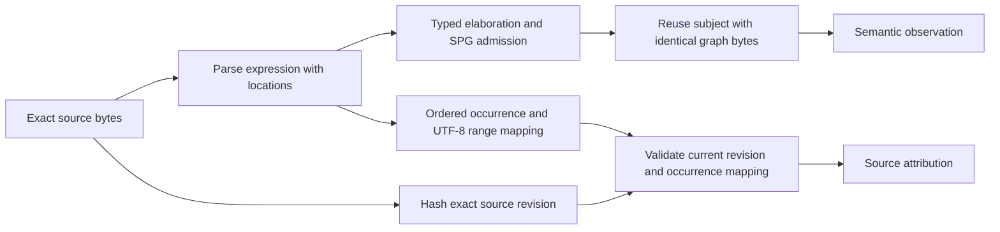

# RT-05 — Reuse semantic graphs across formatting edits and revalidate source locations

**Scope:** PLAN §1.1 and [#288](https://github.com/aivibeflow/LLMLang/issues/288). Bounded scalar SPG experiment using components pinned at `655553342a713c1f1dab611d8c8c4cecb9c4c043`.

A formatter can change source offsets without changing an executable semantic graph. A separate question arises when two occurrences have the same text: even a range in the correct source revision can point to the wrong one. This study compares equality of typed graph bytes with source-location validation for two operation calls in an ordered expression. The result informs which evidence may follow a semantic cache hit.

## Model and variants

The fixture implements `op("provider", x) + op("provider", x)`. The selected provider emits `tick` and returns `x + 2`. Two operand positions, left and right, identify the ordered call occurrences within this implementation. A range is a half-open UTF-8 byte interval `[start, end)` in the original source. A *lexeme check* compares the digest of the source bytes in each indicated range with the digest recorded for that occurrence.

Six layouts vary spacing, a trailing comment, line breaks, non-ASCII comment text and CRLF line endings. They keep the same operations, declaration names, provider binding and call arguments. A test adapter parses the source into a Python expression AST and translates via the [existing expression lowerer](../../PROTOTYPES/DEPENDENCY-GRAPH-01/src/spg_representation.py), using the prototype's typed prefix entry point. The provenance adapter reads the original parser locations before lowering. It uses the exact raw line lengths to convert CPython's UTF-8 byte columns into absolute byte ranges. The generator independently knows both intervals from the positions of the chunks it joins. This extension permits Unicode comment text for the study and leaves the existing ASCII-only public infix profile unchanged.



The two outputs answer different questions. Runtime graph evaluation needs the exact semantic input, including the selected provider in this fixture. Source attribution needs a location in the exact revision and evidence tying it to the ordered occurrence.

## Results

All six layouts yield byte-identical admitted graphs, with 30 successful value-and-trace checks across five inputs per layout. The independent expected result is `2x + 4` and the trace contains two ticks. The runner then compares all 36 ordered pairs of layouts. Six pairs use the same source bytes and 30 cross source revisions.

| Check | Outcome |
| --- | --- |
| Same typed graph across revisions | 30 / 30 cross-revision pairs |
| Old offsets differ from fresh offsets | 28 / 30 cross-revision pairs |
| Old range lexemes still match in the new source | 2 / 30 cross-revision pairs |
| Exact source digest admits stale mapping | 0 / 30 cross-revision pairs |
| In-revision mapping passes full check | 6 / 6 same-revision pairs |
| Character-counted line starts disagree with the byte oracle | 2 / 6 layouts |

The two cross-revision lexeme matches are the compact source and the source with a trailing comment, in both directions. Current offsets happen to coincide. Reuse of the old receipt would still attribute the observation to the wrong source revision. For the two Unicode layouts, counting prior lines in characters sends at least one range to a wrong byte offset even though the parser reports correct UTF-8 columns. This comparison covers absolute byte coordinates through LF and CRLF. Editor position encodings such as UTF-16 require their own conversion.

A separate control swaps the two ranges in a correct compact-source receipt. Both ranges are in bounds, their lexemes match and the graph and source digests are correct. Independent occurrence checks reject the swap. The same lexeme check *does* reject a swap when one call's written argument is changed to `x + 1`. That change also makes the graph bytes different and changes each result by one while preserving the ordered trace. Identical text removes a signal that a source mapping sometimes has, so an integrity check over equal text cannot recover the occurrence association.

## Trade-offs and limits

An SPG-keyed cache allows semantic observations to survive these formatting changes. Storing offsets in the graph key would force six identities for the same semantic subject. A separately versioned map can refresh offsets after a semantic hit. Binding the source digest and checking that a range points to the expected lexeme catches stale revisions and many location mistakes. It needs additional occurrence evidence when snippets are identical. In this fixture, re-running the same parser adapter, checked against the assembly oracle, supplies that evidence.

The ordered left/right key is scoped to one expression shape and one implementation. The observed mapping does not establish a production occurrence identifier for shared subexpressions, macro expansion, inlining, nested calls, multiple files, regenerated source or optimized binaries. The [RT-13 DWARF fixture](../../compiler-and-translation/RT-13/RT-13-DWARF-CALLBACK-SOURCE-ORIGINS-2026-11-24.md) addresses native instruction attribution under separate assumptions. The [RT-31 profile comparison](../../language-design/RT-31/RT-31-CROSS-PROFILE-SPG-2026-11-24.md) checks cross-syntax graph preservation. Production source-to-SPG correspondence, IDE position transforms, independent review and a canonical source-map format remain open.

## Reproduce

Run from the repository root using CPython 3.12.14 and a checkout containing the pinned revision. The runner verifies exact imported prototype source digests, graph bytes, logical call ranges and the independent value-and-trace oracle. The [ledger](SOURCE-OCCURRENCE-01/evidence.json) stores all source strings, byte ranges, pairs, result vectors and control outcomes. Mermaid syntax was inspected directly. This experiment measures no elapsed time.

```sh
fixture=research/semantic-representation/RT-05/SOURCE-OCCURRENCE-01
LC_ALL=C PYTHONHASHSEED=1 python3 -B "$fixture/run.py" > /tmp/llmlang-source-occurrences.json
cmp "$fixture/evidence.json" /tmp/llmlang-source-occurrences.json
```
