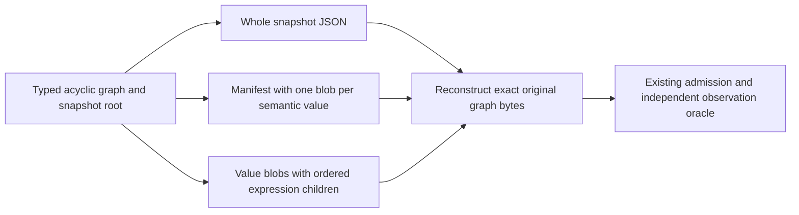

# RT-05 — Snapshot, value and expression granularity for SPG storage

- **Evidence** — Byte-exact archive reconstruction and independent observations in a synthetic typed SPG corpus.
- **Baseline** — `b656c000a3befe7fb609cd1e905711ff64799435`.
- **Tracking** — [PLAN §1.1](../../../PLAN.md#11-semantic-program-graph-and-program-representation) · [LL-006](../../../TODO.md#ll-006--decide-artifact-granularity-for-the-initial-spgstore) · [Typed SPG granularity proposal](RT-05-TYPED-SEMANTIC-PROGRAM-GRAPH.md#6-artifact-granularity-and-trade-offs).

## Experiment

How much raw storage must three artifact boundaries write to retain a new graph version, and which boundaries preserve reusable structure? This experiment projects the existing closed scalar SPG into three different, content-addressed storage layouts. Each layout reconstructs the original serialization, including the exact value identities, snapshot selections, and typed call vectors. A storage hash addresses bytes within this experiment. The original SPG retains its own semantic identity rules.



The whole snapshot stores exactly the existing deterministic JSON export. Value storage stores a manifest and one blob per stored semantic value, including callable-sized implementations. Expression storage uses the same manifest boundary and extracts ordered subexpressions from implementation payloads into shared blobs. Every expression child remains ordered. The implementation record still holds the enclosing interface and the exact call reference vector. Each archive digest is checked during reconstruction before the existing graph persistence and typed admission checks. [Existing persistence](../../PROTOTYPES/DEPENDENCY-GRAPH-01/src/persistence.py) · [Existing typed admission](../../PROTOTYPES/DEPENDENCY-GRAPH-01/src/spg_admission.py)

The corpus has 12, 32 or 64 entry functions and two providers. Entries exercise exact calls to either provider and calls resolved through a binding. They share an arithmetic subtree and emit two ordered events. The six versions at each size are a baseline, a parameter rename, a local body edit, a shared provider edit, an operation rebind, and reordering two effectful operands. Inputs are `-2`, `0` and `5` for every entry. The independent oracle computes the expected result and ordered events from fixture parameters.

## Results

All 54 archives restored the exact original graph bytes. All 5,832 observations agreed with the independent oracle. The table shows the largest fixture. Each edit starts from the same baseline. New bytes count only objects absent in that layout's baseline and include its new manifest. Baseline bytes and object counts include all required stored objects.

| Case, 64 entries | Whole snapshot, bytes | Per-value, bytes | With expression blobs, bytes |
| --- | ---: | ---: | ---: |
| Baseline total | 139,101 | 152,401 | 140,352 |
| Baseline object count | 1 | 202 | 226 |
| Parameter rename, new bytes | 0 | 0 | 0 |
| One body edit, new bytes | 139,101 | 27,076 | 27,153 |
| Shared provider edit, new bytes | 139,101 | 47,107 | 42,259 |
| Rebind, new bytes | 139,101 | 26,582 | 26,587 |
| Reordered effects, new bytes | 139,101 | 27,076 | 27,013 |

The whole snapshot uses one object and the fewest baseline bytes. Per-value storage reduces new bytes for scoped changes while adding many independently addressable objects. Sharing expressions saves 12,049 baseline bytes compared with per-value storage and saves 4,848 new bytes on the shared provider edit. It spends 77 extra bytes on the local body edit when each changed expression ancestor receives a new blob. The size of the rewritten top-level manifest still affects both split layouts.

Two entries reference the same physical open-expression blob but have different exact provider pins. At input zero they return different values. This control separates structural sharing from using a blob address as an execution cache key. Cache evidence would need the local typing and reference context and, for operation calls, the relevant resolved binding. Two additional controls remove or corrupt the shared expression blob and require reconstruction to fail.

## Implications and limits

Callable-sized values are a baseline for a content-addressed implementation with scoped changes. Expression decomposition is an option for repeated subtrees when expected byte savings justify more objects and when their enclosing execution context stays explicit. The whole snapshot remains useful as an interchange envelope and a simple baseline. The choice is workload sensitive. This experiment has repeated synthetic subtrees and a flat manifest. It leaves other artifact types, recursive implementations, compression, database or Git packing, I/O overhead, latency and representative workloads open. [Git textual layout comparison](../../toolchain-and-collaboration/RT-24/RT-24-CANONICAL-GIT-LAYOUTS-2026-11-24.md)

## Reproduction

Run from the repository root with CPython 3.12.14. Five Python hash seeds give byte-identical [machine-readable results](SPG-GRANULARITY-01/evidence.json). [Archive layouts](SPG-GRANULARITY-01/archive.py) · [Corpus and oracle](SPG-GRANULARITY-01/verify.py)

```sh
study=research/semantic-representation/RT-05/SPG-GRANULARITY-01
PYTHONHASHSEED=1 python3 -B "$study/verify.py" > /tmp/llmlang-rt05-granularity.json
cmp "$study/evidence.json" /tmp/llmlang-rt05-granularity.json
(cd research/PROTOTYPES/DEPENDENCY-GRAPH-01 && python3 -B -m unittest \
  tests.test_spg_representation tests.test_spg_admission tests.test_semantic_graph tests.test_persistence)
```
