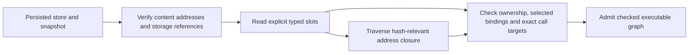

# RT-05 Stored, reachable and selected values in a typed SPG

**Issue** [#288](https://github.com/aivibeflow/LLMLang/issues/288)

A content-addressed store can retain many versions of a semantic value. An exact dependency can also reach a value that does not have a selected slot in the requested snapshot. A typed SPG needs to specify which distinctions determine admission. This fixture uses the existing acyclic scalar graph with both late and exact calls. [Typed Semantic Program Graph](RT-05-TYPED-SEMANTIC-PROGRAM-GRAPH.md) · [Stored graph admission](RT-05-TYPED-SPG-IMPORT-VALIDATION.md)

## Candidate boundary

A stored value is a kind, canonical payload and immutable typed dependency list with an exact address. A selected value is the target of at least one typed slot in the snapshot. Hash reachability follows semantic dependency edges from all selected addresses. A selected slot can require an address of a specific kind, and multiple slots can name the same value. A body names its exact owning operation. The prototype requires that operation in the selected operation table. A late call needs a selected binding for its operation. An exact call names a particular implementation and the scoped admission checker requires that address in the selected implementation set.



The diagram shows that the storage and typed checks answer different questions. Closure establishes that a path exists to its exact bytes. The admission rules also ask whether that target is selected for the required role. A more permissive design could authorize some history objects by reachable address without a selected slot, but it would need explicit rules for ownership, authorization and historical retention. Conversely, requiring every stored value to be selected would lose useful archived values and shared storage. The scoped prototype keeps the checks separate.

## Evidence

The [ledger](SPG-SELECTION-BOUNDARY-01/evidence.json) preserves 14 archived variants, exact roots and the stored, reachable and selected membership of key addresses. Thirteen variants pass persistence. Seven also pass typed admission, six fail typed admission, and one fails persistence before typed admission. Only typed-admitted variants are interpreted, on inputs −2, 0 and 3.

| Control | Observed outcome |
| --- | --- |
| Drop an unused provider's slot | Its bytes may remain stored and become unreachable. The selected program still admits. |
| Remove those unreachable bytes physically | The archive digest changes and the previous selected root and observations remain equal. |
| Rename or add an implementation slot with the same exact provider | The slot change affects the snapshot root and leaves its exact provider available. |
| Keep one of two aliases to the same contract | The remaining exact selected contract suffices. Removing both aliases fails typed operation admission. |
| Remove the late binding while preserving its call body | A physically retained binding has no selection. Typed admission refuses. |
| Remove both the late binding and late body | The remaining exact-call route admits and preserves its checked result and trace. |
| Deselect one reachable provider used by a binding or standalone pin | The address remains stored and reachable. Both cases fail at typed selection checks. |
| Deselect an owning operation or select an operation under an implementation slot | Persistence preserves the bytes, while typed admission refuses the role mismatch. |
| Remove the bytes of a required provider | Persistence refuses the dangling reference even after the outer checksum is recomputed. |

This bounded comparison shows why the graph snapshot should declare its active selections independently of the physical archive. Reachability and selection can drive distinct retention and execution decisions. The rules here come from the existing acyclic compiler and checker. General recursive groups, nominal continuity, closed source inventories, caller conformance, external provider lifecycle and normative scope remain open. The measurements are exact counts and result/trace pairs, with no timing data.

## Reproduction

Use CPython 3.12.14 and Git from repository root. The runner verifies the graph compiler, checker and persistence fixture at `f62bdbced7488ecf244f3028dd51826c5ddfd3b0`. Runs with hash seeds 1 and 2 produced byte-identical ledgers. Relative links and Mermaid source structure were checked. GitHub visual rendering was not manually verified.

```sh
study=research/semantic-representation/RT-05/SPG-SELECTION-BOUNDARY-01
PYTHONHASHSEED=1 python -B "$study/run.py" >/tmp/llmlang-spg-selection.json
cmp "$study/evidence.json" /tmp/llmlang-spg-selection.json
```
