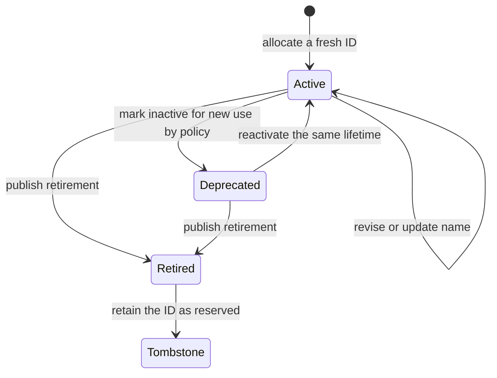

# RT-05 stable-ID lifecycle and candidate catalog publication

A stable ID follows a managed operation lifetime. An immutable operation hash identifies one semantic revision, and a qualified catalog name resolves under a specific catalog revision. This candidate describes how those three records evolve and tests publication of fresh and retired identities in a simple compare-and-set model.

## Lifecycle and authority

Use a named catalog namespace and an authorized allocator. Create an ID by checking both live IDs and retained tombstones. Publish the new selection, alias changes and exact publication tuple in one transaction. That tuple records the namespace, stable ID, operation hash, causal publication revision and applicability scope. Revision of the operation can retain the stable ID and append a new exact publication. Renames and moves can update catalog names while retaining the original lifetime and hash if the call semantics are preserved.



Deprecation can preserve an exact current catalog record, with visibility and new-call policy explicitly stated. Reactivation is allowed before retirement. Retirement is terminal for the ID. A split or merge retires the consumed lifetimes and allocates fresh IDs for separately managed successors, with exact lineage records. Explicit replacement also uses a new lifetime. Replacement can reuse an available discovery alias or refer to the same immutable operation bytes. It never changes which exact publication an existing pin names. Whether a historical exact pin can execute after retirement is a separate archive policy. Retained bytes alone do not decide that.

When two publishers compete, each submits an expected catalog generation and exact authorizations for its retirement and allocation set. Publication is conditional on a freshness check, complete membership checks and an atomic generation update. Refusal preserves the previous catalog. After a conflict, re-evaluate all current input, authority, lineage and alias checks. Substitution of a newer generation alone cannot retire an already-consumed parent or allocate an already selected or tombstoned ID.

## Checks

The candidate authority model orders two requests from a set of six. They are a split, a merge, an attempt at a tombstoned ID, a duplicate successor list, an absent predecessor and missing authority. Both candidate structural edits use overlapping outputs and retire a shared ID. All 36 ordered pairs agree with the independent expected-result table. Twenty pairs contain one publication, and 16 contain none. Each published transition leaves live and retired sets disjoint and preserves all tombstones. None publishes twice. In the 20 retry controls after a publication, substituting the latest generation yields 18 conflicts and two pending outcomes. The requests have fixed, overlapping inputs. A genuinely revalidated independent update is outside this matrix.

The [operation lifetime study](RT-05-OPERATION-LIFETIME-2026-11-25.md) agrees with the exact published-pair resolution oracle for 112 historical lookups under both archive policies. It refuses 48 attempts to mutate or republish retired IDs. Current alias, latest ID and equal bytes each permit incorrect denials or destinations. The [typed transition study](RT-05-EVOLUTION-AND-LINEAGE-BOUNDARIES-2026-11-25.md) checks adjacent endpoint cardinality and retirement. The [multi-parent lineage study](RT-05-MULTI-PARENT-LINEAGE-2026-11-24.md) records the exact causal selection, which can matter even for equal terminal Git trees.

The explicit-ID design supports exact historical references and policy-controlled reuse. Globally allocating random identifiers still requires an admission policy for conflicting allocations and old imports. Exact operation hashes alone avoid an allocation service for immutable values but cannot express the separate lifetimes shown by the equal-value controls. A scoped catalog can coordinate managed allocations while continuing to address immutable values independently.

## Verify and limits

The [runner](STABLE-ID-PUBLICATION-01/check.py) and [ledger](STABLE-ID-PUBLICATION-01/evidence.json) use CPython 3.12.14 and Git 2.56.1 with three older ledgers pinned at `72afdd7055fb17bb7274ae9330aa6a32791fde4e`. Both hash seeds produce identical bytes. The candidate execution models atomic compare-and-set as one state transition. It does not exercise a live concurrent registry.

```bash
fixture=research/semantic-representation/RT-05/STABLE-ID-PUBLICATION-01
PYTHONHASHSEED=37 python3 -B "$fixture/check.py" > /tmp/llmlang-stable-id.json
cmp "$fixture/evidence.json" /tmp/llmlang-stable-id.json
```

Distributed allocation, authenticated retirement authority, alias reservation, historical retention and evidence revocation remain open. The final allocator, namespace and retirement policy require a project decision. [LL-002](../../../PLAN.md#ll-002--define-operation-stable-id-lifecycle)
