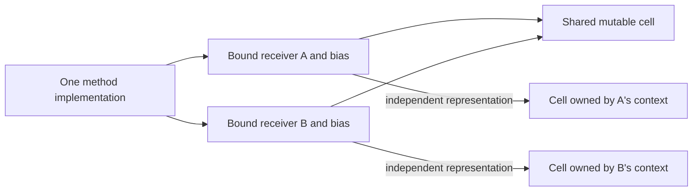

# Preserve receiver state in bound method identity

A generic method can select the same implementation while the bound receiver changes what a call returns or mutates. This experiment compares three descriptors for such a binding. It separates the method and type identity studied for specialization from the captured and shared state needed to reconstruct an executable receiver. [Native generic provider binding](RT-05-GENERIC-PROVIDER-BINDING-2026-11-25.md) · [Mutable reference topology](RT-05-MUTABLE-REFERENCE-TOPOLOGY-2026-11-25.md)

## Native model

Two selected receiver roles use one method definition. Each receiver has its own immutable integer bias and a reference to a mutable cell. The method supports reading the current value, adding the bias and input, and replacing the value. Each action reports the before and after values. The cells may be separate with equal or different numbers, or the two receivers may reference the same cell.

The C executable builds two dictionaries with one equal native function pointer and different context fields. The Rust executable builds two dynamic `Method` trait objects with equal concrete `TypeId` values. The Rust receiver owns an `Rc<Cell<i64>>`, while the C receiver references a stack cell with fixture-controlled lifetime. Each runtime independently confirms whether the receivers share a location. The two observed equality witnesses describe each runtime separately. No memory address or compiler-specific Rust type identifier enters the portable graph key.



The common method arrow identifies reusable code. The outgoing receiver edges determine where writes are visible. The two cells on the right can start with the same value while remaining separate locations.

The code-only descriptor contains the type and method and restores a default receiver environment when used as a complete snapshot. The value descriptor stores both biases and the current scalar value for each receiver, then reconstructs two independent cells. The exact descriptor gives each receiver a canonical reference into one shared table and stores each reachable cell once. Its JSON round trip restores the runtime binding from those references before native execution. Three corrupt graph controls refuse a wrong method, a missing cell and an unreferenced extra cell.

## Results

The corpus enumerates 108 contexts with three choices per bias or cell value, including 27 shared contexts. Five recipes use both receivers and compare mutation, reading and replacement. Every recipe starts with a new state. C at O0 and O2 and Rust at O0 and O3 each run 2,160 complete vectors across the raw and reconstructed inputs. All 8,640 native vectors match an independent Python state calculation and have the expected equality and alias witnesses.

| Descriptor | Recipe vectors changed | Distinct contexts sharing a key | Colliding pairs with different traces |
|---|---:|---:|---:|
| Method code and type | 527 | 5,778 | 5,778 |
| Receiver values with separate state | 135 | 27 | 27 |
| Bound method and shared cell table | 0 | 0 | 0 |

Trace differences compare each policy's 540 reconstructed vectors against the raw context. Identity compares all 5,778 distinct pairs of contexts. For two receivers initially observing 0 with zero biases, applying 2 through the first receiver gives it 2 in both representations. The second receiver subsequently reads 2 from a shared cell and 0 from a separate cell. The value descriptor gives the two cases the same key even though their native effect traces differ.

## Implications and scope

A method code key can support compilation reuse. An executable bound receiver snapshot also needs the admitted captures and any shared location relationships that affect later observations. The independent value representation remains suitable for receiver semantics that explicitly copy all state. For shared mutation, the explicit table agrees with the observed ordered effects and avoids collisions in the finite corpus. Changes to a live cell after snapshot capture still require a state version or another validated replay boundary.

This experiment covers two bound roles and one fixed method with bounded sequential arithmetic. It leaves general closures, lifetime or alias discovery from source, serialization of long-lived object identity across snapshots, concurrency, external effects, ABI adoption and independent review open.

Use CPython 3.12.14, Debian GCC 14.2.0-19 and Rust 1.85.1 at `4eb161250e340c8f48f66e2b929ef4a5bed7c181` with LLVM 19.1.7 on Linux x86-64. The initial LLMLang baseline is `6bf099cc937a95a170cdbcc074122cab13210f0c`. The ledger records exact sources, corpus, observations, keys, graph controls and variant differences.

```bash
fixture=research/semantic-representation/RT-05/STATEFUL-BOUND-METHOD-01
PYTHONHASHSEED=1 python3 -B "$fixture/run.py" > /tmp/llmlang-stateful-bound-method.json
cmp "$fixture/evidence.json" /tmp/llmlang-stateful-bound-method.json
python3 "$fixture/chart.py"
```

[Native C](STATEFUL-BOUND-METHOD-01/observe.c) · [Native Rust](STATEFUL-BOUND-METHOD-01/observe.rs) · [Oracle and projections](STATEFUL-BOUND-METHOD-01/run.py) · [Evidence](STATEFUL-BOUND-METHOD-01/evidence.json) · [Table generator](STATEFUL-BOUND-METHOD-01/chart.py)
