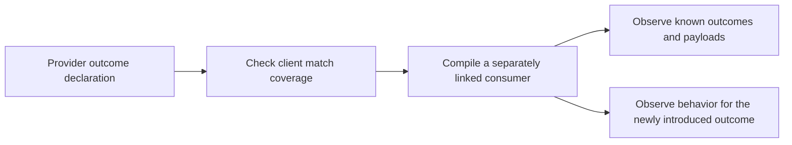

# RT-05 — Closed and extensible sum contracts

- **Date** — 2026-11-25
- **Tracking** — [PLAN §5.1](../../../PLAN.md#51-type-system-and-data-model) · [#324](https://github.com/aivibeflow/LLMLang/issues/324)
- **Status** — Reproduced Rust source compatibility and outcome classification

## Question and setup

What does an extensible outcome type require from independently compiled consumers when a new case appears? The fixture builds four Rust libraries. Both closed and `#[non_exhaustive]` first versions expose `Accepted(u8)` and `Denied(u8)`. Their second versions add `Deferred(u8)` for one of three input groups. The other two groups preserve their original variants and payloads. Five consumer source forms are compiled separately against each provider at O0 and O3. [Typed errors and API evolution](../../language-design/RT-04/RESEARCH-SCENARIO-41-TYPED-ERRORS-AND-API-EVOLUTION.md) · [Rust non-exhaustive attribute](https://doc.rust-lang.org/reference/attributes/type_system.html#the-non_exhaustive-attribute)

Consumers either name their known variants exhaustively or include a wildcard. The two older wildcard consumers distinguish an explicit unsupported outcome from a wildcard that claims success. The revised wildcard consumer names the new case and preserves a future unknown outcome.



## Results

| Consumer source | Closed v1 | Closed v2 | Extensible v1 | Extensible v2 |
|---|---|---|---|---|
| Exhaustive old arms | Admitted | Missing case | Wildcard required | Wildcard required |
| Old arms with explicit unsupported outcome | Admitted | Admitted | Admitted | Admitted |
| Old arms with wildcard success | Admitted | Admitted | Admitted | Admitted |
| Exhaustive revised arms | Variant absent | Admitted | Variant absent | Wildcard required |
| Revised arms with explicit unsupported outcome | Variant absent | Admitted | Variant absent | Admitted |

The matrix verifies 40 compile decisions. The 24 admitted executables match the separate outcome oracle for all 256 byte inputs each, giving 6,144 native observations. With a version 2 provider, the safe older wildcard reports 85 unsupported cases and preserves the known outcomes. The success wildcard labels the same 85 cases as successful. Across two provider forms and two optimizer levels, the latter produces 340 incorrect success classifications. [Evidence ledger](SUM-EXTENSION-01/evidence.json)

## Implications and limits

An extensible sum can preserve source admission while requiring an explicit policy for newly introduced cases. An exhaustive closed sum exposes a new case at recompilation. A wildcard fulfills a syntactic coverage obligation, while the chosen behavior still needs the operation contract. Record whether an outcome type is closed, what unknown means and which consumers may proceed. This experiment uses source recompilation against exact Rust archives. Binary compatibility, wire tags, dynamic replacement, wider algebraic types and LLMLang's general type policy remain open.

## Reproduction

Run from the repository root with Rust 1.85.1 and CPython 3.12.14. The runner writes the fixture sources and compiles each provider and consumer in a temporary directory. [Runner](SUM-EXTENSION-01/run.py)

```sh
set -eu
dir=research/semantic-representation/RT-05/SUM-EXTENSION-01
observed=$(mktemp)
trap 'rm -f "$observed"' EXIT
python3 -B "$dir/run.py" --rustc rustc > "$observed"
cmp "$dir/evidence.json" "$observed"
```
