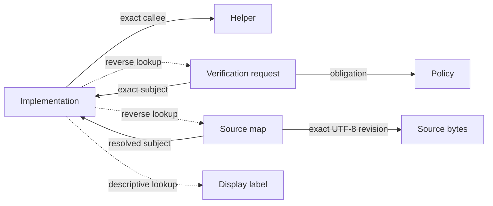

# RT-05 — Typed identity edges for implementation, verification and source navigation

## Question and model

Can one content identity safely serve execution, evidence lookup and source navigation when an SPG records all three kinds of relationships? The [content-addressed entity study](RESEARCH-SCENARIO-06-CONTENT-ADDRESSED-ENTITY-IDENTITY.md) separates provenance from semantic values. The [verification reuse audit](../../research-management/RT-00/RT-00-C-VERIFICATION-REUSE-IDENTITY-RECHECK-2026-11-24.md) distinguishes a verification subject from the policy and action that inspect it. This study compares the identity dependencies jointly on a closed graph with separate consumers. [PLAN §1.2](../../../PLAN.md#12-semantic-identity-hashes-and-canonical-encoding) · [#289](https://github.com/aivibeflow/LLMLang/issues/289) · [LL-005](../../../TODO.md#ll-005--define-hash-relevant-dependency-edges-and-cycles)

The implementation computes `factor * x + delta` through an exact helper reference. Verification checks the result at four finite inputs against one of two bound vectors with inclusive or strict comparison. Navigation returns exact UTF-8 source bytes, a half-open byte interval, and the resolved helper and enclosing implementation. A display label has no role in these three requests. Their desired reuse relations compare the interpreter vector, the exact check inputs/outcome, or the source record and resolved subject respectively.

Six coordinates vary independently over two values each. They change the implementation literal, helper factor, obligation, source formatting, display label and verifier profile. The formatting variant adds a multibyte comment and indentation before the helper occurrence. Hashing uses role-labelled references in a reproducible fixture encoding.



Solid arrows enter the identity of their origin. The dotted edges support retrieval. Treating an implementation's reverse lookup to a source map as an identity edge creates a cycle through that map's exact subject. Whole-snapshot identity is an alternative that serializes the full graph directly without recursively following every reference.

## Results

The experiment compares all 2,016 unordered pairs of 64 profiles for each request. Each cell gives valid reuse / invalid reuse / missed valid reuse. Distinct outcomes are compared independently of the key definitions.

| Projection | Implementation | Verification | Navigation |
| --- | ---: | ---: | ---: |
| Whole snapshot | 0 / 0 / 480 | 0 / 0 / 96 | 0 / 0 / 224 |
| Implementation key for every request | 480 / 0 / 0 | 96 / 384 / 0 | 224 / 256 / 0 |
| Metadata keys without the checked subject | 480 / 0 / 0 | 96 / 384 / 0 | 224 / 256 / 0 |
| Typed projections | 480 / 0 / 0 | 96 / 0 / 0 | 224 / 0 / 0 |

The two unsafe keys fail on different pairs. With an unchanged implementation, changing the verifier changes the result at a bound equal to an observed value. Changing the formatting moves the byte span. Reusing the implementation key for those requests hides both changes. Conversely, a check or navigation key without the subject can survive a helper replacement even though the checked result or the resolved target changed. The typed keys preserve execution under display, source and policy-only changes, while their respective consumers still see the relevant invalidation. Verification and navigation records can carry different exact identities for the same semantic value.

Lean checks that in the mathematical fixture, observations at zero and one determine both parameters over the natural numbers. That makes comparison of the four-input vectors faithful to the implementation parameters used by the finite oracle. The proof uses `propext`, `Classical.choice` and `Quot.sound`. It does not verify the Python encoding, the digest function or general SPG dependency completeness. [Lean model](TYPED-EDGE-PROJECTIONS-01/Observation.lean) · [Axiom output](TYPED-EDGE-PROJECTIONS-01/axioms.txt)

## Reproduce and limits

The LLMLang baseline was `d1b5c1914c8770b5fdf71c5fdf696e59e3d4d3a9` on `research/all`. Run from the repository root with CPython 3.12.14 and Lean 4.36.0 at revision `611c117bfaf7b7ae1cfcf246ce6fba31e8f509e9`. The replay host ran Debian 13 x86-64 on Linux 6.18.57.

```sh
fixture=research/semantic-representation/RT-05/TYPED-EDGE-PROJECTIONS-01
out=$(mktemp)
axioms=$(mktemp)
python3 -B "$fixture/run.py" > "$out" &&
  cmp "$fixture/evidence.json" "$out" &&
  lean -DwarningAsError=true "$fixture/Observation.lean" > "$axioms" &&
  cmp "$fixture/axioms.txt" "$axioms" &&
  python3 -B "$fixture/chart.py"
```

The [ledger](TYPED-EDGE-PROJECTIONS-01/evidence.json) preserves every profile and output of the comparison. The [table generator](TYPED-EDGE-PROJECTIONS-01/chart.py) renders the categorical results. The fixture supports separate role-labelled immutable closures for each request and reverse indexes outside those closures. Production dependency extraction, the authorization of verification evidence, cyclic semantic groups and canonical serialization remain open. [Runner](TYPED-EDGE-PROJECTIONS-01/run.py)
