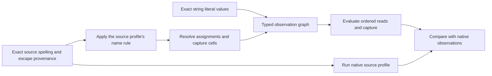

# Preserve source-profile identifier and capture identity in SPG

This RT-05 study compares name resolution of Unicode source spellings across Python, Rust and JavaScript. It asks whether one normalization rule is enough to reconstruct exact local reads, and whether equal resolved names imply the same captured variable. The experiment preserves source spelling and literal data separately from the candidate graph's semantic binding edges.

## Programs and projections

Each source assigns 11 to the first spelling and observes it immediately. It also defines a closure that reads its variable. A second source occurrence assigns 29 or introduces a shadowing Rust `let`. The final observation records the earlier value, the first and second names as used after the second binding, the earlier closure's result, and an equality of literal strings. The string test checks literal data independently of the identifier rule.

Twelve shared pairs cover exact ASCII controls, composed and decomposed accents and Hangul, compatibility characters, different scripts and combining-mark order. Four additional Node cases test JavaScript's source escapes. The Python AST provides an additional observation of the lexical names the frontend uses. A fixture resolver emits immutable graph bodies with assignment cells, value-producing read occurrences, a captured cell and literal values. Native Rust and Node executions check the selected fixtures directly. The resolver models the constrained source shapes rather than extracting all frontend IR.



The policies compare physical tokens, decoded spellings, NFC, NFKC, NFKC applied to both names and literal data, and the correct profile spelling with a deliberately shared cell for equal names. The full profile-specific projection uses the measured name normalization plus the assignment or shadowing behavior of that frontend.

## Results

CPython and each Rust setting run 12 examples. Node runs 16, for 52 native observations. Each number below counts a mismatch in at least one member of the corresponding observation vector.

| Projection | CPython | Node | Rust O0 | Rust O3 |
|---|---:|---:|---:|---:|
| Physical source token | 9 | 3 | 5 | 5 |
| Decoded spelling | 9 | 0 | 5 | 5 |
| NFC name | 4 | 6 | 0 | 0 |
| NFKC name | 0 | 10 | 4 | 4 |
| NFKC name and literal data | 9 | 10 | 9 | 9 |
| Native name rule with one cell for equal names | 0 | 0 | 6 | 6 |
| Profile-specific assignment and capture | 0 | 0 | 0 | 0 |

The matched profile rule is NFKC for Python, NFC for Rust and decoded spelling for JavaScript in this fixture. In the composed/decomposed accent case, Python observes 29 at both later reads and at the earlier closure. Rust also observes 29 at both later reads, while its closure stays bound to the earlier variable and returns 11. JavaScript observes 11 through the first spelling and 29 through the second. The literal strings compare unequal in all three profiles. The full vector is preserved by profile-aware binding and capture. A shared-cell projection changes six vectors in each Rust setting even with the correct name normalization.

The two Rust optimization levels have identical results. The twelve shared source pairs give three distinct exact snapshots under the native profile projections. Spelling normalization alone erases distinctions that matter to cross-profile behavior. Applying the name normalization to string data also changes results.

## Limits and replay

The fixture uses local bindings, one closure and exact string equality. It covers selected Unicode examples and pinned native runtimes. General identifier legality, hygiene, module and package names, user-facing diagnostics, full compiler extraction and independent review remain open. The result distinguishes byte provenance, frontend spelling policy, lexical identity, value dereference and literal data without selecting an LLMLang identifier policy.

Use CPython 3.12.14, Node 22.23.5 and Rust 1.85.1. The initial LLMLang baseline is `3d8ce0e46054b10f6ec54bf69ef1de9589b5c091`. The ledger records tool revisions, Unicode versions from Python and Node, generated source hashes, exact graph roots and every observation. Replay from the repository root.

```bash
fixture=research/semantic-representation/RT-05/UNICODE-BINDING-01
PYTHONHASHSEED=1 python3 -B "$fixture/run.py" > /tmp/llmlang-rt05-unicode-binding.json
cmp "$fixture/evidence.json" /tmp/llmlang-rt05-unicode-binding.json
python3 "$fixture/chart.py"
```

See the [generator and native runner](UNICODE-BINDING-01/run.py), [measured ledger](UNICODE-BINDING-01/evidence.json), [table generator](UNICODE-BINDING-01/chart.py), and [portable identity bytes](RT-05-PORTABLE-IDENTITY-BYTES.md).
