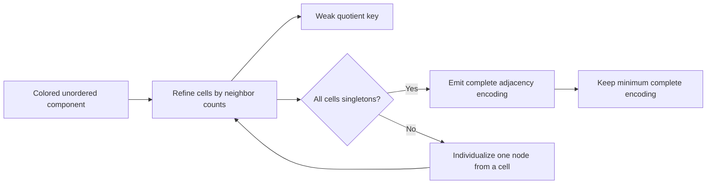

# RT-05 — Canonicalize a recursive group with unordered symmetric edges

**Evidence** — Exact comparisons on 772 small graphs and two counterexamples to stable color refinement.

## Question and scope

The ordered recursive-group study can traverse each member's references in their semantic order. An unordered relation provides no such order. Can stable neighbor refinement provide an exact structural identity there, or must the canonicalizer resolve the remaining symmetries? This study compares stable refinement, exhaustive relabeling and exact partition search. [Ordered recursive traversal](RT-05-ORDERED-SCC-CANONICAL-TRAVERSAL-2026-11-24.md) · [Recursive identity experiment](RT-05-RECURSIVE-IDENTITY-EXPERIMENT.md)

The admitted graphs have a finite set of semantically colored nodes, one connected set of symmetric edges, and no self-loops. The edge set collapses repeated inputs. A symmetric edge represents both directed references, which makes the connected graph one strongly connected component. The colors represent identity-relevant node categories or a selected root marker. The experiment tests graph-group values. It does not assign identities to separately managed members or choose which SPG relation kinds should be unordered.



Color refinement begins with one cell per semantic color. Each split orders the new cells by exact neighbor counts into the previous ordered cells. Stable refinement produces an inexpensive quotient key with color, cardinality and neighbor-count rows. The exact search continues when a cell has more than one node. It branches over choices from the first ambiguous cell and keeps the minimum complete adjacency encoding. It can omit a candidate if swapping it with a representative preserves the whole graph. The checked transposition condition is equal color and identical neighborhoods outside the two nodes. If the exact search exceeds its budget, it rejects the result instead of publishing the weak key.

## Why the exact comparison works

A color-preserving graph isomorphism sends the initial cells to corresponding cells and preserves each neighbor-count signature. At each search node it maps every individualization candidate to a corresponding candidate. The transposition rule removes only branches that an automorphism maps to those retained. Thus isomorphic inputs produce the same set of possible complete encodings and the same minimum. Conversely, a complete encoding records colors and each symmetric adjacency entry. Equal encodings give a concrete bijection of the encoded positions. This argument covers the fixed relation profile and assumes exact completion of the search.

The exhaustive oracle enumerates all input permutations for each small connected graph. The search may emit a different canonical byte sequence because its refinement constrains the enumeration order. The experiment checks that each method induces the same partition into isomorphism classes, using the same complete adjacency serialization. Separate triangle and clique counts provide independent reasons that the two larger collision pairs are nonisomorphic.

## Results

All 772 labeled connected graphs of order 1–5 enter 31 isomorphism classes under both exact methods. Sixty inputs have distinct byte encodings between the two methods. An existing format defined by a full permutation minimum would therefore need a separate identity version for the new encoding.

| Fixture | Nodes | Partitions visited | Equivalent branches pruned |
| --- | ---: | ---: | ---: |
| Triangular prism | 6 | 19 | 0 |
| Complete bipartite graph `K₃,₃` | 6 | 9 | 12 |
| Prism with one colored member | 6 | 3 | 0 |
| Shrikhande graph | 16 | 929 | 0 |
| Four-by-four rook graph | 16 | 1,889 | 0 |
| Complete graph | 24 | 24 | 276 |
| Cycle | 64 | 193 | 0 |

The prism and `K₃,₃` have the same stable refinement key. The prism has two triangles and the bipartite graph has none. The rook and Shrikhande graphs have the same stable key and the same common-neighbor counts for adjacent and nonadjacent pairs. The rook graph has eight 4-cliques and the Shrikhande graph has none. The exact search distinguishes both pairs. Seven relabelings of each scale fixture preserve the corresponding exact key, and marking a member with a new semantic color changes it. Disconnected input, self-loops and a deliberately exhausted canonicalization budget are rejected.

Stable refinement can help partition a candidate comparison but is insufficient for exact structural addresses. Search effort depends on symmetry and the ability to establish automorphisms. The observed fixture counts are operation counts without elapsed-time or memory measurements. This study leaves general directed, labeled or multiple unordered relations, external dependency pins, canonical member orbits, resource bounds for representative SPGs and format selection open.

## Reproduction

Use CPython 3.12.14 from the repository root:

```sh
study=research/semantic-representation/RT-05/UNORDERED-RECURSIVE-01
PYTHONHASHSEED=991 python3 -B "$study/run.py" --output /tmp/llmlang-unordered-scc.json
cmp "$study/evidence.json" /tmp/llmlang-unordered-scc.json
(cd research/PROTOTYPES/DEPENDENCY-GRAPH-01 && python3 -B -m unittest \
  tests.test_recursive_identity tests.test_spg_representation tests.test_spg_admission)
```

The [search and exhaustive oracle](UNORDERED-RECURSIVE-01/run.py) construct the complete small corpus and fixed relabelings. The [ledger](UNORDERED-RECURSIVE-01/evidence.json) preserves counts, hashes, clique controls and search operations.
