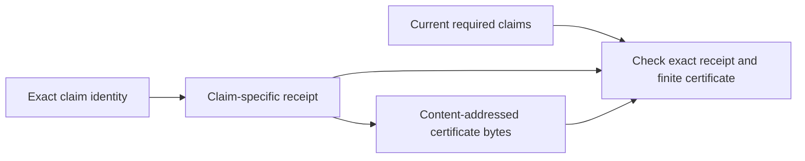
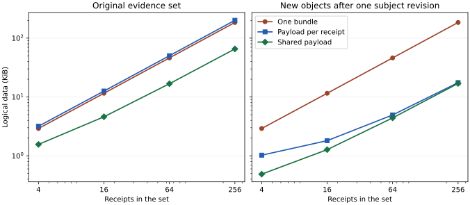

# RT-05 — Compare verification evidence bundle and payload granularity

## Question and method

Can LLMLang share evidence bytes across distinct claims while preserving exact applicability? The [SPG storage comparison](RT-05-SPG-OBJECT-GRANULARITY-2026-11-24.md) measures graph representations. This experiment measures immutable verification evidence objects. The baseline is `b4a91060f1985f749ffa1e36c0d3cc7ce878141c` on `research/all`.

A claim has an exact slot, revision, operation and input domain. Its certificate contains an ordered finite table of input/output rows. The checker verifies the complete domain and the stated arithmetic property. A receipt binds the exact claim, checker, and certificate bytes. The initial set contains different claims with the same 64-row certificate content. Two variants change either one claim revision with identical certificate bytes or both its revision and output relation.

| Layout | Physical objects |
|---|---|
| One bundle | A single immutable object embeds every receipt and certificate. |
| Payload per receipt | An immutable manifest lists exact receipt objects, each embedding its certificate. |
| Shared payload | A manifest lists exact receipt objects, which refer to independently content-addressed certificate objects. |

Each representation must restore and verify every exact current claim. The experiment counts uncompressed canonical fixture JSON bytes for the original objects and for objects newly created by a revision. Object names are SHA-256 hashes. It excludes filesystem framing, network transfers, compression, packing and verification time.



## Results

The figure compares total original data with new logical data after one claim revision that preserves the certificate payload. The axes use logarithmic scales.



| Claims | Revision | One bundle | Payload per receipt | Shared payload |
|---:|---|---:|---:|---:|
| 4 | Subject only | 2,983 B | 1,050 B | 500 B |
| 64 | Subject only | 47,263 B | 5,070 B | 4,520 B |
| 256 | Subject only | 188,959 B | 17,934 B | 17,384 B |
| 256 | Claim and payload | 188,941 B | 17,916 B | 17,887 B |

With 256 initial claims, the original shared layout stores 67,120 bytes, compared with 188,959 for the bundle and 205,869 for embedded per-receipt payloads. Reusing one certificate shrinks the initial footprint substantially. The difference in update bytes becomes small between the two per-receipt layouts because both rewrite one flat manifest with 256 object IDs. A scalable index could change that cost and requires its own experiment. [Exact object and byte counts](EVIDENCE-GRANULARITY-01/evidence.json)

The old exact receipt is refused for a new claim revision even though the certificate bytes are unchanged. An exact recheck can issue a new receipt that refers to those bytes. The same certificate also fails after domain expansion or an incompatible behavior change. Missing receipts and an unapproved checker identity are withheld. These controls preserve a separate distinction between physical reuse and the evidence needed for a claim. They do not establish any cryptographic signing or issuer authorization policy.

The fixture covers bounded arithmetic checks and one flat manifest. It supports physically separate shared payloads with exact claim-specific receipts, subject to real verification and issuer policy. It leaves richer proof formats, bundles with weak payload reuse, indexing, GC, concurrent writes and actual I/O measurement open. [RT-05 tracking](https://github.com/aivibeflow/LLMLang/issues/288)

## Reproduction

Use CPython 3.12.14 and Matplotlib 3.10.8. The [runner](EVIDENCE-GRANULARITY-01/run.py) verifies each restoration and the six receipt controls. The [chart source](EVIDENCE-GRANULARITY-01/chart.py) reads the committed ledger. Hash seeds 1 and 2 produced byte-identical data. The SVG was visually checked using a raster preview from the same chart script.

```bash
fixture=research/semantic-representation/RT-05/EVIDENCE-GRANULARITY-01
LC_ALL=C PYTHONHASHSEED=1 python3 -B "$fixture/run.py" > /tmp/llmlang-rt05-evidence-granularity.json
cmp "$fixture/evidence.json" /tmp/llmlang-rt05-evidence-granularity.json
MPLCONFIGDIR=/tmp/llmlang-mpl-evidence LC_ALL=C python3 -B "$fixture/chart.py"
```
