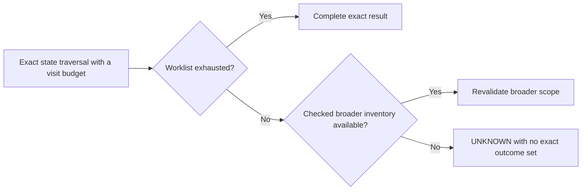

# RT-06 fallback after an exact traversal exhausts its budget

Exact state coalescing solves repeated paths when they carry the same relevant observation. Some graphs still produce many distinct observations after coalescing. This study extends the earlier diamond graph from parity to a bounded bit history. It checks which result the dependency planner may publish when it reaches a state-visit cap. [Earlier diamond traversal benchmark](RT-06-DIAMOND-TRAVERSAL-2026-11-25.md)



Each diamond offers a branch that adds one bit of the path's observable history. The worklist coalesces only identical node and history pairs. For depth \(d\) and history width \(b\), the independent oracle expects each of the \(2^{\min(d,b)}\) outcomes. The checked coarse scope contains the entire finite \(b\)-bit inventory. It is usable for wider revalidation. A bounded prefix cannot establish that an unvisited outcome is absent.

## Checked results

The comparison uses four depths, five history widths and four visit caps, for 80 configurations. Each is evaluated with and without a checked coarse inventory. Thirty-five complete traversals return the oracle set under both conditions. Of the 45 capped traversals, 44 prefixes miss at least one actual outcome. All 45 checked-inventory cases include every actual outcome in their revalidation scope. All 45 cases without that inventory return `UNKNOWN` and withhold an exact result. One incomplete prefix happens to contain all actual outcomes. Its completion flag still correctly withholds exactness.

| Depth, observed bits, cap | Graph nodes | State visits | Outcomes seen | Oracle outcomes | Result with checked inventory |
| --- | ---: | ---: | ---: | ---: | --- |
| 20, 1, 256 | 61 | 119 | 2 | 2 | Exact |
| 20, 16, 4,096 | 61 | 4,096 | 255 | 65,536 | Revalidate broader scope |
| 16, 12, 65,536 | 49 | 65,533 | 4,096 | 4,096 | Exact |

The equal node counts in the first two rows show why a graph-size cutoff misses this workload. Budget the relevant state space or bound it explicitly during traversal. Revalidation scope requires an independently justified inventory and a separate execution budget. The measured quantity here is the number of state visits. Heap bounds, wall-time limits, arbitrary observations and proof of state sufficiency for a production worklist remain open. [Evidence matrix](BOUNDED-TRAVERSAL-FALLBACK-01/evidence.json)

## Reproduction

Use CPython 3.12.14. Both runs reproduce the visit bounds and exact dispositions.

```sh
study=research/semantic-representation/RT-06/BOUNDED-TRAVERSAL-FALLBACK-01
build=$(mktemp -d)
for seed in 37 75; do
  LC_ALL=C PYTHONHASHSEED="$seed" PYTHONDONTWRITEBYTECODE=1 \
    python "$study/run.py" --output "$build/result-$seed.json"
done
cmp "$build/result-37.json" "$build/result-75.json"
cmp "$build/result-37.json" "$study/evidence.json"
```

[Runner](BOUNDED-TRAVERSAL-FALLBACK-01/run.py)
