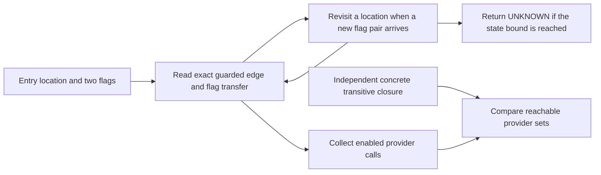

# RT-06 — Conditional dependency closure through recursive control flow

Tracking both control location and flag state recovered every possible provider call in 16,384 finite queries. A traversal that visited each location once omitted a possible target in 3,408 queries. When an external predicate was unavailable, keeping both outcomes avoided misses and retained more precision than discarding all guards.

## Method

A dependency query starts at a declared entry point with two boolean flags and returns the providers callable on any reachable path. The input graph has four control locations and five potential terminal providers. An entry can reach a shared location or a relay. The shared location and relay can call one another with updated flags. Provider calls and control transfers carry predicates. One predicate uses an external truth table. It has a stable Boolean result for each flag pair and no side effects in this experiment.

The corpus crosses four entry updates, four loop updates, four shared-to-relay guards and four optional entry guards. For each of 256 resulting programs there are four flag assignments and 16 possible external truth tables. The independent oracle constructs every concrete state and admissible edge, computes full transitive closure by relation updates, and collects terminal calls from reachable states. The candidate lowers each guard to a bit mask and uses a worklist over reachable `(location, flags)` tuples.



The controls retain only the first reached flag pair at each location, ignore all guards, replace the unavailable external predicate with constant false, or allow both outcomes locally while respecting the other guards. In the final control the stable result is unknown, so each occurrence of the predicate and its negation is considered independently.

## Results

| Method | Queries with misses | Missed targets | Queries with extras | Extra targets |
| --- | ---: | ---: | ---: | ---: |
| allow-either | 0 | 0 | 16,384 | 25,424 |
| assume-external-false | 9,648 | 9,648 | 2,304 | 2,304 |
| exact | 0 | 0 | 0 | 0 |
| first-state | 3,408 | 4,912 | 0 | 0 |
| ignore-guards | 0 | 0 | 16,384 | 53,072 |

The denominator is 16,384 query-and-truth-table pairs per row. A missed target is reachable under the concrete truth table and absent from the computed set. An extra target appears only in the computed set for that pair. The ledger preserves concrete inputs and exact target lists for the first discriminating case of each control.

With both flags initially clear and a false external predicate, the relay flips the low flag on a return to the shared location. A later visit to the relay can reach the modern provider. A location-only traversal discards the changed state and misses that dependency.

The union across all concrete truth tables is the most precise may-set available from this finite provider model. The local allow-either policy adds one target beyond this union for each of 1,024 program and entry-state pairs. In that witness, reaching the `check` location requires the external predicate to be true, and the next edge requires it to be false without a state change. Every stable truth table excludes the target. Local unknown expansion includes it. With a one-state budget the worklist returns `UNKNOWN` for all 1,024 incomplete queries and emits no partial target set.

## Implementation boundary

Call-site evidence can distinguish exact possible providers, a conservative set for an admitted unknown guard, and a query whose assumptions or exploration bounds are unresolved. This supports reconsidering a caller when two routes reach the same operation with different relevant state. A tighter summary must preserve facts such as repeated evaluation of a stable guard. For a foreign operation whose effects or target universe have yet to be established, the tested finite Boolean model supplies no usable completeness evidence.

The corpus uses an explicit control graph and finite scalar state. A production dependency gate still needs source-derived transitions, an admitted abstraction of language state, evidence binding to the exact snapshot and extractor, representative resource measurements, and fail-closed handling of unsupported effects and targets. The result can inform the [source-bound publication gate](../../toolchain-and-collaboration/RT-24/RT-24-TREE-BOUND-CIP-PUBLICATION.md) once that broader evidence is available.

## Reproduce

Use CPython 3.12.14 from the repository root.

```sh
fixture=research/semantic-representation/RT-06/CONDITIONAL-DEPENDENCY-01
output=$(mktemp)
python3 "$fixture/run.py" --output "$output"
cmp "$fixture/evidence.json" "$output"
python3 "$fixture/chart.py"
```

[Runner](CONDITIONAL-DEPENDENCY-01/run.py) · [Evidence ledger](CONDITIONAL-DEPENDENCY-01/evidence.json)
