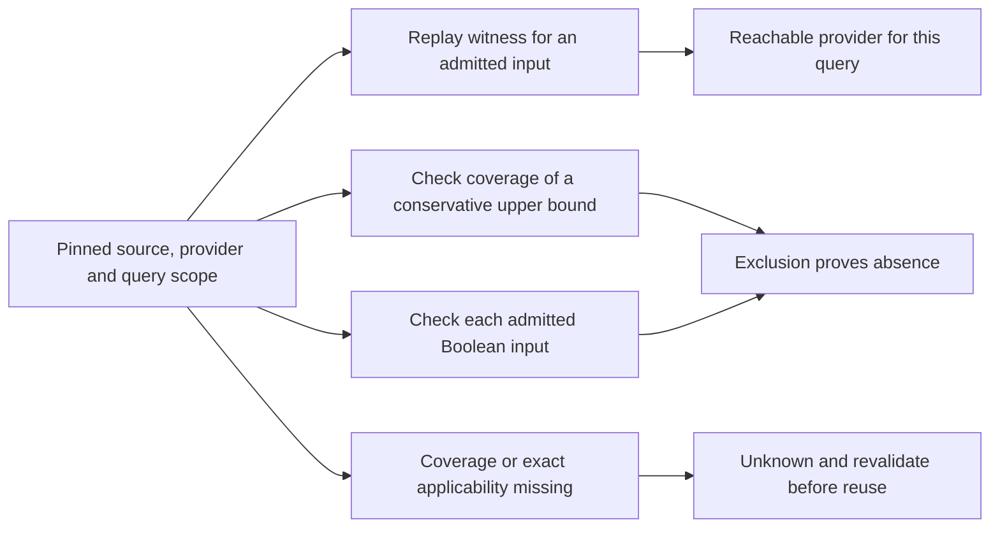

# RT-06 — Distinguish dependency witnesses, coverage, and absence

**Scope:** PLAN §3.1 and [#298](https://github.com/aivibeflow/LLMLang/issues/298), based on `d7874b9547b58ca44a741f5cf98158c871592f21` in `research/all`.

A dependency query can return an edge found during execution, a conservative candidate set, or checked evidence that an edge is absent. LLMLang's callers need to know which conclusions support invalidation or reuse when a provider changes. This study formulates those evidence roles and compares three reuse policies on a closed Boolean dispatch model.

## Evidence roles

A query binds the exact source snapshot, requested provider, admitted input scope, relation being queried and interpretation schema. In this fixture the relation is **reachable direct provider binding**. Reachability means that at least one admitted input calls the provider. A scoped response can use more than one evidence role.

| Evidence role | Valid conclusion and limits |
| --- | --- |
| Syntactic or otherwise unverified candidate | Points to a possible provider or call site for discovery. It requires validation before supplying a checked edge or exclusion. |
| Replayed positive witness | The provider is reachable for this exact scope. The evidence identifies one admitted input and selected binding. Missing witnesses leave the question unresolved. |
| Covered conservative may-set | Every reachable provider belongs to the set. A listed provider remains a possible dependency. Exclusion gives a negative conclusion only under checked coverage of the stated scope. |
| Exhaustive scoped observation | The closed domain was replayed for the exact query. It can give a concrete witness or checked absence. The fixture verifies source inventory, scope and observed rows separately. |
| Unknown or stale | Coverage, reproducibility, authority or exact applicability is missing. The response stays unresolved and cannot justify retaining the old result after a possibly affecting change. |

These roles describe different propositions rather than one numeric confidence scale. A positive witness does not make the rest of the dependency graph complete. A proof of reachability also does not by itself show a change in every observation projection. The finite model here makes provider identity and version observable, so replacement changes at least one observation exactly when that provider is reachable.



The [Lean proof](DEPENDENCY-EVIDENCE-01/Coverage.lean) checks three rules. A witness establishes reachability. Exclusion from a covered upper bound implies absence. On a Boolean domain, checking both admitted alternatives characterizes absence. The three theorems have empty axiom lists. They leave verification of a real source extractor's coverage as a premise.

## Finite policy comparison

A program selects a provider for each of two Boolean inputs, independently choosing no call, provider `a`, or provider `b`. The query can ask about either of those providers or an absent provider `c`. Nine programs, three nonempty scopes, four sampling subsets, three target providers and two source-inventory states give 648 cases per policy. The oracle compares all admitted provider-and-version observations before and after the requested provider replacement.

| Policy | Safe reuses | Stale reuses | Cases with equivalent observations held for revalidation |
| --- | ---: | ---: | ---: |
| Sample-only absence inferred from no observed hit | 472 | 84 | 0 |
| Exclude from the covered whole-program upper bound | 204 | 0 | 268 |
| Check absence over the exact covered scope | 236 | 0 | 236 |

The upper bound unions possible target names across both inputs, so it can include a provider used only outside the requested scope. Exact scoped replay gives 32 additional safe reuses in this corpus. Both policies hold cases when source-inventory coverage is missing. The third policy classifies 92 cases with a sampled positive witness, 42 more as reachable after complete replay, 236 as checked absence and 278 as unresolved. These are exact counts for this product. The rates describe no production workload.

For one concrete control, `false` reaches `a` and `true` reaches `b`. A complete negative result about `b` on the false-only scope cannot justify reuse after expanding the scope or rebinding the false branch to `b`. The checker also refuses to apply that evidence when coverage is missing or the stored observation row is altered. Bare observation can find positive calls with incomplete inventory, while negative conclusions require proof of the bound.

## Implications and limits

A dependency index can retain these roles per exact relation. Typed static extraction can give a useful overapproximation. Runtime and test observations contribute scoped witnesses. Exact negative evidence can refine a covering approximation when missing edges would otherwise invalidate additional dependents. Reusing an artifact still depends on the interpretation of the edge, exact involved identities and permitted observations. The [negative binding-read experiment](RT-06-SCOPED-BINDING-READ-DEPENDENCIES.md) and [bounded conditional closure](RT-06-CONDITIONAL-DEPENDENCY-CLOSURE-2026-11-25.md) cover other closed fixtures with different dependency edges.

This model uses one branch and a fixed provider universe. It holds no production proof about dynamic calls, external discovery, mutable bindings, source-to-index correspondence, transitive dependencies, cross-profile equivalence or authorization. The proof and experiment support the stated evidence distinctions. The representation and criteria for production reuse remain open.

## Reproduce

Use CPython 3.12.14 and Lean 4.36.0 at `611c117bfaf7b7ae1cfcf246ce6fba31e8f509e9`. The [runner](DEPENDENCY-EVIDENCE-01/run.py) enumerates all cases, checks the three rules in Lean and produces the [ledger](DEPENDENCY-EVIDENCE-01/evidence.json). Mermaid syntax was inspected directly. The numbers are finite enumerations with no timing measurements.

```sh
fixture=research/semantic-representation/RT-06/DEPENDENCY-EVIDENCE-01
LC_ALL=C PYTHONHASHSEED=1 python3 -B "$fixture/run.py" \
  --lean "$(command -v lean)" > /tmp/llmlang-dependency-evidence.json
cmp "$fixture/evidence.json" /tmp/llmlang-dependency-evidence.json
```
