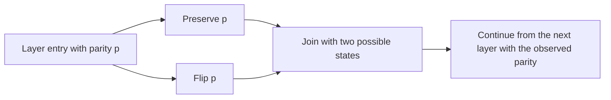
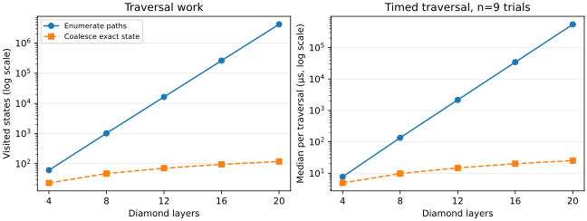

# RT-06 Path expansion and exact state coalescing

**Issue** [#332](https://github.com/aivibeflow/LLMLang/issues/332)

Dependency and impact analysis may revisit the same graph node through many paths. Some queries need path witnesses or correlations. For a query that only needs terminal outcomes, a worklist can merge histories once their remaining behavior is fully described by the same state. This benchmark quantifies the distinction on a synthetic repeated-diamond graph. It is a bounded scalability study, with no production thresholds. [Path-sensitive alias precision](RESEARCH-SCENARIO-108-PATH-SENSITIVE-ALIAS-PRECISION.md)

## Workload and fallback

Each diamond adds two branches and one join. One branch preserves a one-bit parity state, while the other flips it. The initial state is zero. The output is the set of parity values admitted at the terminal join. By construction, every successor and terminal label depends only on the current node and current parity. Two histories with the same pair therefore have identical continuations. A path-sensitive analysis with a different query must establish its own sufficient state.



The same motif repeats at each layer. Explicit path enumeration processes repeated histories separately. The exact-state worklist records each `(node, parity)` once. A node-only deduplication control ignores parity and loses one terminal outcome at each tested depth.

The fallback experiment caps explicit enumeration at 4,096 visits. It accepts a completed prefix and reruns incomplete cases with the exact-state worklist. The fallback returns both outcomes for all five depths. When a sufficient state has not been established, an incomplete enumeration needs an unknown result or a conservative overapproximation supported by the query. The experiment does not discard paths for that general case.

## Exact work and observed timings

A chain of depth \(d\) contains \(3d+1\) nodes and \(4d\) edges. Explicit enumeration visits the initial entry and twice the \(2^j\) histories for each layer \(j\) from one to \(d\), for \(2^{d+2}-3\) visits. Exact coalescing visits five states in the first layer including the initial state, and six per additional layer. The runner verifies both formulas and both terminal outcomes before timing.



The left panel shows exact state visits. The right panel shows median elapsed microseconds per traversal and the first-to-third quartile range across nine trials. Shapes and line styles identify the methods in both panels. These ranges describe observed variation. They are not confidence intervals for other runs or hosts.

| Layers | Graph nodes | Enumerated visits | Exact-state visits | Enumeration median (µs) | Exact-state median (µs) |
| ---: | ---: | ---: | ---: | ---: | ---: |
| 4 | 13 | 61 | 23 | 7.70 | 4.92 |
| 8 | 25 | 1,021 | 47 | 135.35 | 9.80 |
| 12 | 37 | 16,381 | 71 | 2,155.18 | 14.83 |
| 16 | 49 | 262,141 | 95 | 34,294.18 | 20.15 |
| 20 | 61 | 4,194,301 | 119 | 546,096.99 | 25.29 |

All timings use CPython 3.12.14 and Linux 6.18.57 x86-64, pinned to logical CPU 2 of the recorded AMD EPYC 9V74 host. The runner times traversal after graph generation with cyclic collection disabled. It uses seeded within-trial method order and divides each batch duration by its recorded number of traversals. The raw [evidence](DIAMOND-TRAVERSAL-01/evidence.json) includes all 90 elapsed measurements in nanoseconds, repetition counts, trial order, clock resolution, source digest and terminal checks. Both timing methods include the work of maintaining and reporting their own traversal state. The host was shared, so measurements describe this run. There are no allocation, peak RSS or confidence-interval measurements.

The exponential count comes from the repeated paths in this workload, despite its small node inventory. The coalesced bound depends on the two possible states and does not extend unchanged to alias partitions, stateful path guards or provenance-sensitive queries. Representative LLMLang graphs, concurrent graph changes, memory measurements and realistic timeout policies remain open.

## Reproduction

The baseline is `5619c764c399c25453730cd93d50515dd6eb7ba2`. Use the same CPU on the recorded runner, or an available logical CPU on a new runner and record the separate conditions. Expect identical logical outcomes and visit counts, with timing differences across runs. The chart uses Matplotlib 3.10.8 and can be regenerated byte for byte from the recorded evidence using the command below. Relative links, Mermaid source structure and the PNG chart preview were checked locally. GitHub visual rendering was not manually verified.

```sh
study=research/semantic-representation/RT-06/DIAMOND-TRAVERSAL-01
LC_ALL=C PYTHONHASHSEED=1 python -B "$study/run.py" --cpu 2 >/tmp/llmlang-diamond-trial.json
LC_ALL=C MPLCONFIGDIR=/tmp/llmlang-diamond-mpl python -B "$study/chart.py" \
    --input "$study/evidence.json" --output /tmp/llmlang-diamond-traversal.svg
cmp "$study/diamond-traversal.svg" /tmp/llmlang-diamond-traversal.svg
```
