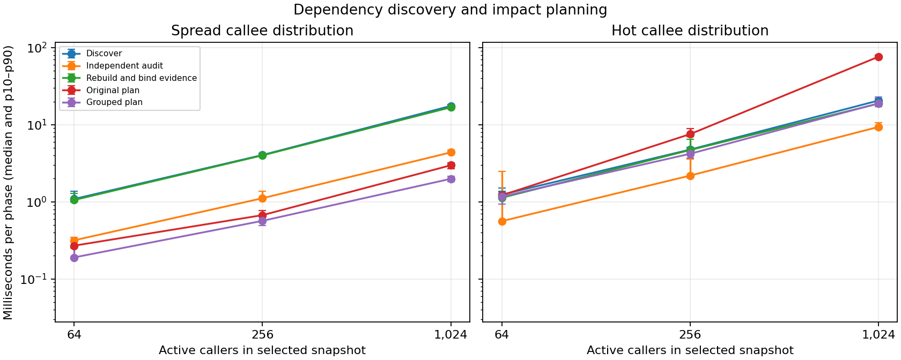

# RT-06 snapshot dependency discovery and impact planning costs

When changing a callee, the Toolchain needs to discover exact active callers, validate evidence about the discovered edges, then build actions for the candidate change. These phases can scale differently. This pilot measures the current prototype on two synthetic caller distributions and compares its planning loop with a temporary grouped lookup. [Snapshot index](../../PROTOTYPES/DEPENDENCY-GRAPH-01/src/semantic_dependency_index.py) · [Impact planner](../../PROTOTYPES/DEPENDENCY-GRAPH-01/src/impact_planning.py)


Each snapshot selects 64, 256 or 1,024 active callers and leaves one historical caller outside the selection. The hot workload points every active caller at the queried callee. The spread workload points one eighth there. The independent audit traverses the same stored declarations in a separate way. Its receipt is scoped to the exact snapshot, target, projection and extractor. Fixture decisions preserve each discovered edge under supplied synthetic evidence labels. The measurements cover the planner's validation and action generation for those labels. Computing compatibility evidence is outside the timed planning phase.

The original planner scans the full decision list for each incoming edge. The temporary candidate groups the already formed decision keys once by caller, call-site and target, and uses the same validation and serialization thereafter. The harness swaps the exact function fragment in an isolated Python namespace and pins its source. It compares the complete plans, including their IDs, and separately checks the independently expected actions. Both implementations require full revalidation when the audit is bound to a stale snapshot or one decision is missing.

## Results

Each row has ten independently launched trial processes. Both planners run per process in randomized order. The runner was logical CPU 4 on AMD EPYC 9V74, Linux 6.18.57, CPython 3.12.14. No cgroup CPU periods were throttled. Table values are milliseconds per phase, reported as medians.

| Workload | Active callers | Incoming edges | Discover | Audit | Rebuild query and bind | Original planner | Grouped planner |
| --- | ---: | ---: | ---: | ---: | ---: | ---: | ---: |
| Hot | 64 | 64 | 1.24 | 0.56 | 1.13 | 1.22 | 1.17 |
| Hot | 256 | 256 | 4.77 | 2.19 | 4.70 | 7.56 | 4.20 |
| Hot | 1,024 | 1,024 | 20.62 | 9.38 | 18.80 | 76.28 | 18.95 |
| Spread | 64 | 8 | 1.09 | 0.32 | 1.06 | 0.27 | 0.19 |
| Spread | 256 | 32 | 4.05 | 1.11 | 4.01 | 0.67 | 0.57 |
| Spread | 1,024 | 128 | 17.56 | 4.38 | 16.83 | 2.98 | 1.99 |



All 60 trial pairs produce identical complete plans, and both conservative controls agree on every trial. For the hot 1,024-caller workload, the median of paired planner ratios is 3.98×. For the spread workload of the same active size, index reconstruction and audit dominate the planning phase. This separates a high-fan-in planner cost from whole-snapshot scanning cost. The comparison leaves representative repositories, persistent indexes, the memory overhead of the grouped lookup, mixed decision kinds and production integration open. [Raw data](IMPACT-PLANNING-BENCHMARK-01/evidence/samples.csv) · [Distributions](IMPACT-PLANNING-BENCHMARK-01/evidence/summary.json) · [Configuration](IMPACT-PLANNING-BENCHMARK-01/evidence/config.json)

## Reproduction

Use CPython 3.12.14 and Matplotlib 3.10.8 on Linux with cgroup CPU accounting. Choose a CPU in the runner's allowed affinity. Measurements vary across runs.

```sh
study=research/semantic-representation/RT-06/IMPACT-PLANNING-BENCHMARK-01
build=$(mktemp -d)
LC_ALL=C PYTHONHASHSEED=37 PYTHONDONTWRITEBYTECODE=1 python "$study/measure.py" \
  --cpu 4 --trials 10 --seed 20261125 --output "$build/evidence"
LC_ALL=C MPLBACKEND=Agg MPLCONFIGDIR="$build/plot-cache" python "$study/summarize.py" \
  --evidence-dir "$build/evidence"
```

[Collector](IMPACT-PLANNING-BENCHMARK-01/measure.py) · [Summary and chart generator](IMPACT-PLANNING-BENCHMARK-01/summarize.py)
