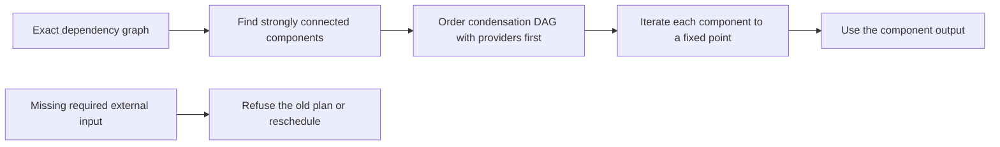

# RT-06 — Scheduling cyclic dependency analysis

A set of mutually dependent analysis nodes needs a joint fixed point before its consumers can rely on its results. This fixture checks strongly connected component scheduling and how a topology change affects an old plan. It uses the [recursive identity implementation](../RT-05/RT-05-RECURSIVE-TOPOLOGY-EDITS-2026-11-25.md) and complements [guarded dependency closure](RT-06-CONDITIONAL-DEPENDENCY-CLOSURE-2026-11-25.md) for [PLAN §3.1](../../../PLAN.md#31-semantic-dependency-model) and [#298](https://github.com/aivibeflow/LLMLang/issues/298).

An edge points from a consumer to an input provider. Each vertex contributes its own finite set of facts and unions the facts reported by its providers. Within one strongly connected component, the solver iterates this transfer until no fact changes. Between components, the scheduler first resolves external providers. The condensation graph is a DAG. Sorting component members and dependency lists makes the schedule reproducible in this fixture. An independently implemented reachability closure computes expected facts for each node.



Lean proves that any set of reported facts closed under its dependency edges propagates a fact along every finite path. Consequently, mutually reachable vertices in this union model agree on facts. The proof uses no axioms. The finite oracle checks least fixed points and the exact schedule separately.

## Results

| Check | Count |
| --- | ---: |
| Directed graphs including self-loops | 512 |
| Fresh graph/seed fixed points agreeing with the reachability oracle | 4,096 |
| Directed single-edge additions or removals | 4,608 |
| Edits that change component membership | 1,440 |
| Edited graph/seed comparisons | 36,864 |
| Old schedule has a newly unresolved external dependency | 7,488 |
| Old schedule reports an incorrect result when missing inputs count as empty | 4,448 |

Every partition matches a mutual-reachability oracle, and reversing declaration insertion order preserves every schedule. On the bounded corpus, every old schedule whose external dependencies remain available computes the same least fixed point when rerun from the new graph. Reusing a previous result still requires verifying its exact graph. The old schedule can remain operationally applicable after a component split while its component identity and proof receipts still need replacement.

For each observed fact change after an edge edit, the affected node lies in the known reverse cone of the edited consumer. Condensing or reusing a grouping requires the exact graph and complete edges. Missing evidence can force a conservative reanalysis or unknown result. A self-loop is allowed in this analysis fixture and an isolated node still contributes its own input facts. The model has a finite union domain. General lattices, effectful transfer functions, persistent version-bound scheduling and source dependency completeness remain open. [DEP-009 and DEP-011](../../research-management/RESEARCH-DEPENDENCY-MAP.md#3-directed-dependency-register)

## Reproduce

Use Git 2.56.1, CPython 3.12.14 and Lean 4.36.0 at `611c117bfaf7b7ae1cfcf246ce6fba31e8f509e9`. Run from the repository root with archive commit `c3e6060d7397074544020fed78ae5597d697a0bc`. The [ledger](SCC-SCHEDULING-01/evidence.json) preserves the exact partition implementation identity, observed counts and a failing old-plan witness.

```sh
set -eu
fixture=research/semantic-representation/RT-06/SCC-SCHEDULING-01
out=$(mktemp -d)
trap 'rm -rf "$out"' EXIT
lean -DwarningAsError=true "$fixture/Closure.lean" > "$out/axioms.txt"
cmp "$fixture/axioms.txt" "$out/axioms.txt"
LC_ALL=C PYTHONHASHSEED=1 python3 -B "$fixture/run.py" > "$out/evidence.json"
cmp "$fixture/evidence.json" "$out/evidence.json"
```
