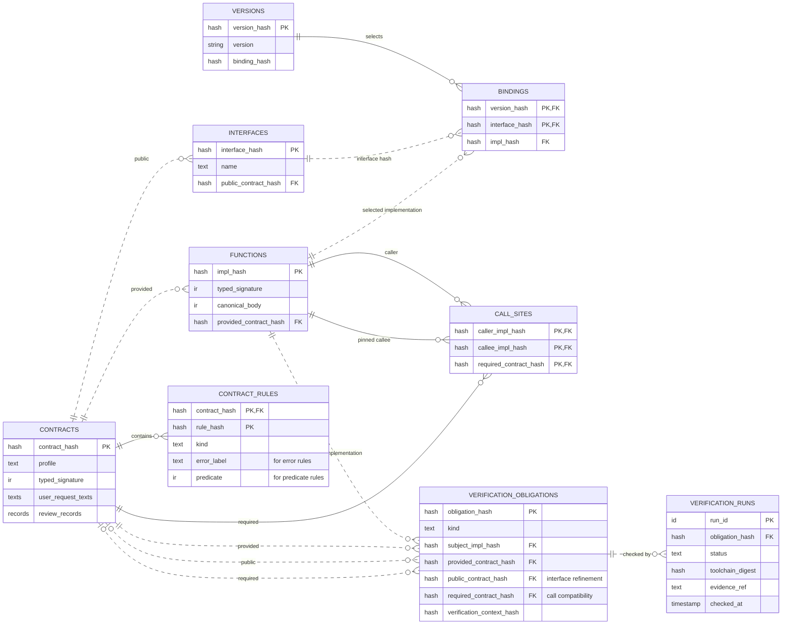

# Scalar MVP relational schema

**Status** — Logical schema accepted in [ADR-027](../../../draft/adr/027-scalar-spg-relational-projection.md). Database implementation and migration validation are pending.

The [earlier relational candidate](PREFERRED-FUNCTION-RELATIONAL-SCHEMA.json) links implementations to contracts and verification results. This projection adds named program versions, deduplicated call dependencies, and typed contract rules. Each contract retains its originating user requests and review records. The scalar MVP supplies the typed SPG, Contract IR, binding manifest, and review artifacts. The proposed identity treats the rules in a scalar contract as a set so that permuting clauses or repeating an identical rule cannot create a second contract. [Scalar MVP and its evidence boundary](https://github.com/aivibeflow/LLMLang/blob/c0559cb12469f876e7f5143798cad71e6f841480/tools/llmlang_mvp/RELEASE.md)

## Entity–relationship diagram

Each box represents a table. PK and FK mean primary and foreign key. Multiple PK labels within a box form one composite key. Each child row references its parent through the indicated FK, and crow's feet indicate that a parent can have multiple child rows.

## Key rules and scope

- `version_hash = hash(version)` is the primary key. `version` is a string and `binding_hash` identifies its binding manifest. Changing the bindings of an immutable version requires a new version string.
- `CALL_SITES` is an implementation dependency index keyed by `(caller_impl_hash, callee_impl_hash, required_contract_hash)`. Repeated calls to the same implementation with the same required contract produce one row, and different requirements produce separate rows. The proposed version-independent index derives both the callee pin and the required contract pin from the caller's canonical SPG body. A changed requirement creates a new caller implementation identity. The current scalar MVP gets the required hash from the callee's public contract in the binding manifest. Projecting those requirements into the caller's canonical form requires a versioned import step that preserves the original artifact identities. [MVP binding manifest](https://github.com/aivibeflow/LLMLang/blob/c0559cb12469f876e7f5143798cad71e6f841480/tools/llmlang_mvp/__main__.py#L25-L46)
- For a public interface call, check that its admitted `BINDINGS` row in the selected version matches the SPG's callee pin. The public contract is available through `BINDINGS` → `INTERFACES` → `CONTRACTS`. A direct internal call uses the same dependency row and can explicitly pin the callee's provided contract as its requirement. The scalar MVP currently pairs a public and a provided contract for every function. [MVP contract pair validation](https://github.com/aivibeflow/LLMLang/blob/c0559cb12469f876e7f5143798cad71e6f841480/tools/llmlang_mvp/verify.py#L246-L269)
- Normalize each rule to a canonical encoding of its kind, applicable error label, and typed predicate where present. Compute `rule_hash` from that encoding. A rule is a precondition, postcondition, error declaration, or error guard. Error guards reference their declaration by label within the contract. An error outcome with no guards still has a declaration row.
- Deduplicate identical normalized rules and sort their hashes in byte order. Compute `contract_hash` from a versioned canonical encoding of the profile, typed signature, and sorted unique rule hashes. The composite PK `(contract_hash, rule_hash)` enforces one row per rule in a contract. For example, swapping two scalar preconditions leaves the contract hash unchanged. Moving a predicate from a precondition to a postcondition changes its rule hash. Preserve order within a predicate and in the signature according to the active profile. This proposal canonicalizes identical rules. Proving logical equivalence between different predicates is a separate operation.
- The current scalar MVP includes clause order in its existing `ContractHash`. Use a separate hash domain for the proposed identity and preserve the original hashes for existing artifacts and signed review packets. Any importer must verify the original artifacts against their original identities before projecting them into the new scheme. [Current scalar hash and normalization](https://github.com/aivibeflow/LLMLang/blob/c0559cb12469f876e7f5143798cad71e6f841480/tools/llmlang_mvp/CONTRACT-IR.md#normalization-versions-and-identities)
- Store the original user requests or conditions verbatim in `user_request_texts`. Retain each source text when multiple requests yield the same contract. Store review data in `review_records` on the contract. Each record retains the version hash, exact packet bytes and digest, and the signed decisions with reviewer and public key identity. Verify the signature and the packet's applicability to the exact contract and review context before relying on an approval. The request texts and review records are metadata outside `contract_hash`. If a request is shown for approval, include it in the packet bytes so the approval covers that exact text. [Signed review receipts](https://github.com/aivibeflow/LLMLang/blob/c0559cb12469f876e7f5143798cad71e6f841480/tools/llmlang_mvp/review.py#L261-L306)
- Verification distinguishes body conformance, public binding refinement, and call compatibility. Public binding admission checks the provided contract against the exact public contract. Call compatibility checks that `FUNCTIONS[callee_impl_hash].provided_contract_hash` satisfies the exact `CALL_SITES.required_contract_hash`. Reuse evidence when the subject, compared contracts, profile, and assumptions match, including applicable binding evidence when the required and public contracts coincide. Body verification checks each call expression's arguments against the required precondition. Each verification run retains its own status and evidence reference. [MVP call precondition check](https://github.com/aivibeflow/LLMLang/blob/c0559cb12469f876e7f5143798cad71e6f841480/tools/llmlang_mvp/verify.py#L167-L180)

The diagram specifies a logical schema for discussion. SQL types, indexes, and an importer remain open. The diagram has no database execution or migration evidence.
