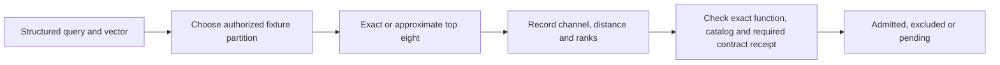

# RT-35. Approximate neighbor discovery with scoped contract filters

The same retrieval budget can yield different results depending on when scope is applied. This prototype compares exact and approximate KD-tree search over a synthetic function catalog. It applies namespace, signature and effect filters either before search by using an exact partition or after a global top-eight ranking. A separate receipt check classifies returned candidates as admitted, excluded or pending. [Issue #335](https://github.com/aivibeflow/LLMLang/issues/335) · [Scoped retrieval and binding](RT-35-SCOPED-RETRIEVAL-2026-11-25.md)

The catalog contains 3,072 synthetic functions, with 256 per partition and 192 queries over 12-dimensional vectors. The bounded compatibility labels are generated independently of the vector distances. The exact reference sorts all distances within the requested partition. The three partitioned KD-tree channels use `eps=0`, `0.6` or `1.5`. Every returned candidate carries its exact function hash, fingerprint digest, channel, tolerance, distance and ranks before and after filtering. Contract receipt identities are recorded separately. [SciPy query contract](https://docs.scipy.org/doc/scipy/reference/generated/scipy.spatial.cKDTree.query.html)



## Results

The exact scoped channel matches independent brute force on every query. All approximation results satisfy the measured nearest-neighbor distance bound and every reported distance agrees with a separate computation. The compatible neighbor column measures overlap with the proved candidates in the exact scoped top eight.

| Search policy | Exact scoped neighbors recovered, of 1,536 | Compatible exact neighbors recovered, of 327 | Empty shortlists |
| --- | ---: | ---: | ---: |
| Exact search in partition | 1,536 | 327 | 0 |
| Approximate in partition, eps 0.6 | 1,528 | 325 | 0 |
| Approximate in partition, eps 1.5 | 1,336 | 280 | 0 |
| Exact global top eight, then filter | 120 | 31 | 102 |

The looser approximation changes returned membership in 126 queries. Prefiltering preserves a full eight-candidate budget for the requested partition. A stale catalog root, wrong function, wrong contract or missing receipt each returns pending, even for a candidate whose current receipt would admit it. The gate agrees with the generated compatibility labels on every returned candidate. [Counts and candidate provenance](ANN-FILTER-01/evidence.json)

These are synthetic geometry and receipt controls. They establish a replaceable retrieval interface and separate structured applicability, approximate rank and exact compatibility. They leave real embeddings, measured latency and storage, update behavior, proof authentication, full ambiguity resolution and production access enforcement open. A returned shortlist supplies no completeness claim about the rest of the catalog.

## Replay

Source baseline `7883946` on `research/all`. Replay used CPython 3.12.14, NumPy 2.3.5, SciPy 1.17.0 and a fixed PCG64 seed. Run from the repository root.

```sh
data=research/semantic-representation/RT-35/ANN-FILTER-01
receipt=$(mktemp)
python -B "$data/run.py" "$receipt"
cmp "$data/evidence.json" "$receipt"
rm "$receipt"
```
