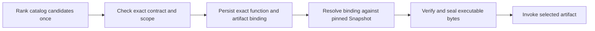

# RT-35. Native calls from an exact discovery binding

Discovery ranks candidate descriptions. The invocation needs a separately accepted function hash from a particular semantic Snapshot. This fixture uses a small KD-tree at binding time and two statically linked Linux executables at runtime. The binding records the snapshot root, exact function, required contract and exact artifact digest. The runtime module reads the pinned catalog and artifact store directly. [Issue #335](https://github.com/aivibeflow/LLMLang/issues/335) · [Scoped ANN and contract filters](RT-35-ANN-CONTRACT-FILTER-2026-11-25.md)

The binding step compares the index's root and complete fixture inventory with the authoritative catalog. It excludes a closer-ranked candidate with a different contract. Runtime rechecks the catalog digest, scope, exact selection and artifact digest. It copies the verified executable bytes into a sealed Linux memory file and executes that same descriptor. The fixture records that both executables contain neither an ELF interpreter entry nor a dynamic dependency.



## Results

The fixture checks all nine input values in four histories, yielding 36 native calls. Rebuilding the original index in reverse score order preserves the binding. The old provider still returns the old offset after the index is removed. The current Snapshot selects the replacement and returns the new offset with the search index absent. Passing a separately pinned and authorized retained Snapshot continues to invoke the old provider as long as its bytes remain available.

Nine negative controls reject stale and duplicate index rows, an old binding at the new root, a wrong requested contract, wrong function or artifact selection, mismatched snapshot contents, replaced artifact bytes and a missing retained artifact. A missing retained artifact does not trigger rediscovery. [Exact hashes, results and refusals](BOUND-NATIVE-CALL-01/evidence.json)

The fixture assumes the caller already has authority to use its exact Snapshot and that the catalog's contract mapping has been validated. It tests hash binding and invocation independent of search. Contract proof, process sandboxing, revocation policy, separately versioned ABI profiles, artifact retention and portable loader support remain open.

## Replay

Source baseline `bdb404a` on `research/all`. Replay used Linux 6.18.57, CPython 3.12.14, GCC 14.2.0, glibc 2.41 and SciPy 1.17.0. The Linux profile requires executable memory files, seals and procfs descriptor access. Exact artifact hashes depend on the static compiler and libc. Run from the repository root.

```sh
data=research/semantic-representation/RT-35/BOUND-NATIVE-CALL-01
receipt=$(mktemp)
python -B "$data/run.py" "$receipt"
cmp "$data/evidence.json" "$receipt"
rm "$receipt"
```
