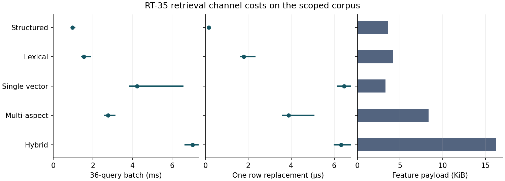
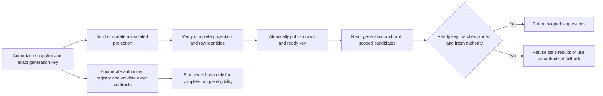

# RT-35 retrieval corpus, channel costs and index lifecycle

Semantic discovery needs a shortlist that covers likely candidates and a separate source of authority for calling an exact function. This candidate comparison pairs archived quality checks with the measured cost of ranking the same corpus through cached feature projections. A separate SQLite experiment supplies persistence and update evidence. The measurements support replaceable retrieval methods and a shared validation boundary.

## Corpus and comparison

The [scoped fixture](RT-35-SCOPED-RETRIEVAL-2026-11-25.md) has 72 cards and 66 exact objects. Six families have distinct-name implementations with the same purpose and descriptions that alias the same object. Similar objects share some signatures and metadata while changing input domain, output, ownership, effects, failure or available evidence. Literal and paraphrased requests cross three visibility scopes for 36 contexts. The independent fixture truth labels 48 compatible query-object pairs. Stable exact IDs deduplicate aliases before the ranking cutoff.

Structured ranking compares contract tags. Lexical ranking compares token sets. Single-vector exact nearest-neighbor search uses cosine similarity over a 16-bucket token-count vector. Multi-aspect exact ranking combines purpose and description sets with contract overlap. Hybrid sums reciprocal ranks across structured, lexical and multi-aspect channels. These five scorers exchange the same scope and exact artifact identifiers. A separate [KD-tree comparison](RT-35-ANN-CONTRACT-FILTER-2026-11-25.md) used synthetic vectors over 3,072 functions and 192 queries. At epsilon 0.6, scoped approximate retrieval recovered 1,528 of 1,536 scoped exact neighbors and 325 of 327 exact-shortlist compatible pairs. Global top-eight followed by scope filtering left 102 lists empty.

| Channel | Query hit@3 | Compatible recall@3 | Precision@3 | MRR@3 | nDCG@3 | Unsafe first | False unique |
|---|---:|---:|---:|---:|---:|---:|---:|
| Structured | 6/36 | 8/48 | 0.0741 | 0.1667 | 0.1667 | 30/36 | 2/36 |
| Lexical | 36/36 | 42/48 | 0.3889 | 0.5000 | 0.6007 | 36/36 | 18/36 |
| Single vector | 36/36 | 41/48 | 0.3796 | 0.4444 | 0.5541 | 36/36 | 19/36 |
| Multi-aspect | 36/36 | 42/48 | 0.3889 | 0.5000 | 0.6007 | 36/36 | 18/36 |
| Hybrid | 28/36 | 30/48 | 0.2778 | 0.4352 | 0.4639 | 31/36 | 17/36 |

Query hit@3 counts contexts with at least one compatible candidate. Compatible recall counts exact compatible pairs and precision measures the compatible share of 108 positions. MRR averages the reciprocal rank of the first compatible result. nDCG measures rank-discounted compatible results relative to the ideal order for the context. Unsafe first includes incompatible and unchecked first results. False unique is a shortlist-only eligibility check that binds despite ambiguity or pending evidence in the full authorized registry. The complete registry produced 12 bound, 12 ambiguous and 12 pending decisions. Lexical and multi-aspect tied on these aggregate quality measures, while the tested hybrid lost compatible pairs.

## Measured cost

All 180 full orders from the cached projections match the reference fixture. For each channel, one description replacement produces the same serialized feature table by a one-row update as by full rebuild. Measurements use 20 shuffled blocks on one pinned logical CPU. Each timed batch ranks all 36 queries over already scoped cards and materialized features, including query feature calculation, scoring, sorting and exact-ID deduplication. The update sample is the mean cost of 200 individual row projections and replacements in a copied in-memory table. Feature bytes count compact JSON of that table, including its keys.

| Channel | Batch ms, median (p10–p90) | Update µs, median (p10–p90) | Feature bytes |
|---|---:|---:|---:|
| Structured | 0.974 (0.917–1.118) | 0.166 (0.164–0.169) | 3,655 |
| Lexical | 1.545 (1.389–1.908) | 1.788 (1.614–2.345) | 4,257 |
| Single vector | 4.231 (3.845–6.571) | 6.459 (6.120–7.522) | 3,373 |
| Multi-aspect | 2.778 (2.543–3.147) | 3.871 (3.562–5.089) | 8,523 |
| Hybrid | 7.040 (6.629–8.269) | 6.313 (5.978–7.042) | 16,625 |



The dot marks the median and the line spans the empirical p10–p90 range. Structured ranked fastest in these samples and had the lowest compatible recall. Lexical used about half the serialized feature bytes of multi-aspect and ranked faster with the same recall. Timings omit authorization, database I/O, vector-service calls, and network latency. The byte counts measure encoded features. Runtime heap and persistent index size require separate measurements.

## Candidate publication and cache contract

Bind each generation to a workspace namespace, immutable snapshot, description digest, visibility revision, projection schema and token or embedding model version. Version the ranking configuration and ANN metric and build parameters with the projection that uses them. A search cache key also includes the normalized typed query, authorized scope, ranking configuration and result limit. Reuse across keys requires an independently verified equivalence of the affected projection and scope. Exact contract receipts and bindings retain their own snapshot and artifact keys.



A delta can replace changed rows and remove withdrawn ones. Rebuild from the authoritative snapshot if the previous generation, delta coverage or verification is unavailable. Serving freshness requires comparing the full ready key to both the pinned key and current authority. Rankers do not supply completeness for binding.

The [native SQLite WAL experiment](RT-35-PERSISTENT-INDEX-GENERATIONS-2026-11-25.md) returned 10 exact results and refused 18 in 28 full-key schedules. The seven separate premature-ready controls yielded two exact and five incomplete results, so the marker and the complete rows must enter the same transaction. Across 24 maintenance measurements the full and delta projections agreed. At 1,024 source rows and one replacement, full rebuild wrote 1,023 rows and allocated 385,024 database bytes, while delta wrote one row and allocated 360,448 bytes. Both visited 4,092 rows for comparison and validation. Those figures describe the SQLite fixture including authority and both workspaces. They are separate from the in-memory feature and latency measurements above.

## Evidence and limits

- [Timing samples and feature sizes](CHANNEL-COST-01/evidence.json) use CPython 3.12.14, Linux 6.18.57, and logical CPU 3 on AMD EPYC 9V74. The ledger pins both Python source hashes. The scoped fixture source was last changed at `12a7cfa69e8e7ee49dc4b991ecb9359aebde3dda`. A two-block run with seed 71 reproduced the order digest and feature sizes. Timing ranges describe run-to-run variation on this host.
- [Quality ledger](SCOPED-RETRIEVAL-01/evidence.json), SHA-256 `e00902d063a76344b1f7c68c612ed9b58ab01d9c02516b3a0e9ed9d13bbbedbb`.
- [ANN ledger](ANN-FILTER-01/evidence.json), SHA-256 `cf40876c886cee6d5b304243dbdbfe30a9049735a2337413f6d535984c551bde`.
- [SQLite ledger](PERSISTENT-INDEX-01/evidence.json), SHA-256 `f69318b9a526249403decf80acca3937c7b746948f7f6de9dd74fc339d4e2d72`.

The corpus uses hand-authored families and synonyms. The experiments cover finite fixture evidence, synthetic vectors, and local SQLite process behavior. They do not establish a production model or layout, pressure and contention costs, distributional recall, or a threshold for promotion on representative workloads. Those decisions require representative labels and measurements.

To collect a fresh set of timings from the repository root, select an allowed logical CPU and write to a separate file. The plot uses archived timings and Matplotlib 3.10.8.

```bash
fixture=research/semantic-representation/RT-35/CHANNEL-COST-01
LC_ALL=C PYTHONHASHSEED=37 PYTHONDONTWRITEBYTECODE=1 python3 "$fixture/measure.py" \
  --cpu 3 --blocks 20 --seed 3535 > /tmp/llmlang-rt35-channel-cost.json
LC_ALL=C MPLBACKEND=Agg MPLCONFIGDIR=/tmp/llmlang-rt35-mpl python3 "$fixture/chart.py"
```
