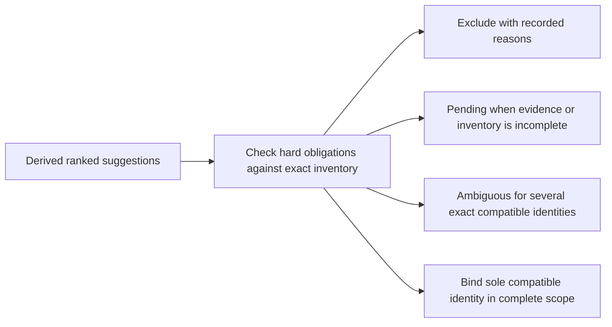

# RT-35 hard compatibility and explicit ambiguity

A candidate is compatible only when every hard obligation has applicable passing evidence. An established violation excludes the candidate with a specific reason. Missing or conflicting evidence remains unknown. Similarity affects suggestions, and exact candidate evidence governs call resolution.

## Candidate checks

| Obligation | Bounded check |
| --- | --- |
| Types and ownership | Match the exact input/output type pair and the required ownership mode. |
| Preconditions | The provider accepts every input admitted by the caller. |
| Postconditions | Every observed provider result lies in the caller's allowed result set. |
| Effects and capabilities | Provider effects and required capabilities are subsets of the caller's allowed sets. |
| Failure behavior | Each permitted provider failure satisfies the caller's allowed observable outcome. |
| Evidence applicability | Resolve current facts for the exact callable, declared query and snapshot. Treat unresolved evidence as unknown. |

The fixture uses finite value sets and exact type and ownership modes. General predicates need typed refinement or proof. Exclusion reasons and unknown obligations are reported independently of retrieval scores. [Scoped retrieval and exact binding](RT-35-SCOPED-RETRIEVAL-2026-11-25.md) · [Structured query provenance](RT-35-SEMANTIC-DESCRIPTION-AND-QUERY-2026-11-25.md)



## Checked outcomes

Across 2,187 combinations of seven passing, failing or unknown facets, one is compatible, 2,059 are excluded and 127 remain unknown. Seven typed negative controls each isolate one failing obligation. A high-score candidate with a forbidden effect cannot displace a verified lower-score candidate. One verified candidate with an unresolved alternative stays pending. Two verified identities remain ambiguous irrespective of ranking. An exact repeated candidate is counted once, and conflicting evidence for the same candidate stays pending.

The experiment assumes applicable evidence and a separately established complete authorized inventory. It validates classification and decision behavior over the recorded fixture. Native call binding, production proof acquisition, unknown external domains and policy for selecting among verified alternatives remain separate gates. [Exact native call](RT-35-BOUND-NATIVE-CALL-2026-11-25.md)

## Reproduce

Use CPython 3.12.14. Python hash seeds 37 and 71 produce evidence SHA-256 `e46abd9be7dd1a9693ae5e614be3cf04d64ba26c32f80267c4eff233ed73cea4`. [Evidence ledger](COMPATIBILITY-EXPLANATION-01/evidence.json)

```sh
LC_ALL=C PYTHONHASHSEED=37 PYTHONDONTWRITEBYTECODE=1 \
  python research/semantic-representation/RT-35/COMPATIBILITY-EXPLANATION-01/check.py > /tmp/rt35-compatibility.json
```
