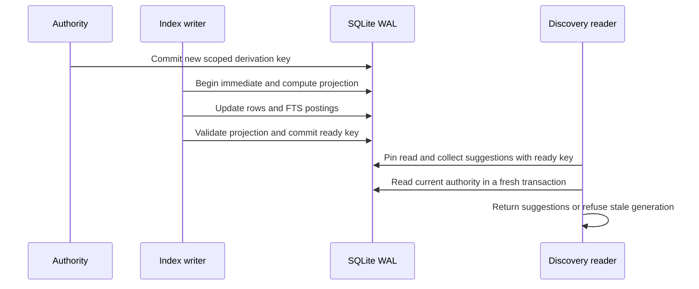

# Persistent discovery index generations in SQLite

This RT-35 experiment compares freshness gates for a rebuildable function discovery index and measures update work for full rebuild and row delta publication. It asks which changes invalidate search output even when exact selected function hashes stay the same. The ranking channel is an actual SQLite FTS5 index. The experiment covers discovery results. Exact semantic compatibility and call binding require their own authority.

## Publication and query protocol

A workspace namespace identifies one logical projection. Within that namespace its key contains a digest of the selected name/hash map, a digest of the descriptions, the visibility policy generation, the projection schema version and the token model version. The two digests and visibility are held in the authoritative tables. The same logical function names exist in another workspace with different artifact hashes. The fixture supports one visibility class per workspace.

The FTS5 external-content table uses insert, update and delete triggers. A writer obtains a SQLite immediate transaction, computes the visible authoritative projection, applies a full rebuild or delta, verifies equality to the expected rows, and publishes a ready header in the same commit. The reader queries FTS using `exact AND search`, filters by namespace, orders by logical name and takes at most four results. Its original SQLite WAL read holds both the header and projection stable across writer commits. A fresh read transaction provides the comparison point for current authority.



The atomic index commit covers the projection, FTS postings and ready header. The authority update can become durable before that index commit. It creates a window in which a fresh query must wait, refuse or use a separate authoritative fallback. This experiment implements refusal.

The four gates implement different assumptions. Pinned only checks the full header against the original read. Current root compares only the observed and fresh semantic roots. Fresh rows removes suggestions that are outside the current exact authorized name/hash selection. Complete key compares the original ready header, the original full key and the fresh full key.

## Protocol results

The fixture crosses seven changes with five schedules. Changes include a no-op, exact artifact replacement, visibility revocation or expansion, and description, schema or model edits. The schedules pin a query across a commit, leave authority ahead of the projection, terminate a process inside an uncommitted rebuild, commit a complete update, or deliberately stamp readiness before a separately committed partial rebuild. The last protocol is a negative control. The oracle independently enumerates expected matches from current source rows and the model and schema versions. Exact means the same ordered suggestions as the oracle. An ineligible outcome returns a currently unauthorized or superseded row. Stale or incomplete indicates an eligible subset or a result derived from obsolete text or version.

| Gate | Exact | Refused | Ineligible | Stale or incomplete |
|---|---:|---:|---:|---:|
| Pinned only | 10 | 12 | 2 | 4 |
| Current root | 10 | 3 | 3 | 12 |
| Fresh rows | 13 | 0 | 0 | 15 |
| Complete key | 10 | 18 | 0 | 0 |

The 28 protocol schedules consist of seven changes crossed with four schedules. Comparing the full key prevents stale acceptance in this set. Fresh row membership prevents ineligible results but cannot restore an omitted visible alternative or identify all obsolete text matches. Inspecting the other workspace finds identical results in every schedule.

The seven split-publication controls yield two exact results and five incomplete results for every gate, including the full key. An honest marker is therefore a transaction invariant. After process termination, delta repair reconstructs the oracle result and FTS5's external-content integrity check passes. The atomic-abort cases retain the previous committed projection and header together.

## Maintenance work

The 24 measurements cross 64, 256 and 1,024 source rows, two update methods and four change types. At each size the two methods yield the same projection digest for each change. The table shows the 1,024-row slice. Write payload bytes count JSON-encoded upsert arguments and exclude removal arguments, SQLite pages and WAL frames. Database allocation includes both workspaces, authority, indexes, and free pages after checkpoint. Read counts are row visits in the projection comparison and verification passes.

| Change | Update | Deletes | Writes | Write payload bytes | Rows read for compare/validation | Allocated database bytes |
|---|---|---:|---:|---:|---:|---:|
| root | rebuild | 1023 | 1023 | 109365 | 4092 | 385024 |
| revoke | rebuild | 1023 | 1022 | 109264 | 4089 | 385024 |
| schema | rebuild | 1023 | 1023 | 109365 | 4092 | 385024 |
| description | rebuild | 1023 | 1023 | 109373 | 4092 | 385024 |
| root | delta | 0 | 1 | 101 | 4092 | 360448 |
| revoke | delta | 1 | 0 | 0 | 4089 | 360448 |
| schema | delta | 0 | 3 | 303 | 4092 | 360448 |
| description | delta | 0 | 1 | 109 | 4092 | 360448 |

Delta publication needs one upsert for a selected-object or description replacement and one delete for revocation. The schema edit changes only three visible encoded rows. Both methods still scan and verify the complete projection, so fewer SQLite writes do not establish sublinear update work. Real dependency-indexed updates and verification of partial source deltas are follow-up comparisons.

## Limits and replay

This experiment covers process termination and WAL transaction visibility on a local filesystem. It does not measure power-loss durability, query or update latency, contention, reader starvation, concurrent authority writer races, distributed tenant isolation, or response delivery after the final authority read. Full-key equality is evaluated at the fresh database observation. Physical database allocation is an observation of this SQLite build and page size. The namespace filter proves fixture result isolation only. The test also assumes writers respect the protocol and does not attest filesystem protection or privileged alteration of FTS structures.

Use CPython 3.12.14 and SQLite 3.53.1 with FTS5. The ledger records exact SQLite and FTS5 source IDs and a SHA-256 of the runner. The initial baseline is `12d340b8b94533c8359da4e06c39d4f1ef3543eb`. Replay from the repository root.

```bash
fixture=research/semantic-representation/RT-35/PERSISTENT-INDEX-01
PYTHONHASHSEED=1 python3 -B "$fixture/run.py" > /tmp/llmlang-rt35-index.json
cmp "$fixture/evidence.json" /tmp/llmlang-rt35-index.json
python3 "$fixture/chart.py"
```

See the [native fixture](PERSISTENT-INDEX-01/run.py), [measured ledger](PERSISTENT-INDEX-01/evidence.json), [table generator](PERSISTENT-INDEX-01/chart.py), and [RT-35 research brief](RT-35-SEMANTIC-FUNCTION-DISCOVERY-AND-RETRIEVAL.md).
