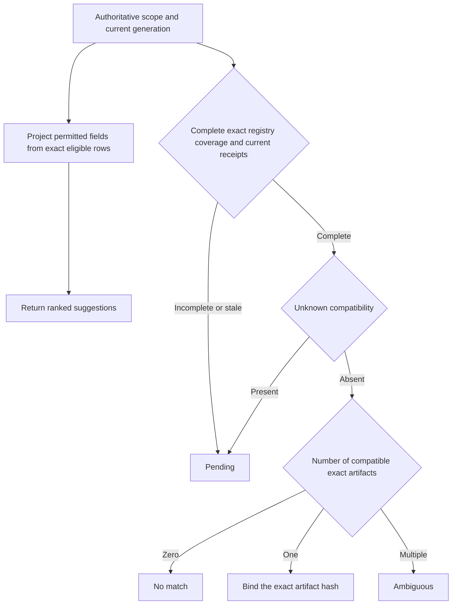

# RT-35 scoped response and automatic-resolution gates

A discovery service needs to make two distinct checks. Each returned field needs current authority for its scope. Each automatic binding needs exact compatibility and complete evidence for the selected scope. This study checks a candidate response and resolution contract over finite input combinations and compares it with earlier native and ranking fixtures.

## Response eligibility

The response model checks ready versus current generation, tenant, workspace, authorized package and currently selected exact artifact. It projects only the allowed fields. Its 384 cases cross two tenants, two workspaces, three package values, two exact-selection conditions, four generation conditions and four combinations of visible name and description. An independently specified expected result accepts eight exact cases across the two allowed packages and refuses 376. Each allowed package has one case for every possible field set, including the permitted empty projection. The matrix checks exact equality of projected content. The candidate treats field authorization as an authoritative input supplied by the caller of the projection function. A production service must obtain it from policy at the same scope rather than taking it from the search index.

The [scoped retrieval fixture](RT-35-SCOPED-RETRIEVAL-2026-11-25.md) compares misleading descriptions and semantically near alternatives with materially different contracts. A finite-domain checker and snapshot-bound receipts provide compatibility independently of text. Prior-root, misidentified row and omitted-alternative controls distinguish stale, unauthorized and incomplete derived evidence. This is a defensive check on index integrity. The [SQLite WAL fixture](RT-35-PERSISTENT-INDEX-GENERATIONS-2026-11-25.md) checks namespaces and transactional replacement and supplies a negative control for premature ready metadata. The prototype covers projection and result integrity under fixture assumptions. Distributed tenant policies, side channels and operational enforcement require evidence from the selected service.

## Automatic resolution



The fixture crosses two candidates' three compatibility states with five coverage sets, two iteration orders and two receipt generations. The separate nine-cell oracle applies to complete current coverage. All other cases must stay pending. The 180 outcomes contain four bound, two ambiguous, two no-match and 172 pending. Each outcome is invariant to the two candidate orders. Pending includes 162 cases with absent, extra, or stale coverage and ten complete-current cases with an unknown. The prototype uses exactly two selected identities and no foreign live system.

The candidate minimum safety threshold is exact coverage of the current authorized registry, all relevant obligations checked for their exact snapshot and artifact, zero unknown compatibility verdicts, exactly one compatible identity, and a current authorized invocation of its exact hash. The current generation check guards the suggestions. A semantic similarity score establishes none of the binding obligations. Any bounded acceptance suite should require zero ineligible response fields and zero false bindings, including negative controls. The tested exact decision oracle passes 180/180 and the projection oracle passes 384/384. These are regression criteria for the finite inputs. They give no statistical upper bound for deployment failures.

Search quality is a separate prerequisite for enabling automatic resolution in a representative deployment. The [channel comparison](RT-35-CHANNEL-COST-AND-CORPUS-2026-11-25.md) reports compatible recall numerators and denominators, rank metrics, per-query ambiguity failures, and empirical timing ranges. Its best compatible recall is 42/48 and every first suggestion in the two leading channels is either incompatible or unchecked. These results rule out rank-only or truncated-shortlist binding for the checked design and corpus. A representative minimum recall, workload coverage, performance targets and release approval remain human-dependent. ANN, embedding and projection versions should accompany every quality report together with exact ground-truth provenance, per-scope failures, and uncertainty based on independent sampling when available.

## Replay and provenance

The [runner](RESPONSE-GATE-01/check.py) and [enumerated outcomes](RESPONSE-GATE-01/evidence.json) are executable with CPython 3.12.14. The ledger contains the runner digest. The coverage and counts are exact enumerations, so the table of totals in the ledger is sufficient to inspect their distributions. The fixture has no embedding model. Its lexical and vector findings come from the separately pinned channel ledgers, which specify their feature and metric versions. Two hash seeds produced byte-identical archived results.

```bash
fixture=research/semantic-representation/RT-35/RESPONSE-GATE-01
LC_ALL=C PYTHONHASHSEED=37 python3 -B "$fixture/check.py" > /tmp/llmlang-rt35-response.json
cmp "$fixture/evidence.json" /tmp/llmlang-rt35-response.json
```
