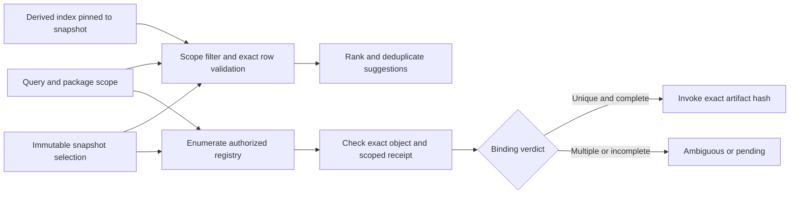

# Bounded scoped retrieval and exact function binding

This RT-35 study asks whether discovery rankings can recover functions that meet a query and whether a ranked shortlist contains enough evidence to bind a call. The experiment compares five retrieval channels and checks binding against the complete authorized snapshot selection. It exercises a fixture-level candidate design.

## Fixture and alternatives

The catalog contains 72 cards for 66 distinct content-addressed objects. Six function families each have literal and paraphrased queries. Three access scopes produce 36 query contexts. In each family two descriptions refer to the same exact object, and a second implementation has a different content hash. Nearby objects differ in type, permitted inputs, result, effect, ownership, failure, or available evidence. Two foreign cards per family are lexical matches. The candidate bodies describe an integer mapping on the complete fixture domain `[-2, 3]`. Each known compatibility receipt is keyed by snapshot root and artifact hash.

The structured baseline scores declared metadata overlap. The lexical baseline uses Jaccard overlap on tokens. The single vector orders 16-bucket token-hash vectors by cosine similarity. The multi-aspect baseline uses purpose, description and contract with weights 0.55, 0.35 and 0.10. It uses a fixture synonym map. The hybrid combines structured, lexical and multi-aspect ranks by summing reciprocal ranks starting at denominator 20. Each channel deduplicates by exact artifact before taking the first three. Metadata is a discovery hint and can disagree with the body.

A hand-authored fixture oracle labels compatible variants independently of the compatibility checker. The checker examines the exact selected object over the finite domain and checks receipt scope. It returns ambiguous for multiple confirmed artifacts, pending when an unknown might affect a unique selection, and bound for a sole compatible artifact when the catalog contains no unresolved alternative. An empty proven set with no unknown yields no match. The fixture exercises the first three outcomes. A bound call evaluates the exact hash at input 2.



The ranking lane presents suggestions. The binding lane uses the authorized registry and exact objects even if the derived index omits one of them. Both lanes use the same pinned selection.

## Measurements

A query hit recovers at least one compatible artifact. Compatible recall counts artifacts across all eligible query contexts, including two per extended scope. Precision uses 108 shortlist positions. MRR and nDCG use binary compatibility at cutoff three. Unsafe first counts a first suggestion without established compatibility. False unique counts cases where shortlist-only compatibility returns bound but exhaustive checking returns ambiguous or pending. Late-filter loss counts a reduction in compatible hits when truncation precedes scope filtering. Global shortlist evaluation runs inside the synthetic experiment.

| Ranking channel | Query hits | Compatible recall | Precision@3 | MRR@3 | nDCG@3 | Unsafe first | False unique | Late-filter losses |
|---|---:|---:|---:|---:|---:|---:|---:|---:|
| Structured | 6/36 | 8/48 | 0.0741 | 0.1667 | 0.1667 | 30/36 | 2/36 | 0/36 |
| Lexical | 36/36 | 42/48 | 0.3889 | 0.5000 | 0.6007 | 36/36 | 18/36 | 6/36 |
| Single vector | 36/36 | 41/48 | 0.3796 | 0.4444 | 0.5541 | 36/36 | 19/36 | 17/36 |
| Multi-aspect | 36/36 | 42/48 | 0.3889 | 0.5000 | 0.6007 | 36/36 | 18/36 | 6/36 |
| Hybrid | 28/36 | 30/48 | 0.2778 | 0.4352 | 0.4639 | 31/36 | 17/36 | 6/36 |

Lexical and multi-aspect ranking both recovered 42 of 48 compatible query-artifact pairs. This fixture showed no lift from the hand-authored aspects over lexical ranking. All 36 first suggestions in both channels lacked established compatibility. Shortlist-only compatibility falsely bound 18 contexts in both. Filtering before truncation avoided lost compatible hits in six contexts for each of these channels. The single-vector baseline lost compatible hits with late filtering in 17 contexts. The hybrid recovered 30 pairs and shows how equal rank contributions from weaker signals can reduce recall on this workload.

The complete authorized registry produced 12 bound, 12 ambiguous and 12 pending decisions. A stale index root was refused. Relabelling an old index with a current root did not make its obsolete row eligible. A receipt from the prior root for an unchanged alias left compatibility unknown in the current snapshot. Removing a compatible row from a derived index with the current root made the index-only policy bind, while the registry still reported ambiguity.

## Limits and replay

The comparisons cover a deterministic synthetic corpus with correlated rank features and fixture-specific synonyms. All results are counts for the enumerated inputs. They supply no estimate of production quality, ANN recall, large-scale authorization, tenant information leakage, storage, latency or index build and update costs. The receipt representation models checked finite-domain evidence and does not implement a proof service or package-policy principal. An independently collected corpus, a broad set of held-out query forms, stored index lifecycle tests and valid compatibility evidence for full language contracts remain research dependencies. The ranking results support evaluating candidate coverage separately from permission, compatibility and the completeness needed for automatic binding.

The archived ledger uses CPython 3.12.14 and records the fixture source SHA-256, exact content and snapshot addresses for controls, and per-query outcomes. The initial repository base is `67ba4decaa806cbf61d8dbf44b725f2ff93ffd33`. The semantic store and snapshot are imported from the checkout containing this study. Replay from the repository root.

```bash
fixture=research/semantic-representation/RT-35/SCOPED-RETRIEVAL-01
PYTHONHASHSEED=1 python3 -B "$fixture/run.py" > /tmp/llmlang-rt35-scoped.json
cmp "$fixture/evidence.json" /tmp/llmlang-rt35-scoped.json
python3 "$fixture/chart.py"
```

See the [scenario runner](SCOPED-RETRIEVAL-01/run.py), [measured ledger](SCOPED-RETRIEVAL-01/evidence.json), [table generator](SCOPED-RETRIEVAL-01/chart.py), and [RT-35 research brief](RT-35-SEMANTIC-FUNCTION-DISCOVERY-AND-RETRIEVAL.md).
