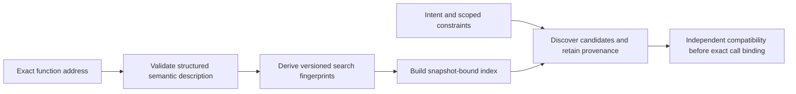

# RT-35 semantic function description and discovery queries

Exact function identity pins what can be called. The canonical description supports applicability checks. Versioned fingerprints and indexes derive search candidates from those facts. The query records the provenance of hard constraints independently of the text used for relevance.

## Candidate records

| Record | Exact subject |
| --- | --- |
| Function address | Immutable callable content, declared contract and execution profile |
| Canonical description | Structured purpose, typed input and output roles, ownership, preconditions, postconditions, effects, required capabilities, errors, explicit constraints and optional cost evidence |
| Fingerprint | Named versioned projection of relevant description fields |
| Search index | Selected snapshot, fingerprint derivation and physical layout |
| Query | Exact intent, structured clauses or both, with hard requirements and soft preferences carrying their provenance |

The fixture describes a bounded reservation operation. It carries an explicit unknown cost rather than fabricating a cost. Changing optional cost evidence changes the description while the tested fingerprint can remain equal when its projection excludes cost. Changing fingerprint version or index layout changes the derived identity independently of the callable address. [RT-35 research brief](RT-35-SEMANTIC-FUNCTION-DISCOVERY-AND-RETRIEVAL.md) · [Relational identity candidate](PREFERRED-FUNCTION-RELATIONAL-SCHEMA.json)



## Checked cases

The model crosses three query forms, presence of intent text, three constraint states, three provenance classes and two source scopes. Twenty-two of 108 inputs pass shape and provenance checks. The rest refuse. Intent-only prose generates candidates and supplies no hard clause. Structured and hybrid hard clauses require an independent approved source bound to the current request. Soft preferences remain distinct from hard clauses. Unsupported query forms and unknown constraint strengths refuse in two additional controls.

The fixture uses a fixed canonical JSON projection and simulated approved sources. It leaves actual author authentication, semantic equivalence, contract proof, fingerprint quality and canonical wire selection open. [Exact snapshot-bound native call](RT-35-BOUND-NATIVE-CALL-2026-11-25.md)

## Reproduce

Use CPython 3.12.14. Both Python hash seeds 37 and 71 produce evidence SHA-256 `ed57ef3859b9bed4197d6e6f6283a71cc41661e514bd949b1d41c7d16d24d7e5`. [Evidence ledger](DESCRIPTION-QUERY-01/evidence.json)

```sh
LC_ALL=C PYTHONHASHSEED=37 PYTHONDONTWRITEBYTECODE=1 \
  python research/semantic-representation/RT-35/DESCRIPTION-QUERY-01/check.py > /tmp/rt35-description-query.json
```
