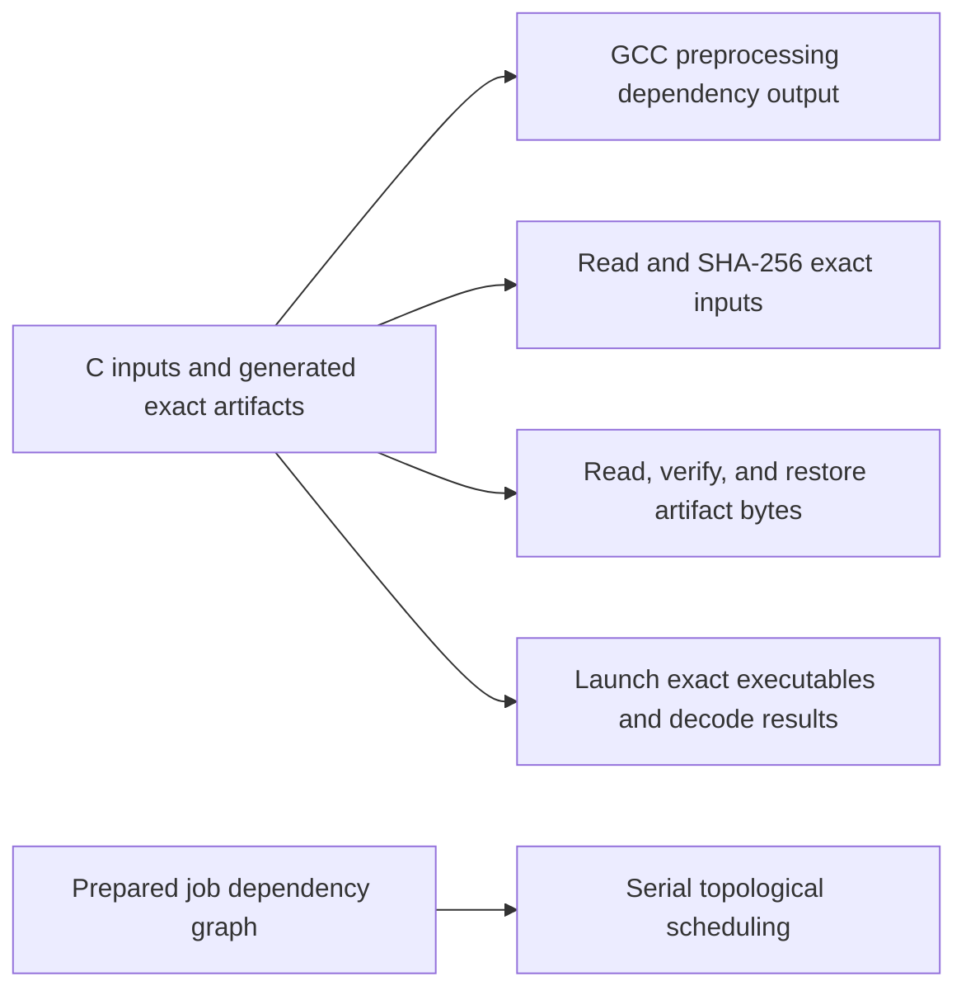
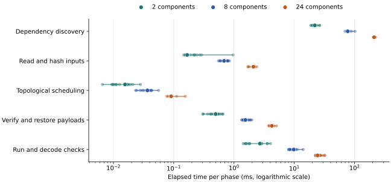

# Discovery, hashing, scheduling, storage and validation costs

## Native workload

The earlier synthetic timing study measured an aggregate cost for key construction, cache lookup and verification. This experiment isolates five operations on a prepared C build. Each component supplies a caller and library source, two object files, one archive and one executable. The checker runs the linked executable and decodes its integer observation. The runner records 17 samples at each of 2, 8 and 24 components, shuffles phase order with seed 318 and warms each phase once. Artifact compilation and linking happen before sampling. [Earlier timing study](RT-11-SYNTHETIC-CXX-CACHE-TIMINGS-2026-11-25.md) · [Per-action hit rates](RT-11-MULTI-ACTION-CACHE-HITS-2026-11-25.md)



| Phase | Timed operation | Correctness check |
| --- | --- | --- |
| Dependency discovery | Run one GCC `-MM` command over all translation units and parse the reported prerequisites. | Compare with the fixture's exact expected source and non-system header map. |
| Hashing | Read each source, shared header and built output and compute its SHA-256. | Match the pinned fixture's source and output checksum map. |
| Scheduling | Build the reverse graph and run a heap-based topological order. | Every declared job appears and every prerequisite precedes its consumer. |
| Storage | Read each cached artifact, check its digest and write it to a separate local directory. | Restore the expected count and check all resulting file digests. Removal of the previous copy is outside the timer. |
| Verification | Launch each linked executable and parse its one integer observation. | Compare with the expected integer series. |

The costs are separate observations. Storage includes its own payload digest, so summing it with the hashing phase would double-count part of the work in an integrated candidate. The runner does no forced filesystem flush. It uses one pinned logical CPU, warm files, overlayfs, serial subprocesses and no network cache. The host remains shared.

## Measured distributions

The 24-component workload schedules 120 jobs, discovers dependencies for 48 translation units, reads and hashes 477,992 bytes, restores 474,384 payload bytes, and runs 24 verification invocations. All oracle checks pass. [Timing samples and manifest](BUILD-PHASE-OVERHEAD-01/evidence.json) · [Plot generator](BUILD-PHASE-OVERHEAD-01/plot.py)



Each faint point is one observation. Larger dots show medians, and lines span the observed minima and maxima. The horizontal axis is logarithmic.

| Median phase time (ms) | 2 components | 8 components | 24 components |
| --- | ---: | ---: | ---: |
| Dependency discovery | 21.865 | 76.973 | 210.992 |
| Read and hash inputs | 0.167 | 0.685 | 2.097 |
| Topological scheduling | 0.016 | 0.037 | 0.091 |
| Verify and restore payloads | 0.496 | 1.548 | 4.233 |
| Run and decode checks | 2.693 | 9.799 | 24.395 |

At 24 components, dependency discovery ranges from 204.946 to 222.776 ms and verification from 22.283 to 32.117 ms. Discovery dominates the other measured operations in this fixture. It invokes the compiler's preprocessor for every translation unit, including system headers that do not appear in the emitted dependency map. A production policy that can reuse dependency discovery or validation would change the relevant cost; the measurement does not establish that reuse is safe. The result leaves controlled hardware, another compiler or toolchain, parallel scheduling, durable storage, proof validation and end-to-end build overhead open.

## Reproduction

Use CPython 3.12.14, GCC Debian 14.2.0-19, GNU Binutils 2.44 and Matplotlib 3.10.8. The recorded system was Linux 6.18.57 on x86-64 AMD EPYC 9V74, with runner affinity set to logical CPU 4 and a cgroup quota of four logical CPUs. Choose an equivalent allowed CPU for a new run if necessary. Run from repository root.

```sh
set -eu
fixture=research/toolchain-and-collaboration/RT-11/BUILD-PHASE-OVERHEAD-01
scratch=$(mktemp -d)
trap 'rm -rf "$scratch"' EXIT
taskset -c 4 python3 -B "$fixture/run.py" --trials 17 --seed 318 > "$scratch/evidence.json"
MPLCONFIGDIR="$scratch" python3 -B "$fixture/plot.py" \
  --input "$scratch/evidence.json" --output "$scratch/timings.svg"
```

Use the published evidence as the plot input to regenerate the archived figure. Fresh elapsed times vary. Compare source and output hashes, work counts and observed results before comparing timings.

[PLAN §3.4](../../../PLAN.md#34-quantify-compilation-speedup) · [Issue #318](https://github.com/aivibeflow/LLMLang/issues/318)
