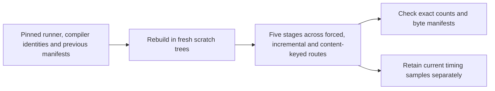

# Fresh reproduction of five build-cache stages

## Scope and checked invariants

This replay checks that the reproducible benchmark implements cold, warm, local-edit, component-edit and broad-change cases. It exports the exact earlier runner and evidence from `research/all` at `0f4d06770500a9482cd175c67afe0dc620d49a5c`. The driver compares the archived runner digest with its ledger, recompiles all required objects, and checks each new sample's method position, compiler count, cache count and exact output manifest against the corresponding archived trial. [Original executable benchmark](RT-11-SYNTHETIC-CXX-CACHE-TIMINGS-2026-11-25.md)



The two tool executable digests match the earlier run, including Clang `0a3c55936ac43954fbe4914e6e73b577ca9e35e75d89ef13d3e28c187f41ca1a`. Three fresh trials cover 15 complete blocks and 45 method rows. The comparison checks all 12 object digests per row via the sorted native manifest. All 45 rows reproduce the expected manifest, order, compiler count and cache count. [Evidence ledger](BUILD-STAGE-REPLAY-01/evidence.json) · [Table generator](BUILD-STAGE-REPLAY-01/chart.py)

| Stage | Forced compiles | Incremental compiles | Content compiles | Content hits |
| --- | ---: | ---: | ---: | ---: |
| `cold` | 12 | 12 | 12 | 0 |
| `warm` | 12 | 0 | 0 | 12 |
| `local` | 12 | 1 | 1 | 11 |
| `component` | 12 | 4 | 4 | 8 |
| `broad` | 12 | 12 | 12 | 0 |

## Fresh timing observations

| Stage | Forced median (ms) | Incremental median (ms) | Content median (ms) |
| --- | ---: | ---: | ---: |
| `cold` | 381.544 | 385.512 | 356.750 |
| `warm` | 374.632 | 1.843 | 1.206 |
| `local` | 384.462 | 32.413 | 31.325 |
| `component` | 368.283 | 120.993 | 120.072 |
| `broad` | 366.181 | 368.338 | 347.533 |

The fresh runner and its compiler children were pinned to one logical CPU on the shared host. The earlier archive exposed five CPUs and also ran serially. The new elapsed times remain separate from the older sample. The fixture uses four translation units in each of three components and a fixed known include graph. General dependency extraction, representative workloads, parallelism, remote cache and controlled hardware remain outside this replay.

## Reproduction

Use CPython 3.12.14, Debian Clang 19.1.7 `1:19.1.7-3+b1` with its matching libraries, GNU Make 4.4.1 and Git 2.56.1. Set `CLANG` to its absolute executable path and run from the checkout root on x86-64 Linux. Adjust the CPU number to an allowed CPU if needed.

```sh
set -eu
fixture=research/toolchain-and-collaboration/RT-11/BUILD-STAGE-REPLAY-01
out=$(mktemp)
trap 'rm -f "$out"' EXIT
taskset -c 4 python3 -B "$fixture/run.py" --clang "$CLANG" \
  --make /usr/bin/make --trials 3 > "$out"
python3 -B "$fixture/chart.py"
```

The runner validates the exact manifest and action invariants during every replay. Elapsed times can vary. The table generator reads the committed ledger.

[PLAN §3.4](../../../PLAN.md#34-quantify-compilation-speedup) · [Issue #318](https://github.com/aivibeflow/LLMLang/issues/318)
