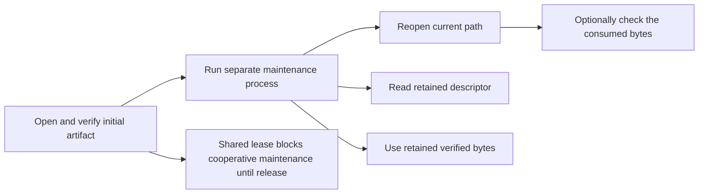

# RT-11 — Keep verified cache bytes stable through use

## Question and method

When can a consumer use an artifact after independently verifying its advertised digest, while cache maintenance may remove or replace the pathname? The [layered cache fixture](RT-11-LAYERED-CACHE-LOOKUP-2026-11-25.md) checks action evidence and artifact retrieval. The [POSIX file identity experiment](../../runtime-and-systems/RT-10/RT-10-POSIX-FILE-IDENTITY-2026-11-25.md) distinguishes current paths from open files. This study checks what those distinctions imply at the cache admission-to-consumption boundary. [PLAN §3.3](../../../PLAN.md#33-semantic-build-and-cache-graph) · [#300](https://github.com/aivibeflow/LLMLang/issues/300)

A reader hashes a regular file containing known fixture bytes. A separate maintenance process then runs in the same private temporary directory before consumption. Its five schedules leave the file unchanged, remove the pathname, replace it with identical bytes, replace it with other fixture bytes, or rewrite the existing file. The comparison uses an unbuffered descriptor, retained verified bytes, a second digest check on bytes acquired at use, and cooperative file locks. Two additional schedules present an already missing or corrupt file at the initial check.



The fixture checks exact payload bytes, reports unavailability separately from integrity failure, and records the maintenance disposition. A reader lease uses a shared lock. The maintenance process tries an exclusive lock on the same lock file and retries after the reader exits.

## Results

The following table covers the five valid-start schedules per policy. All ten remaining schedules fail the initial check appropriately, five for missing bytes and five for integrity failure.

| Read policy | Exact bytes | Wrong bytes | Missing afterward | Final integrity refusal |
| --- | ---: | ---: | ---: | ---: |
| Reopen pathname | 2 | 2 | 1 | 0 |
| Retain descriptor | 4 | 1 | 0 | 0 |
| Retain verified byte snapshot | 5 | 0 | 0 | 0 |
| Reopen and revalidate consumed bytes | 2 | 0 | 1 | 2 |
| Cooperative read lease | 5 | 0 | 0 | 0 |

Reopening a verified name can lose the file or read a new value. An open descriptor survives unlink and atomic replacement in these schedules, but an in-place write changes the bytes that the same descriptor reads. Keeping the exact bytes that were verified preserves all five reads. Acquiring a fresh snapshot and checking it at use protects integrity while allowing the read to fail after eviction.

The lease preserves all five valid-start reads. The maintenance process defers every request while the reader holds the lock and can apply it after release. This protection depends on maintenance and writers honoring the same lock. Retaining a large in-memory snapshot would have different resource costs from leasing immutable on-disk bytes. The fixture records categorical outcomes and does not measure those costs.

## Reproduce and limits

The baseline was `330933c8df5148e95342eff6d2aa7e0d76321e7d` on `research/all`. The replay used CPython 3.12.14 on Linux 6.18.57 x86-64 with overlayfs and the GNU `stat` utility. Run from the repository root:

```sh
fixture=research/toolchain-and-collaboration/RT-11/CACHE-ARTIFACT-LIFETIME-01
out=$(mktemp)
python3 -B "$fixture/run.py" > "$out" &&
  cmp "$fixture/evidence.json" "$out" &&
  python3 -B "$fixture/chart.py"
```

The [ledger](CACHE-ARTIFACT-LIFETIME-01/evidence.json) preserves all 35 outcomes and the content digests. The [table generator](CACHE-ARTIFACT-LIFETIME-01/chart.py) renders the read dispositions. Controlled process order gives specific interleavings. Network filesystem leases, partial writes during verification, lock recovery after process death, authority, and integration with persistent cache metadata remain separate questions. [Runner](CACHE-ARTIFACT-LIFETIME-01/run.py)
