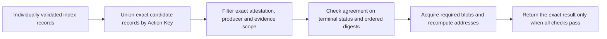

# Merge cache indexes and validate exact result availability

**Scope:** PLAN §3.3, [#300](https://github.com/aivibeflow/LLMLang/issues/300), and [LL-021](../../../TODO.md#ll-021--define-semantic-action-caching-and-incremental-compilation). Closed candidate fixture on `research/all` at `e42d50a353f6c0fb92bf5728d66da115f2e407ce`.

## Question and candidate

[Scenario 93](RESEARCH-SCENARIO-93-CACHE-SOUNDNESS-RESULT-ENVELOPES-AND-TRUST.md) separates Action Key identity, artifact integrity, applicability and producer authorization. What should happen when two validated indexes make the same claim, disagree, or refer to evicted bytes?

The existing [index validator](../../packages-and-ecosystem/PROTOTYPES/PACKAGE-IDENTITY-01/cache_index.py) verifies the shape of each contributing index, its language context and its exact Action Key. This fixture keeps each candidate's producer, evidence scope, status and ordered artifact locator list. It unions identical candidate identities inside each Action Key and sorts the results. Structural index validation makes the members eligible for evaluation under a consumer policy. Authenticated candidate IDs, allowed publishers and required evidence scope are inputs to that policy.



For a byte-exact request, an admitted candidate also needs byte determinism and the expected output count. Check every artifact address before returning a hit. The fixture uses an in-memory byte store and an externally supplied set of authenticated candidate IDs. It exercises policy checks without implementing a signature scheme, identity provider or package transport.

## Results

The [ledger](CACHE-INDEX-MERGE-01/evidence.json) records 23 controls. All 24 permutation orders for the four contributing indexes produce the same merged candidate set. The 16 existing language-version and index-validation tests also pass.

| Control class | Observed policy |
| --- | --- |
| Repeated identical receipt or agreeing authorized producers | Retain distinct producer evidence and return one exact result. |
| Authorized disagreement on byte digest or terminal status | Report a conflict instead of electing an arbitrary winner. Evicting the disagreeing output leaves the metadata conflict visible. |
| Missing or stale attestation, revoked producer or different evidence scope | Decline authoritative reuse. An outside-policy candidate does not defeat the otherwise valid result. |
| Incomplete closure, transient outcome or nondeterminism | Reject at structural validation. A semantic-only deterministic entry is structurally eligible but cannot serve the byte-exact request. |
| Evicted artifact, incorrect bytes or incomplete outputs | Distinguish unavailable, integrity failure and wrong output shape. Rematerializing verified bytes restores the hit under the same authorizations. |

The fixture admits six hits and reports three conflicts. It separately reports five cases without an applicable attestation, two missing-artifact cases, one integrity failure, one wrong output shape, one miss, one semantic-only result and three structural rejections. A last-writer-wins policy would hide the two types of authorized disagreement. Treating all submitted metadata as equally authoritative could let an outside-policy entry block a valid result. Filtering before conflict detection makes the result depend on the consumer's trust and applicability rules.

A content store can evict payload bytes while historical receipts remain inspectable. A present, hash-matching blob supplies content integrity without establishing that the recipe or computation was correct. A production consumer should acquire a stable verified snapshot or lease across validation and use. This fixture does not run concurrent eviction or reader recovery. Named and typed output manifests, durable merge publication, real authentication, lifecycle and policy revocation, evidence equivalence and production package distribution remain separate.

## Reproduce

Use CPython 3.12.14 and Git 2.56.1. The [runner](CACHE-INDEX-MERGE-01/run.py) imports the archived index validator and emits the complete dispositions.

```sh
set -eu
scratch=$(mktemp -d)
git archive e42d50a353f6c0fb92bf5728d66da115f2e407ce research | tar -x -C "$scratch"
fixture=research/toolchain-and-collaboration/RT-11/CACHE-INDEX-MERGE-01
cp -R "$fixture" "$(dirname "$scratch/$fixture")/"
python3 -B "$scratch/$fixture/run.py" > "$scratch/evidence.json"
cmp "$scratch/evidence.json" "$fixture/evidence.json"
(
  cd "$scratch/research/packages-and-ecosystem/PROTOTYPES/PACKAGE-IDENTITY-01"
  python3 -B -m unittest test_language_version_cache_index.py
)
```

The counts enumerate the fixture. Mermaid source was inspected directly.
