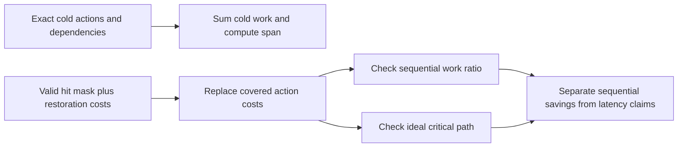

# RT-11 validate the cache speedup equation and its scheduling boundary

The analytical cache equation predicts reduced sequential work when saved recomputation exceeds the cost of finding and restoring valid results. A concurrent build additionally depends on the order and duration of actions on its critical path. This finite check validates the sequential equation and tests which of its speedup conclusions carry over to ideal parallel execution. It uses previously recorded native measurements to state where calibration is still needed.

## Model

Let (W) be the sum of cold action costs. Each valid hit skips its original action cost and contributes an exact restoration cost. Let (R) be skipped cost divided by (W), and (O) restoration cost divided by (W). The sequential work ratio is (W/W_{cache}=1/(1-R+O)). The formula includes overheads only when they are assigned to the modeled inputs. A hit is eligible only if action identity, evidence and artifact contents permit reuse.

For a fixed dependency graph, ideal execution with unlimited workers completes in the maximum total cost along any directed path, called the span. The cached graph keeps the same dependencies and substitutes the hit restoration cost at its original node. A finite-worker runtime can also incur waiting, contention, scheduling cost and resource constraints. Its wall time has both the span lower bound and work divided by available workers as a lower bound under the modeled costs.



## Checked comparison

The model uses four fixed topologically ordered nodes with cold costs (3,7,11,19), and hit restoration costs (1,8,2,20) in arbitrary units. Two restoration costs exceed recomputation, preserving the explicit cost of ineffective caching. All 64 forward-edge sets and 16 hit masks give 1,024 cases. Exact rational arithmetic matches the analytical work equation in every case. An independent path enumerator agrees with the dynamic critical-path calculation.

| Sequential work | Span improves | Span unchanged | Span worsens |
|---|---:|---:|---:|
| Improves | 424 | 120 | 160 |
| Unchanged | 18 | 80 | 30 |
| Worsens | 0 | 32 | 160 |

For four independent actions, hitting only the third costs 31 instead of 40 total units and leaves span 19. Hitting both the third and fourth costs 32 units and increases span to 20. The two cases show why a speed estimate based on total avoided work cannot be read as ideal wall time. A scheduling estimate must use separate critical paths and declared worker and resource constraints. These counts summarize the selected costs and graphs. They are neither workload timings nor frequencies for representative projects.

The [paired C++ cache study](RT-11-PAIRED-CACHE-SPEEDUP-2026-11-25.md) already recalculates the published Amdahl table and checks all 35 serial build blocks. Its equal-cost compile-action estimate has cold residuals from −37.951 to 41.548 ms. The [build phase measurements](RT-11-BUILD-PHASE-OVERHEAD-2026-11-25.md) separate hashing, discovery, scheduling, storage and validation overhead. The [multi-action cache study](RT-11-MULTI-ACTION-CACHE-HITS-2026-11-25.md) shows why hit rates should remain separated by action type and checked against the exact output oracle. These observations constrain a real calibration. They do not give LLMLang-wide stage weights or representative critical paths.

## Verify and limits

The [runner](CACHE-WORK-SPAN-01/check.py) and [ledger](CACHE-WORK-SPAN-01/evidence.json) use CPython 3.12.14 and Git 2.56.1 with three archived measurement inputs pinned at `2c7e8914f77e97617bcb883e4c01fa85df49974d`. Hash seeds 37 and 71 give identical results. No timings are collected in this analytic validation.

```bash
fixture=research/toolchain-and-collaboration/RT-11/CACHE-WORK-SPAN-01
PYTHONHASHSEED=37 python3 -B "$fixture/check.py" > /tmp/llmlang-cache-work-span.json
cmp "$fixture/evidence.json" /tmp/llmlang-cache-work-span.json
```

Production calibration requires representative LLMLang build and edit workloads, paired resource measurements and an agreed build scheduler/profile. The bounded validation supports using the formula for sequential work with known costs. Project-wide wall-clock predictions remain outside that validated scope.
