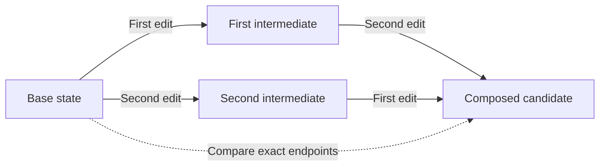

# RT-11 — Check non-interference on the composed edit plan

## Question and method

If two edits affect disjoint variables and each preserves an observation against the same baseline, may an incremental action reuse that observation after applying both? This study compares the evidence used by four impact gates. The baseline is `904050edbe4482692f1cce35e5bbabc788c5547f` on `research/all`. [Semantic dependency evidence](../../semantic-representation/RT-06/RT-06-DEPENDENCY-EVIDENCE-CLASSES-2026-11-25.md) · [Scoped fallback](RT-11-SCOPED-UNKNOWN-DEPENDENCY-FALLBACK-2026-11-25.md)

An observation is an arbitrary Boolean function of three bits. The fixture enumerates all 256 such functions, all eight base states, and the three pairs of distinct bits to toggle. The patches commute as state updates because their write locations are disjoint. The gate decides whether the observation can be retained for the final state.

| Gate | Required comparison |
|---|---|
| Separate baseline comparisons | Each edit applied alone preserves the base observation. |
| Exact composed comparison | The selected final observation equals the selected baseline observation. |
| Sequential comparisons | The first edit preserves the baseline observation, and the second preserves it from the intermediate state. |
| Contextual comparisons | All four states in the two-edit square yield the same observation. |



The two comparisons that leave the baseline only establish equalities at the first edges. A composed claim requires evidence about the selected final state or an applicable proof that covers the later context.

## Results

| Gate or outcome | Cases among 6,144 |
|---|---:|
| Separate baseline comparisons admit | 1,536 |
| Separate comparisons admit despite a changed composed observation | 768 |
| Exact composed comparison admits | 3,072 |
| Sequential comparisons admit | 1,536 |
| Contextual comparisons admit | 768 |
| Composed result is unchanged but the sequential policy withholds reuse | 1,536 |

For a given distinct edit pair, the four states are distinct. Across every Boolean truth table, equality on three of those states holds in a quarter of cases, with the fourth value unconstrained. This gives the observed 768 incorrect admissions under separate baseline comparisons. Contextual equality is stronger because it also constrains the fourth value. These counts describe the finite fixture. [Raw counts and first witness](COMPOSED-NONINTERFERENCE-01/evidence.json)

A small counterexample observes `a && b` at `(false, false)`. Setting either bit alone leaves the observation false, while applying both makes it true. Lean checks that concrete example and proves sequential equality composition and uniform non-interference composition over arbitrary state and observation types. All three theorems have no axiom dependencies. [Lean model](COMPOSED-NONINTERFERENCE-01/Composition.lean)

For a verified atomic update, an exact baseline-to-final comparison can preserve a result even if an intermediate would differ. When the intermediate actions themselves are observable, those observations belong in the required comparison. The fixture tests a pure Boolean observation and assumes that the composed candidate is the exact publication target. It leaves side effects, invalid intermediate states, conflict resolution, and source-to-action dependency completeness open. [Incremental analysis tracking](https://github.com/aivibeflow/LLMLang/issues/299)

## Reproduction

Use CPython 3.12.14 and Lean 4.36.0 at `611c117bfaf7b7ae1cfcf246ce6fba31e8f509e9`. The [runner](COMPOSED-NONINTERFERENCE-01/run.py) records counts, source hashes and the Lean axiom report. Hash seeds 1 and 2 produced identical bytes. The diagram was checked as Mermaid source.

```bash
fixture=research/toolchain-and-collaboration/RT-11/COMPOSED-NONINTERFERENCE-01
LC_ALL=C PYTHONHASHSEED=1 python3 -B "$fixture/run.py" --lean "$(command -v lean)" \
  > /tmp/llmlang-rt11-composed-noninterference.json
cmp "$fixture/evidence.json" /tmp/llmlang-rt11-composed-noninterference.json
```
