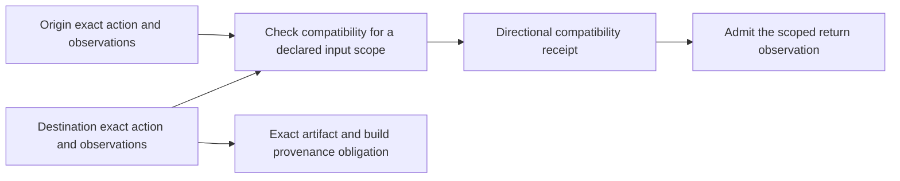

# RT-11 — Reuse scoped observations across toolchains with exact compatibility evidence

## Question and method

What can a cache retain when a different compiler produces the same observed behavior? The [typed pipeline study](RT-11-TYPED-PIPELINE-INVALIDATION-2026-11-25.md) distinguishes action inputs from artifact identities. This experiment performs native GCC and Clang builds and compares whole object bytes with complete return observations for one bounded operation. The baseline is `19210d20ed87b3f1f0ebd9a4de3cc1d870fe4fc1` on `research/all`. [Compile action inputs](../../compiler-and-translation/RT-13/RT-13-COMPILE-ACTION-DETERMINISM-2026-11-25.md)

The C fixture increments an unsigned byte under either wrapping or saturation. Both compilers build both arithmetic profiles at O2 with PIC. One pinned GCC driver and linker produce the shared libraries. The runner compares each of 256 native returns per build with a separate arithmetic oracle. The fixture action key binds source bytes, compiler digest/version/target, compilation settings, arithmetic mode, and recorded linker inputs. It uses an explicit finite return observation projection.



A compatibility receipt identifies both exact action keys, direction, input scope, observation projection, checker and common observation digest. The test admits the receipt only if those fields and the finite comparison match. Establishing the receipt in the experiment requires both builds and measurements. The experiment does not estimate time savings.

## Results

| Comparison | Observed disposition |
|---|---|
| GCC wrapping versus Clang wrapping action identity | Different keys and whole object bytes. |
| GCC wrapping versus Clang wrapping executable text and returns | Same `.text` bytes and the same return vector for all 256 inputs. |
| Observations with exact bridge | Admitted for the bound return-only scope. Missing or reversed receipt is withheld. |
| Wrapping versus saturation across the full domain | Different at input 255. Wrapping returns 0, while saturation returns 255. |
| Wrapping versus saturation over inputs 0 through 254 | Equal on that restriction. The partial receipt is refused for the full request. |

All 1,024 native returns match their profile oracle. The exact object request misses across compiler identities even when the extracted machine-code bytes happen to match. Equality of the observed return projection allows a separately named compatibility result. It does not furnish the destination object's bytes or provenance. [Exact versions, keys, receipts and return observations](CROSS-TOOLCHAIN-CACHE-01/evidence.json)

The experiment supports retaining exact cache keys and admitting only an independently established weaker observation result where a consumer explicitly accepts that projection. The proof scope does not extend to debug information, larger programs, other targets, complete production dependency closure or general compiler correctness. The fixture rechecks a finite comparison with a stipulated checker; production receipt authorization and trust remain open. [Cache graph tracking](https://github.com/aivibeflow/LLMLang/issues/300)

## Reproduction

Use CPython 3.12.14, Debian GCC 14.2.0-19, GNU Binutils 2.44 and the Clang 23.1.1 executable shipped with Lean 4.36.0 on Linux x86-64. The [runner](CROSS-TOOLCHAIN-CACHE-01/run.py) records exact compiler binary digests and tool versions. Hash seeds 1 and 2 produced identical bytes. The diagram was checked as Mermaid source.

```bash
fixture=research/toolchain-and-collaboration/RT-11/CROSS-TOOLCHAIN-CACHE-01
LC_ALL=C PYTHONHASHSEED=1 python3 -B "$fixture/run.py" --clang "$CLANG" \
  > /tmp/llmlang-rt11-cross-toolchain.json
cmp "$fixture/evidence.json" /tmp/llmlang-rt11-cross-toolchain.json
```
